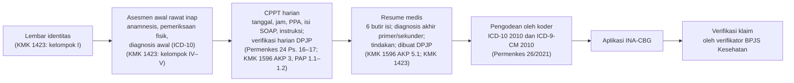
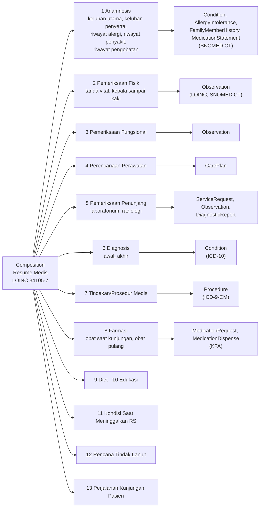
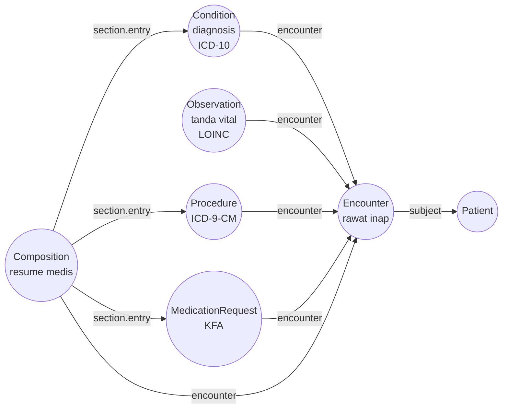
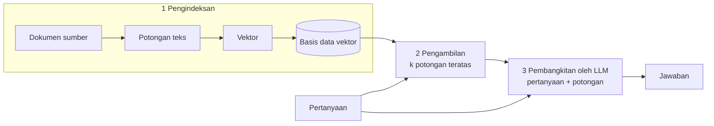

# Bab II — Revisi berdasarkan notulensi bimbingan (DRAFT 6)

> **Status:** `DRAF`, belum ditinjau pembimbing. Berkas ini menggantikan `Pembuka_Bab_II.md` dan `II.1`–`II.8_*.md` (berkas lama tidak dihapus). Hanya bagian **Naskah** dan **Daftar Pustaka (sementara)** yang masuk ke proposal. Bagian **Catatan revisi** di akhir berkas adalah alat bantu kerja.
>
> **Konvensi sitasi sementara:** penulis-tahun dengan nomor halaman (`hlm.`). Untuk artikel berhalaman cetak, `hlm.` = nomor cetak; untuk artikel bernomor (mis. e51270, 104201) dan dokumen tanpa nomor cetak, `hlm.` = halaman berkas PDF. Regulasi dirujuk dengan pasal atau kode standar dan halaman berkas. Format akhir menunggu pedoman program studi.
>
> **Gambar:** Gambar II.1–II.4 ditulis sebagai diagram Mermaid dan perlu dirender menjadi gambar sebelum dimasukkan ke `.docx`.

---

## Naskah

## BAB II STUDI LITERATUR

Bab ini menelaah literatur dan dokumen acuan yang berkaitan dengan peran penulis dalam tim, yaitu komponen kecerdasan artifisial (*artificial intelligence*, AI) dan pemrosesan bahasa alami (*natural language processing*, NLP) untuk memeriksa dokumentasi klaim rawat inap sebelum diajukan ke Badan Penyelenggara Jaminan Sosial (BPJS) Kesehatan [SESUAIKAN DENGAN BAB I: cakupan kasus dan batas komponen]. Urutan subbab mengikuti pertanyaan yang muncul dari masalah tersebut. Subbab II.1 menguraikan dokumen rawat inap dan aturan yang mengikatnya, II.2 menjelaskan bagaimana isi dokumen itu menentukan klaim, dan II.3 membahas standar yang dipakai di Indonesia untuk menstrukturkan isinya. Subbab II.4 membahas cara menstrukturkan catatan klinis, termasuk sebagai graf pengetahuan. Subbab II.5 dan II.6 menelaah penelitian tentang pemeriksaan dokumentasi klinis dengan model bahasa besar dan penjangkaran keluarannya pada bukti. Subbab II.7 sampai II.9 membahas rekomendasi penggunaan model bahasa besar di bidang klinis, cara mengomunikasikan ketidakpastian keluaran, dan pedoman de-identifikasi data rekam medis. Bab ini hanya menguraikan isi sumber; analisis kesesuaiannya dengan rancangan penelitian dibahas pada Bab III.

## II.1 Rekam Medis Rawat Inap dalam Regulasi Indonesia

### II.1.1 Kewajiban dan Isi Rekam Medis Elektronik

Peraturan Menteri Kesehatan (Permenkes) Nomor 24 Tahun 2022 mewajibkan setiap fasilitas pelayanan kesehatan, termasuk rumah sakit, menyelenggarakan rekam medis elektronik (RME) (Pasal 3, hlm. 3–4). Penyelenggaraannya paling sedikit meliputi registrasi pasien, pendistribusian data, pengisian informasi klinis, pengolahan informasi, penginputan data untuk klaim pembiayaan, penyimpanan, penjaminan mutu, dan transfer isi RME (Pasal 13 ayat 1, hlm. 6). Pengisian informasi klinis dilakukan oleh tenaga kesehatan pemberi pelayanan, sedangkan kegiatan lainnya dilakukan oleh tenaga perekam medis dan informasi kesehatan (Pasal 13 ayat 2–3, hlm. 6). Isi RME terdiri atas dokumentasi administratif dan dokumentasi klinis, dan dokumentasi klinis berisi seluruh dokumentasi pelayanan yang diberikan kepada pasien (Pasal 27 ayat 1–3, hlm. 12). Sistem elektronik RME harus mengacu pada variabel dan metadata yang ditetapkan Kementerian Kesehatan; metadata itu meliputi definisi, format, dan kodifikasi (Pasal 11, hlm. 5).

Standar akreditasi rumah sakit yang berlaku, yaitu Keputusan Menteri Kesehatan (KMK) Nomor HK.01.07/MENKES/1596/2024, merinci kewajiban tersebut dalam kelompok standar Manajemen Rekam Medis dan Informasi Kesehatan (MRMIK). Rekam medis harus memuat informasi yang memadai untuk mengidentifikasi pasien, mendukung diagnosis, menjadi dasar pengobatan, mendokumentasikan hasil pemeriksaan dan pengobatan, memuat ringkasan pasien pulang, serta meningkatkan kesinambungan pelayanan di antara profesional pemberi asuhan (PPA) (MRMIK 7, hlm. 163). Setiap catatan harus mencantumkan tanggal, jam, serta nama jelas dan tanda tangan atau paraf PPA yang menulisnya, dan rumah sakit harus menetapkan prosedur koreksi catatan (MRMIK 8, hlm. 163–164). Rumah sakit juga harus menetapkan daftar kode, simbol, dan singkatan yang boleh dan tidak boleh digunakan. Kode penyakit utamanya memakai *International Statistical Classification of Diseases and Related Health Problems, 10th Revision* (ICD-10), dan kode tindakan memakai *International Classification of Diseases, 9th Revision, Clinical Modification* (ICD-9-CM) (MRMIK 9, hlm. 164–165). Gambaran umum standar itu menyebut bahwa kegagalan komunikasi sering terjadi akibat tulisan yang tidak terbaca serta singkatan, simbol, dan kode yang tidak seragam (hlm. 148). Komite atau tim rekam medis mengkaji rekam medis secara berkala, setidaknya setiap tahun, dengan sampel yang mewakili pasien yang masih dirawat dan yang sudah pulang. Pengkajian itu paling sedikit berfokus pada ketepatan waktu, keterbacaan, kelengkapan, dan kesesuaian isi dengan peraturan (MRMIK 12, hlm. 167–168).

### II.1.2 Catatan Perkembangan Pasien Terintegrasi

Permenkes 24/2022 mengatur bahwa pencatatan informasi klinis harus lengkap, jelas, dilakukan setelah pasien menerima pelayanan, serta mencantumkan nama, waktu, dan tanda tangan tenaga kesehatan. Pencatatan itu disusun berurutan pada catatan setiap tenaga kesehatan sesuai dengan waktu pelayanan (Pasal 16 ayat 2–3, hlm. 7). Pada fasilitas yang memiliki lebih dari satu jenis tenaga kesehatan, pengisian harus terintegrasi, yaitu dalam satu dokumen yang memuat catatan beberapa tenaga kesehatan secara berurutan waktu (Pasal 17 ayat 1–2, hlm. 7–8).

KMK 1596/2024 menamai dokumen ini catatan perkembangan pasien terintegrasi (CPPT). Perkembangan pasien didokumentasikan para PPA di formulir CPPT (Elemen Penilaian AKP 3 butir d, hlm. 215). Instruksi PPA, misalnya permintaan pemeriksaan laboratorium atau pemberian obat, dapat dituliskan di CPPT agar staf mengetahui kapan dan oleh siapa instruksi dilaksanakan (PAP 1.1, hlm. 263). Instruksi berdasarkan rencana asuhan juga didokumentasikan di CPPT, dan dokter penanggung jawab pelayanan (DPJP) sebagai ketua tim PPA melakukan reviu berkala serta verifikasi harian atas asuhan terintegrasi (PAP 1.2, hlm. 266). Di unit intensif atau unit khusus, DPJP mencatat perkembangan pasien pada lembar pemantauan khusus, sedangkan PPA lain dapat mencatat di CPPT (AKP 3 butir e, hlm. 215). Dalam teks KMK 1596/2024 yang ditelaah, format penulisan isi CPPT tidak ditetapkan.

Format yang dipakai di lapangan dilaporkan oleh dua studi Indonesia. Oktavia Az dan Sonia (2021) menyebut bahwa CPPT ditulis dengan metode *Subjective, Objective, Analisis, Planning* (SOAP), dengan mengacu pada standar akreditasi edisi sebelumnya (MIRM 13.3 SNARS Edisi 1.1) (hlm. 426). Nadi dan Fortunandha (2024) menjelaskan keempat bagian itu sebagai riwayat keluhan pasien (S), hasil pemeriksaan fisik (O), diagnosis (A), dan rencana asuhan (P) (hlm. 1).

Oktavia Az dan Sonia (2021) meneliti kelengkapan CPPT pada 200 berkas rekam medis rawat inap yang diambil secara acak dari sebuah rumah sakit ibu dan anak di Kota Bandung (disebut RSKIA Kota Bandung dalam sumber), ditambah wawancara dengan bidan, perawat, dan apoteker (hlm. 427). Butir yang dinilai adalah terisi atau tidaknya identitas pasien, nomor rekam medis, tanggal, jam, bagian SOAP, dan tanda tangan atau paraf. Identitas pasien lengkap pada 87,5% berkas, nomor rekam medis pada 78%, tanggal pada 51%, jam pada 48%, tanda tangan atau paraf pada 80%, dan bagian SOAP pada seluruh berkas (hlm. 427, 432). Penulis mengaitkan ketidaklengkapan dengan keterbatasan waktu, miskomunikasi, kurangnya disiplin PPA, dan kurangnya pengetahuan tentang pedoman, serta mencatat belum adanya prosedur operasional baku untuk pengisian CPPT di rumah sakit itu (hlm. 425, 427). Nadi dan Fortunandha (2024) menelaah praktik CPPT di Indonesia secara naratif. Mereka mengelompokkan hambatan kelengkapan CPPT menjadi kurangnya komitmen manajemen, terbatasnya kapasitas tenaga kesehatan, dan kurang memadainya infrastruktur, lalu mengusulkan digitalisasi CPPT melalui RME dengan siklus *Plan-Do-Study-Act* (hlm. 1).

### II.1.3 Resume Medis

KMK 1596/2024 mewajibkan ringkasan pasien pulang (*discharge summary*) dibuat untuk semua pasien rawat inap yang keluar dari rumah sakit (AKP 5.1, hlm. 218). Isinya meliputi (a) indikasi pasien masuk dirawat, diagnosis, dan komorbiditas lain; (b) temuan fisik penting dan temuan lain; (c) tindakan diagnostik dan prosedur terapi yang telah dikerjakan; (d) obat yang diberikan selama rawat inap dan obat yang harus digunakan di rumah; (e) kondisi pasien saat pulang; dan (f) instruksi tindak lanjut. Ringkasan dibuat DPJP sebelum pasien keluar, dan salinannya diberikan kepada tenaga kesehatan yang melanjutkan asuhan, kepada pasien, dan kepada penjamin (hlm. 219). Permenkes 24/2022 menetapkan isi minimum rekam medis yang diberikan kepada pasien rawat inap saat pulang, yaitu identitas pasien, hasil pemeriksaan fisik dan penunjang, diagnosis, pengobatan, rencana tindak lanjut, serta nama dan tanda tangan tenaga kesehatan. Rekam medis itu dibuat oleh penanggung jawab pelayanan (Pasal 26 ayat 6–8, hlm. 11–12). Permenkes 26/2021 menyebut dokumen ini resume medis (hlm. 8), dan Panduan SATUSEHAT memetakan data resume medis rawat inap ke jenis dokumen *Hospital Discharge summary* (kode LOINC 34105-7) (Kementerian Kesehatan, 2026).

### II.1.4 Variabel dan Metadata Rekam Medis Elektronik Rawat Inap

Variabel dan metadata yang dirujuk Pasal 11 Permenkes 24/2022 ditetapkan dalam KMK Nomor HK.01.07/MENKES/1423/2022. Pedoman itu digunakan sebagai standar elemen data untuk kompatibilitas dan interoperabilitas sistem elektronik yang dikembangkan fasilitas pelayanan kesehatan atau penyelenggara sistem elektronik (hlm. 3). Lampirannya memuat lima dataset, yaitu instalasi gawat darurat (IGD), rawat jalan, rawat inap, laboratorium, dan apotek (hlm. 5). Setiap variabel diberi tipe data, format atau nilai, definisi operasional, dan referensi (hlm. 6). Kelompok variabel dataset rawat inap dirangkum pada Tabel II.1.

Tabel II.1. Kelompok variabel dataset rawat inap menurut KMK HK.01.07/MENKES/1423/2022

| Kelompok | Contoh variabel | Tipe dan format | Halaman |
| --- | --- | --- | --- |
| I Lembar Identitas | Nama lengkap, nomor rekam medis, Nomor Induk Kependudukan (NIK), tanggal lahir, alamat | Karakter dan numerik; NIK 16 digit | 57–62 |
| II Cara Pembayaran | Metode pembayaran | Pilihan berkode | 62 |
| III Persetujuan Umum | Persetujuan pasien, petugas yang memberi penjelasan | Karakter | 62–64 |
| IV Formulir Rawat Inap | Anamnesis (keluhan utama, riwayat penyakit, alergi, pengobatan); pemeriksaan fisik (keadaan umum, tingkat kesadaran, tanda vital, pemeriksaan kepala sampai kaki); status psikologis, sosial ekonomi, dan spiritual | Teks bebas; pilihan berkode; angka bersatuan | 64–68 |
| V Pemeriksaan Spesialistik | Riwayat penggunaan obat, perencanaan pemulangan, rencana rawat, instruksi medik dan keperawatan | Teks bebas; pilihan berkode | 69 |
| | Pemeriksaan penunjang laboratorium dan radiologi | Berkas, teks, kode pemeriksaan | 69–76 |
| | Diagnosis awal atau masuk; diagnosis akhir primer dan sekunder | Teks bebas dan kode ICD-10 | 76–77 |
| | Persetujuan atau penolakan tindakan | Karakter, tanggal, waktu | 77–78 |
| | Terapi: nama tindakan; peresepan obat; pengkajian resep | Isian basis data sesuai ICD-9-CM; formularium | 78–81 |

Diagnosis awal didefinisikan sebagai keputusan tenaga medis tentang kondisi pasien saat masuk sebelum pemeriksaan lanjutan, sedangkan diagnosis akhir primer dan sekunder merupakan keputusan DPJP ketika pasien akan dipulangkan (hlm. 76–77). Rencana rawat, yaitu rencana terapi, tindakan, dan lama hari rawat, serta instruksi medik dan keperawatan dicatat sebagai teks bebas (hlm. 69). Dataset rawat inap tersebut tidak memuat variabel khusus untuk CPPT atau catatan perkembangan harian.

Keterkaitan dokumen yang diatur regulasi di atas dalam satu episode rawat inap digambarkan pada Gambar II.1.

Gambar II.1. Dokumen dalam satu episode rawat inap dan alurnya menuju klaim (disusun dari Permenkes 24/2022, Permenkes 26/2021, KMK 1423/2022, dan KMK 1596/2024)

## II.2 Pengodean dan Verifikasi Klaim INA-CBG

Dalam Jaminan Kesehatan Nasional (JKN), BPJS Kesehatan menangani pendaftaran peserta, pengumpulan iuran, kontrak dengan penyedia layanan, dan pemrosesan klaim. Rumah sakit dibayar per kasus menurut tarif *Indonesian Case Base Groups* (INA-CBG) (Susilo dkk., 2025, hlm. 2). Permenkes 26/2021 menetapkan bahwa pengelompokan INA-CBG didasarkan pada kode diagnosis akhir dan tindakan, dengan ICD-10 versi 2010 untuk diagnosis dan ICD-9-CM versi 2010 untuk tindakan. Pengelompokan itu menghasilkan 1.075 kelompok kasus, terdiri atas 786 kelompok rawat inap dan 289 kelompok rawat jalan (hlm. 10). Sumber data pengodean ialah diagnosis dan tindakan dalam resume medis; berkas rekam medis dapat dilihat bila diperlukan. Ketepatan kode diagnosis dan tindakan disebut sangat berpengaruh pada hasil pengelompokan dalam aplikasi INA-CBG (hlm. 23). Diagnosis utama didefinisikan sebagai diagnosis yang ditegakkan dokter pada akhir episode perawatan yang menyebabkan pasien mendapatkan perawatan atau pemeriksaan lebih lanjut (hlm. 23).

Permenkes 26/2021 membagi tanggung jawab di antara tiga pihak (hlm. 8–9). Dokter menegakkan dan menuliskan diagnosis utama, diagnosis sekunder, dan tindakan, serta membuat resume medis yang lengkap, jelas, dan spesifik. Koder mengodekan diagnosis dan tindakan yang ditulis dokter. Verifikator BPJS Kesehatan memeriksa kelengkapan berkas klaim dan kesesuaian diagnosis serta tindakan dalam resume medis dengan ICD-10 dan ICD-9-CM. Permenkes 24/2022 menempatkan pengodean sebagai bagian pengolahan informasi RME (Pasal 18, hlm. 8). Penginputan data klaim merupakan kegiatan memasukkan kode klasifikasi penyakit ke aplikasi pembiayaan berdasarkan diagnosis dan tindakan yang ditulis tenaga kesehatan sesuai dengan rekam medis (Pasal 19, hlm. 9).

Simbolon dan Gani (2023) merangkum lima artikel tahun 2020–2022 tentang penyebab klaim rawat inap yang tertunda (*pending*). Faktor yang muncul ialah pengodean yang tidak sesuai, berkas yang tidak lengkap, dan perbedaan penegakan diagnosis antara DPJP dan verifikator BPJS (hlm. 72, 77). Tabel ulasan tersebut memuat studi Muroli dkk. (2020) di RSAB Harapan Kita, Jakarta Barat. Menurut ringkasan dalam tabel itu, resume medis tidak lengkap pada 38 berkas (41,8%), pengodean tidak tepat pada 44 berkas (48,4%), dan berkas klaim tidak lengkap pada 27 berkas (29,7%) (hlm. 75). Angka tersebut berasal dari ringkasan dalam ulasan, bukan dari artikel Muroli dkk., dan ulasan itu tidak menguraikan penilaian mutu terhadap kelima artikel yang dimasukkan.

## II.3 Standar Interoperabilitas dan Terminologi Klinis di Indonesia

### II.3.1 SATUSEHAT dan Profil Rawat Inap Berbasis HL7 FHIR

Permenkes 24/2022 mewajibkan RME yang disimpan fasilitas pelayanan kesehatan terhubung dengan platform interoperabilitas dan integrasi data kesehatan yang dikelola Kementerian Kesehatan (Pasal 21, hlm. 10). Platform itu ialah SATUSEHAT. Heryawan dkk. (2025) menguraikan komponennya (hlm. 3). Server *Health Level Seven Fast Healthcare Interoperability Resources* (HL7 FHIR) menyediakan antarmuka pemrograman untuk pertukaran data. Server terminologi menyediakan acuan baku, yaitu ICD-10 untuk diagnosis, *Logical Observation Identifiers Names and Codes* (LOINC) untuk observasi, dan *Systematized Nomenclature of Medicine Clinical Terms* (SNOMED CT) untuk istilah klinis lain. Server data induk memuat nomor identitas penduduk, data tenaga kesehatan, fasilitas kesehatan, dan pembiayaan. *Developer hub* menyediakan lingkungan uji. Heryawan dkk. menganalisis isi pesan grup Telegram pengembang SATUSEHAT di lingkungan puskesmas dan klinik swasta. Mereka menemukan 61 persoalan terkait server FHIR, 37 terkait pemetaan data RME ke data terstandar seperti SNOMED CT, dan 9 terkait pemilihan profil FHIR (hlm. 1).

Panduan SATUSEHAT untuk modul rawat inap (versi 6.0, 10 Januari 2026) menetapkan urutan pengiriman data dan *resource* FHIR yang digunakan (Kementerian Kesehatan, 2026). Kunjungan dicatat dengan Encounter. Anamnesis dikirim dengan Condition, AllergyIntolerance, dan MedicationStatement. Pemeriksaan fisik dan tanda vital dikirim dengan Observation, rencana rawat serta instruksi medik dan keperawatan dengan CarePlan, diagnosis dengan Condition, tindakan dengan Procedure, peresepan dengan MedicationRequest, dan resume medis dengan Composition. Pemetaan terminologinya ialah ICD-10 untuk kode diagnosis (`http://hl7.org/fhir/sid/icd-10`), ICD-9-CM untuk tindakan, LOINC untuk tanda vital, SNOMED CT untuk temuan klinis dan lokasi tubuh, serta Kamus Farmasi dan Alat Kesehatan (KFA) untuk obat. Resume medis dikirim sebagai Composition berjenis LOINC 34105-7 dengan tiga belas bagian (*section*) yang masing-masing merujuk ke *resource* lain (Gambar II.2). Alur integrasi rawat inap dalam panduan itu tidak memuat *resource* atau bagian khusus untuk CPPT.

Gambar II.2. Struktur resume medis rawat inap pada Panduan SATUSEHAT versi 6.0 (diolah dari Kementerian Kesehatan, 2026) [PERLU VERIFIKASI: *resource* acuan bagian 9–13 belum dicek satu per satu]

### II.3.2 Adopsi Terminologi Klinis

ICD-10 dan ICD-9-CM telah diwajibkan untuk pengodean klaim (Permenkes 26/2021, hlm. 10, 23) dan pengodean rekam medis (KMK 1596/2024, MRMIK 9, hlm. 165). Adopsi SNOMED CT lebih baru. Pertiwi dkk. (2026) menelaah literatur dan dokumen kebijakan tahun 2020–2024 dengan Korea Selatan sebagai contoh utama. Mereka menyimpulkan bahwa adopsi SNOMED CT di Indonesia masih tahap awal, dengan proyek percontohan di beberapa rumah sakit vertikal dan institusi pendidikan tinggi kesehatan (hlm. 76, 80). Kendala yang mereka sebut ialah keterbatasan infrastruktur digital, ketimpangan sebaran sumber daya manusia terlatih, dan kebutuhan konten lokal (hlm. 76).

## II.4 Penstrukturan Catatan Klinis

### II.4.1 Bagian SOAP dan Relasi antara Penilaian dan Rencana

Gao dkk. (2022) menyusun skema anotasi bertingkat untuk catatan perkembangan harian (*daily progress note*), yaitu catatan yang ditulis berkala dalam format berorientasi masalah dan lazimnya mengikuti judul bagian SOAP (hlm. 5484). Korpusnya terdiri atas 5.000 catatan perkembangan harian dari *Medical Information Mart for Intensive Care III* (MIMIC-III), yaitu basis data rekam medis unit perawatan intensif berbahasa Inggris (hlm. 5484, 5486). Tahap pertama anotasi memberi label bagian teks, misalnya keluhan utama, riwayat penyakit sekarang, riwayat alergi, dan pemeriksaan fisik, lalu memetakan setiap label ke salah satu jenis S, O, A, atau P (Tabel 1, hlm. 5487). Tahap kedua melabeli relasi antara bagian penilaian (*Assessment*) dan setiap subbagian rencana (*Plan*). Tahap ketiga menandai masalah dan diagnosis dalam setiap subbagian rencana secara terpisah dari rencana tindakannya (hlm. 5487–5488). Gao dkk. (2023) menjadikan tahap kedua tugas bersama n2c2 2022 Track 3. Setiap pasangan penilaian–subbagian rencana diklasifikasikan menjadi empat relasi: *Direct* bila masalah dalam rencana merupakan alasan utama rawat inap atau terkait langsung dengan gejala dan hasil pemeriksaan; *Indirect* bila merupakan masalah sekunder; *Neither* bila masalah itu tidak didokumentasikan dalam penilaian; dan *Not Relevant* bila subbagian rencana tidak memuat diagnosis atau masalah (hlm. 2). Delapan tim mengirimkan sistem. Macro-F1 terbaik ialah 0,8212, dan relasi *Indirect* paling sulit dikenali, dengan rata-rata 0,6713 (hlm. 4–5). Penyelenggara mencatat bahwa ukuran sampel tidak dihitung secara formal sehingga uji mungkin kurang kuat untuk membedakan sistem yang skornya berdekatan (hlm. 7).

### II.4.2 Graf Pengetahuan Berbasis Rekam Medis

Graf pengetahuan (*knowledge graph*, KG) merepresentasikan konsep medis sebagai simpul dan relasinya sebagai sisi. Murali dkk. (2023) menelaah KG medis yang dibangun dari data rekam medis pada tiga tingkat, yaitu representasi, ekstraksi, dan pelengkapan. Representasi yang umum ialah *triple* yang terdiri atas dua entitas dan satu relasi; format itu dapat diperluas menjadi *quadruple* untuk menyimpan cap waktu kejadian (hlm. 4). Ontologi dan terminologi seperti UMLS, SNOMED CT, dan ICD-10 dipakai sebagai sumber pengetahuan untuk menyatukan data dari berbagai format (hlm. 2, 4). Menurut tinjauan itu, tantangan utama KG berbasis rekam medis ialah kompleksitas dan dimensi data yang tinggi, kurangnya penggabungan pengetahuan, dan pembaruan graf yang dinamis (hlm. 1).

Xiao dkk. (2022) membangun KG klinis yang mengikuti spesifikasi FHIR dalam format *Resource Description Framework* (RDF). Sistem FHIR-Ontop-OMOP menerjemahkan basis data relasional berstandar *Observational Medical Outcomes Partnership Common Data Model* (OMOP CDM) menjadi graf virtual melalui lebih dari 100 pemetaan elemen data yang mencakup 11 *resource* FHIR (hlm. 1). Pada data MIMIC-III, graf yang dihasilkan memuat 46.520 instans Patient, 716.595 Condition, 1.063.525 Procedure, dan 365.181.104 Observation. Jumlah pasien dari lima pasang kueri SQL dan SPARQL identik, dan graf untuk 100 pasien sepenuhnya sesuai dengan spesifikasi FHIR RDF (hlm. 1). Nilai Condition.code dapat berupa kode SNOMED CT atau teks (hlm. 4). Ilustrasi struktur graf untuk satu episode rawat inap menurut *resource* tersebut ditunjukkan pada Gambar II.3.

Gambar II.3. Ilustrasi struktur graf satu episode rawat inap berdasarkan *resource* FHIR yang dipakai Xiao dkk. (2022) dan Panduan SATUSEHAT (Kementerian Kesehatan, 2026) [PERLU VERIFIKASI: nama elemen referensi terhadap spesifikasi FHIR R4]

Rotmensch dkk. (2017) mempelajari KG penyakit–gejala langsung dari 273.174 rekam medis yang telah dide-identifikasi dengan tiga model probabilistik. Model *noisy OR* menghasilkan graf terbaik, dengan presisi 0,85 pada *recall* 0,6 dalam evaluasi klinis terhadap pendapat dokter (hlm. 1). Ali dkk. (2026) membangun ontologi dan KG dalam format RDF/*Web Ontology Language* (OWL) dari data klinis dan rumah sakit beberapa institusi di Mesir, lalu memakainya untuk menjangkarkan jawaban model bahasa besar pada tanya jawab klinis. Pada 60 pertanyaan, pendekatan itu menjawab benar 59 pertanyaan (98%), dibandingkan 37% untuk ChatGPT-4 dan 52% untuk DeepSeek-R1. Acuan jawabannya diambil dari lima studi rumah sakit di Mesir yang telah ditelaah sejawat (hlm. 1).

## II.5 Pemeriksaan Dokumentasi Klinis dengan Model Bahasa Besar

Dietrich dan Stubbert (2026) mengevaluasi empat model bahasa besar (*large language model*, LLM) sebagai pemeriksa catatan pemulangan IGD. Data berasal dari 600 kunjungan pada basis data MIMIC-IV-ED. Sebanyak 500 catatan masing-masing disisipi satu kesalahan dari lima kategori, dan 100 catatan lain tidak memuat kesalahan (hlm. 95–96). Akurasi deteksi kesalahan apa pun berkisar 93,2–94,2%, presisi 98,3–99,1%, dan spesifisitas 92,0–96,0% (hlm. 98). Kinerja berbeda menurut kategori. Ketidaksesuaian identitas atau waktu kunjungan serta kesalahan obat dan alergi terdeteksi dengan F1 ≥0,96. Ketidaksesuaian antara tanda vital atau pemeriksaan fisik dan interpretasi naratif paling sulit dideteksi, dengan F1 0,75–0,84 yang terutama disebabkan oleh rendahnya *recall* (hlm. 98). Kesalahan dalam studi itu disisipkan oleh peneliti, seluruh data berasal dari satu institusi (hlm. 100), dan catatan yang dinilai adalah satu dokumen yang disusun dari elemen data terstruktur kunjungan (hlm. 96). Penulis menyebut kerangka audit berbasis agen yang mengambil pedoman dan memeriksa konsistensi lintas dokumen sebagai arah penelitian lanjutan (hlm. 100).

Skrabic dkk. (2026) menguji tiga model penalaran sebagai pemeriksa kedua (*second reviewer*) pada 102 laporan unit gawat darurat penyakit dalam yang identitasnya telah dihapus (hlm. 1–2). Dua dokter spesialis menyisipkan 99 kesalahan yang realistis dan menandai tiga kesalahan yang sudah ada dalam laporan asli (hlm. 2). Model menerima satu perintah seragam tanpa pengambilan referensi atau pemanggilan fungsi (hlm. 3). Model menemukan lokasi kesalahan dengan benar pada 65,7–79,2% laporan, sedangkan tiga dokter pembanding, yang masing-masing meninjau sepertiga kasus, menemukan 48,0% (hlm. 4). Studi ini tidak menyertakan catatan tanpa kesalahan, dan datanya berasal dari satu pusat layanan (hlm. 6).

Zeba dkk. (2026) memeriksa keluaran LLM terhadap rekam medis sumber dengan modul pemeriksa fakta yang tidak memakai LLM (hlm. 1). Ringkasan dan rekam medis dipecah menjadi proposisi atomik (hlm. 7). Setiap proposisi kemudian diberi vonis Didukung atau Tidak Didukung melalui pemeriksaan negasi, implikasi, konsistensi temporal, eksklusivitas bersama, kecocokan numerik, dan keberadaan (hlm. 6, 14). Pada 104 ringkasan yang diekstrak menjadi 3.786 proposisi dan divalidasi dokter, modul itu mencapai presisi 0,8904, *recall* 0,8234, dan F1 0,8556 (hlm. 1). Datanya berasal dari MIMIC-III (hlm. 10). Penulisnya menyatakan bahwa sistem kurang andal pada bidang yang kurang terwakili, termasuk gangguan metabolik anak, dan hanya memberi vonis biner tanpa usul perbaikan (hlm. 15).

Jaganathan dkk. (2025) menguji ketahanan model pengode ICD, yaitu PLM-ICD, dengan pengujian metamorfik (*metamorphic testing*). Catatan diubah secara sederhana, lalu daftar kode keluarannya dibandingkan dengan keluaran catatan asli. Pada 3.372 catatan uji MIMIC-III, penggantian akronim, penghapusan kata, dan salah ketik menyebabkan perbedaan pada lima kode teratas di 70–81% catatan (hlm. 4). Penggantian dua puluh akronim yang paling sering muncul menyebabkan perbedaan pada 80,7% catatan (hlm. 5). Kriteria kegagalannya ialah setiap perbedaan pada himpunan lima kode teratas (hlm. 4), sehingga angka itu menunjukkan ketidakstabilan keluaran, bukan persentase kode yang salah.

## II.6 *Retrieval-Augmented Generation* dan Penjangkaran Keluaran pada Bukti

Lewis dkk. (2020) memperkenalkan *retrieval-augmented generation* (RAG), yaitu model yang menggabungkan memori parametrik, berupa model bahasa *sequence-to-sequence* pralatih, dengan memori nonparametrik, berupa indeks vektor padat atas kumpulan dokumen yang diakses melalui *retriever* neural (hlm. 1). Dalam rancangan asalnya, *retriever* (*Dense Passage Retriever*) mengambil dokumen yang relevan dengan masukan, lalu model BART membangkitkan keluaran dengan mempertimbangkan masukan dan dokumen tersebut (hlm. 2). Gao dkk. (2023) menyebut proses dasar RAG sebagai *Naive RAG*, yang terdiri atas tiga langkah: pengindeksan, yaitu memecah dokumen menjadi potongan, mengubahnya menjadi vektor, dan menyimpannya dalam basis data vektor; pengambilan k potongan yang paling mirip secara semantik dengan pertanyaan; dan pembangkitan jawaban oleh LLM dari pertanyaan beserta potongan yang diambil (hlm. 3). Mereka membedakannya dari *Advanced RAG* dan *Modular RAG*, yang menambahkan modul seperti pencarian dan penyempurnaan *retriever* (hlm. 1, 4). Survei Gao dkk. merupakan pracetak arXiv [PERLU VERIFIKASI status terbit]. Alur dasar RAG ditunjukkan pada Gambar II.4.

Gambar II.4. Alur dasar RAG (diolah dari Gao dkk., 2023, hlm. 3)

Zhang dkk. (2026) membandingkan enam strategi pengambilan pada catatan keperawatan fasilitas perawatan lansia di Australia. Indeksnya dibangun dari segmen catatan itu sendiri untuk dua tugas ekstraksi entitas yang masing-masing diuji pada 208 rekaman (hlm. 1, 5). Tanpa pengambilan, F1 jawaban ialah 0,702 untuk gejala agitasi pada demensia dan 0,722 untuk faktor risiko malnutrisi; dengan *dense reranking*, angkanya 0,946 dan 0,953 (hlm. 6). F1 jawaban itu dihitung dengan BERTScore, yaitu kemiripan semantik terhadap anotasi acuan (hlm. 3). Penulisnya membatasi kesimpulan pada dua tugas berbasis skema; ekstraksi relasi, penalaran temporal, dan tanya jawab terbuka tidak dievaluasi (hlm. 11).

Li dkk. (2026) mencontohkan penjangkaran bukti pada pendukung keputusan bedah tulang belakang. Pangkalan pengetahuannya memuat pedoman dan literatur yang masing-masing diberi ID, sumber, tahun, dan tingkat bukti (hlm. 3). Empat paragraf teratas disisipkan ke masukan model, dan keluaran berformat "rekomendasi + paragraf kutipan". Model diinstruksikan menjawab *"no clear conclusions available"* bila literatur tidak memberi jawaban pasti (hlm. 4). Lima ahli bedah menilai 200 kasus dengan rubrik 11 dimensi, termasuk ketepatan bukti yang dikutip (hlm. 1, 5). Yang dibandingkan ialah empat agen LLM dalam satu kerangka RAG di satu pusat, bukan RAG terhadap tanpa RAG (hlm. 9).

## II.7 Rekomendasi Penggunaan LLM di Bidang Klinis

### II.7.1 Pengaturan di Indonesia

Undang-Undang Nomor 27 Tahun 2022 tentang Pelindungan Data Pribadi menggolongkan data dan informasi kesehatan sebagai data pribadi yang bersifat spesifik (Pasal 4 ayat 2, hlm. 5). Penjelasannya menyebut bahwa pemrosesan data jenis ini dapat menimbulkan dampak lebih besar bagi subjek data, antara lain diskriminasi (hlm. 38). Permenkes 24/2022 mewajibkan semua pihak yang memiliki akses terhadap data pasien, termasuk tenaga yang berkaitan dengan pembiayaan dan badan hukum, menjaga kerahasiaan isi rekam medis (Pasal 32, hlm. 14–15). Peraturan yang khusus mengatur penggunaan AI di bidang kesehatan belum ditemukan. Fitriasari dan Umasugi (2026) berpendapat bahwa aplikasi AI berisiko menyebar ke rumah sakit, puskesmas, penyedia telemedisin, dan asuransi sebelum ada aturan yang jelas tentang validasi, pemantauan, dan akuntabilitas (hlm. 1). Mereka mengusulkan klasifikasi risiko per kasus penggunaan, validasi lokal, dan mekanisme akuntabilitas algoritmik (hlm. 2). Menurut pemberitaan 30 Oktober 2026, peraturan presiden tentang etika AI masih dalam proses penandatanganan (CNBC Indonesia, 2026) [PERLU VERIFIKASI: perbarui bila peraturan terbit]. Karena itu, subbab ini memakai rekomendasi organisasi profesi dan kajian yang telah ditelaah sejawat.

### II.7.2 Rekomendasi Organisasi Profesi dan Kajian

*European Society for Medical Oncology* (ESMO) menyusun panduan ELCAP melalui tinjauan literatur dan proses Delphi yang melibatkan 20 pakar pada November 2024 sampai Februari 2025 (Wong dkk., 2025, hlm. 1447). Pakar menilai setiap pernyataan pada skala 1–9 (hlm. 1449). Panduan itu membagi penggunaan LLM menjadi tipe 1 (aplikasi untuk pasien), tipe 2 (aplikasi untuk tenaga kesehatan), dan tipe 3 (sistem institusional di latar belakang), dengan ekstraksi data dan sistem peringatan sebagai contoh tipe 3 (hlm. 1447–1448). Untuk tipe 2, tenaga kesehatan diminta memverifikasi setiap informasi yang disarankan AI terhadap pedoman, studi yang ditelaah sejawat, atau konsensus pakar, serta mempertahankan pengawasan manusia untuk keputusan klinis yang kritis. Tenaga kesehatan juga tidak boleh menyerahkan tanggung jawab akhir atas diagnosis atau rencana terapi kepada LLM, menganggap keluaran AI pasti benar, atau mengunggah data pasien yang sensitif ke platform eksternal tanpa keamanan ketat dan persetujuan institusi serta pasien (pernyataan 2.1–2.7, hlm. 1449). Untuk tipe 3, panduan meminta dokumentasi rekam medis dipastikan lengkap dan akurat, proses ekstraksi divalidasi, kinerja dipantau terus-menerus, dan staf dilatih untuk mempertanyakan temuan yang mencurigakan. Panduan juga melarang penggantian tinjauan manusia dengan keluaran otomatis untuk tugas kritis, validasi yang hanya dilakukan sekali, dan penerapan tanpa evaluasi dampak terhadap proses klinis (pernyataan 3.1–3.8, hlm. 1449). Panduan itu menyebut bahwa LLM dapat membantu pengodean dan penagihan, tetapi model umum memiliki keterbatasan berupa pelatihan domain yang kurang, kerentanan terhadap kesalahan, dan kebutuhan penyesuaian dengan aturan penjamin (hlm. 1453).

Devanand dkk. (2026) menyusun kerangka bertingkat risiko untuk unit perawatan intensif di Australia berdasarkan kajian naratif. Aplikasi dikelompokkan menurut risiko klinis dan keterpulihan kesalahan, dan setiap tingkat dipasangkan dengan pengawasan yang sepadan (hlm. 1). Tingkat 1 mencakup tugas berisiko rendah yang kesalahannya mudah dideteksi dan dipulihkan, seperti menyusun draf ringkasan pulang dan mendokumentasikan serah terima (hlm. 3). Tingkat 2 mencakup tugas yang boleh memengaruhi penalaran klinis tetapi tidak boleh langsung mengarahkan tata laksana, seperti menafsirkan pedoman dan meringkas informasi pasien yang kompleks sebelum visite. Keluaran pada tingkat ini bersifat saran dan harus diperiksa klinisi (hlm. 4). Tingkat 3, seperti rekomendasi diagnosis otonom, dosis obat, dan triase, dinilai tidak layak untuk penggunaan klinis rutin di luar penelitian yang diawasi ketat (hlm. 4–5).

*American Health Information Management Association* (AHIMA) (2024) mewawancarai sepuluh organisasi penyedia layanan, penjamin, vendor, dan konsultan hukum tentang alat AI untuk pekerjaan nonklinis (hlm. 1–2). Alat yang sudah dipakai atau sedang diuji mencakup pengodean berbantuan komputer, penjaminan mutu rekam medis, dan tinjauan klaim sebelum penagihan (hlm. 2). Narasumber menekankan bahwa data dalam rekam medis tetap harus diautentikasi, integritas dokumentasi tetap diutamakan, dan organisasi perlu membangun tata kelola yang memadai untuk alat AI (hlm. 3). Dokumen ini berupa ringkasan isu berbasis wawancara dan tidak melalui telaah sejawat. Ketiga sumber dirangkum pada Tabel II.2.

Tabel II.2. Ringkasan rekomendasi penggunaan LLM di bidang klinis

| Aspek | Wong dkk. (2025), ESMO ELCAP | Devanand dkk. (2026) | AHIMA (2024) |
| --- | --- | --- | --- |
| Dasar penyusunan | Delphi, 20 pakar, onkologi | Kajian naratif, perawatan intensif | Wawancara 10 organisasi, pekerjaan nonklinis |
| Tugas yang dinilai sesuai | Mengurangi beban administrasi; ekstraksi data dengan validasi | Tingkat 1: draf ringkasan pulang, dokumentasi serah terima; tingkat 2: tafsir pedoman dan ringkasan pasien, dengan pemeriksaan klinisi | Pengodean berbantuan komputer, penjaminan mutu rekam medis, tinjauan klaim sebelum penagihan |
| Tugas yang tidak boleh diserahkan | Tanggung jawab akhir atas diagnosis dan rencana terapi; tinjauan manusia pada tugas kritis | Tingkat 3: diagnosis otonom, dosis obat, triase | (tidak dirinci) |
| Verifikasi keluaran | Terhadap pedoman, studi, atau konsensus pakar | Sepadan dengan tingkat risiko | Autentikasi data rekam medis tetap wajib |
| Data pasien | Tidak diunggah ke platform eksternal tanpa keamanan dan persetujuan | Perlindungan data sebagai syarat tata kelola | Kepatuhan pada aturan privasi |
| Pemantauan | Terus-menerus; validasi ulang bila alur kerja atau sumber data berubah | Tata kelola dan audit | Struktur tata kelola AI |

## II.8 Ketidakpastian Keluaran dan Peringatan Tingkat Kepercayaan

Kinerja pemeriksaan otomatis dapat berbeda antarkategori dalam satu sistem, seperti terlihat pada perbedaan F1 antarkategori kesalahan dalam studi Dietrich dan Stubbert (2026, hlm. 98) (Subbab II.5). Testoni dan Calixto (2026) menguji metode estimasi ketidakpastian pada tanya jawab klinis untuk sebelas spesialisasi dan enam jenis pertanyaan, dengan sepuluh LLM sumber terbuka dan beberapa model berbayar (hlm. 2364). Mereka menemukan bahwa keandalan estimasi ketidakpastian bukan sifat tunggal sebuah model; kalibrasi dan daya bedanya bergeser menurut spesialisasi dan jenis pertanyaan (hlm. 2364). Mereka menyarankan agar klinisi dilibatkan untuk menilai pertanyaan yang ditandai tidak pasti guna menentukan sinyal yang menandakan perlunya tinjauan manusia (hlm. 2372). Jawaban bebas model dipetakan ke pilihan ganda untuk evaluasi, sehingga tanya jawab yang sepenuhnya terbuka belum diuji (hlm. 2372).

Griot dkk. (2025) menyusun MetaMedQA, yaitu 1.373 soal yang dimodifikasi dari MedQA-USMLE dan Glianorex. Pada 115 soal, jawaban yang benar adalah "tidak ada pilihan yang benar", dan pada 162 soal, jawaban yang benar adalah "tidak tahu atau tidak dapat dijawab" (hlm. 2). Dua belas model diuji, dan semuanya gagal mengenali batas pengetahuannya: model tetap memberi jawaban dengan yakin meskipun pilihan yang benar tidak tersedia (hlm. 1). Kompa dkk. (2021) menjelaskan bahwa estimasi ketidakpastian per prediksi memungkinkan model abstain secara otomatis atau semiotomatis pada sampel yang sangat tidak pasti (hlm. 1). Pendekatan ini disebut *selective prediction*. Abstain dapat diberi biaya tertentu dalam fungsi kerugian, atau model dilatih untuk abstain sehingga mencapai kriteria kinerja tertentu, misalnya akurasi X% pada sebagian data (hlm. 4). Mereka juga mencatat bahwa empat model pembelajaran mesin medis yang paling banyak dikutip sejak 2016 tidak memiliki mekanisme abstain dan tidak melaporkan kalibrasi (hlm. 1).

## II.9 De-identifikasi Data Rekam Medis

Pedoman *Office for Civil Rights* Departemen Kesehatan Amerika Serikat (HHS, 2012) menjelaskan dua metode de-identifikasi menurut *Health Insurance Portability and Accountability Act* (HIPAA), yaitu *Safe Harbor* dan *Expert Determination* (hlm. 4). *Safe Harbor* mensyaratkan penghapusan delapan belas jenis pengenal. Pengenal itu antara lain nama, wilayah geografis yang lebih kecil daripada negara bagian, semua unsur tanggal kecuali tahun (termasuk tanggal lahir, masuk, dan pulang), nomor telepon, dan nomor rekam medis (hlm. 7–8). Selain itu, pemegang data tidak boleh memiliki pengetahuan aktual bahwa informasi yang tersisa, sendiri atau digabung dengan informasi lain, dapat mengidentifikasi pasien. Contohnya, pekerjaan "mantan rektor universitas negeri" yang tercatat dalam rekam medis sudah cukup untuk mengidentifikasi pasien bila digabung dengan usia atau negara bagian, sehingga penghapusan delapan belas pengenal saja tidak memenuhi standar (hlm. 27). *Expert Determination* menyerahkan penilaian risiko kepada ahli yang mempertimbangkan seberapa mudah data direplikasi, tersedia di sumber lain, dan dibedakan. Contohnya, kombinasi tanggal lahir, jenis kelamin, dan kode pos lima digit diperkirakan unik bagi lebih dari 50% penduduk Amerika Serikat (hlm. 14). Pedoman itu menegaskan bahwa kedua metode tetap menyisakan risiko identifikasi yang sangat kecil tetapi tidak nol (hlm. 6).

NIST SP 800-188 (Garfinkel dkk., 2023) membedakan pengenal langsung dari kuasi-pengenal (*quasi-identifier*), yaitu atribut yang tidak mengidentifikasi sendiri tetapi dapat mengidentifikasi bila digabungkan. Pedoman itu menjelaskan model *k-anonymity*, yaitu setiap kombinasi nilai kuasi-pengenal harus dimiliki sedikitnya k rekaman (hlm. 17). Menemukan kuasi-pengenal memerlukan pengetahuan domain, dan teks tidak terstruktur dalam data tabular memerlukan perhatian khusus (hlm. 48). Untuk tanggal, pedoman itu menyebut generalisasi ke tahun menurut *Safe Harbor* dan pergeseran semua tanggal dalam rekaman satu orang sebesar nilai acak yang sama (hlm. 54–55).

Tiga studi mengukur risiko re-identifikasi. Rocher dkk. (2019) memperkirakan bahwa 99,98% penduduk Amerika Serikat dapat diidentifikasi ulang dengan benar dalam dataset apa pun yang memuat 15 atribut demografis, meskipun datasetnya tidak lengkap (hlm. 1). Kudlicki dkk. (2026) menunjukkan bahwa pergeseran tanggal dapat dibalik dengan memanfaatkan pola jadwal. Sebanyak 98,0% kunjungan rawat jalan terjadi pada hari kerja, dan dengan pergeseran 30 hari, pergeseran yang sebenarnya dapat ditemukan dengan benar untuk 5,9% populasi pada ambang keyakinan 0,95 (hlm. 1). El Emam dkk. (2011) menelaah 14 serangan re-identifikasi secara sistematis. Rata-rata sekitar seperempat rekaman berhasil diidentifikasi ulang, tetapi hanya dua serangan yang dilakukan pada data yang dide-identifikasi menurut standar. Satu-satunya serangan pada data kesehatan berstandar tersebut berhasil pada 0,013% rekaman (hlm. 1).

Pada data klinis berupa teks bebas, Faustini dkk. (2026) menelaah 83 artikel de-identifikasi berbasis NLP tahun 2015–2024. Sebagian besar studi menggarap teks berbahasa Inggris karena dataset yang tersedia berbahasa Inggris, dan metode berbasis aturan tetap umum di luar bahasa Inggris (hlm. 1, 6). Azzam dkk. (2026) mengusulkan sistem agentik tempat LLM yang dihosting lokal menangani semua langkah sensitif, sedangkan LLM publik hanya menalar atas masukan yang sudah dianonimkan (hlm. 1). Pada dataset rekam medis sintetis, sistem itu mencapai presisi 1,000 dan *recall* 0,936 (hlm. 12). Penyebutan obat terjaga 0,974 tetapi dosis hanya 0,769 (hlm. 12), dan sistem baru mendukung masukan berbahasa Inggris (hlm. 19).

---

## Daftar Pustaka (sementara)

> **[FORMAT AKHIR PERLU DIKONFIRMASI]** Pola mengikuti contoh pada templat. Judul asli dipertahankan apa adanya. Entri bertanda `[PERLU VERIFIKASI]` belum dicocokkan seluruh metadatanya.

AHIMA. (2024). *Artificial intelligence tools for documentation and other non-clinical work in healthcare* [Issue brief]. American Health Information Management Association.

Ali, M., Taha, Z., & Morsey, M. M. (2026). Ontology-grounded knowledge graphs for mitigating hallucinations in large language models for clinical question answering. *Journal of Biomedical Informatics, 175*, 104993.

Azzam, R., Musamih, A., Gebreab, S., Salah, K., & Omar, M. (2026). Agentic LLM for anonymizing healthcare data with contextual awareness. *Knowledge-Based Systems, 343*, 116034.

CNBC Indonesia. (2026, 30 Oktober). *RI atur AI sesuai risiko, Komdigi beberkan isi regulasinya*. <https://www.cnbcindonesia.com/tech/20261030162941-37-781009/ri-atur-ai-sesuai-risiko-komdigi-beberkan-isi-regulasinya> [PERLU VERIFIKASI judul persis]

Devanand, N. A., Verghese, S., Bacchi, S., Bain, C., Subramaniam, A., & Sundararajan, K. (2026). A pragmatic risk-stratified framework for using large language models in intensive care medicine: A narrative review. *Critical Care and Resuscitation, 28*, 100194.

Dietrich, N., & Stubbert, B. (2026). Automated auditing of emergency department documentation using large language models. *American Journal of Emergency Medicine, 104*, 95–101.

El Emam, K., Jonker, E., Arbuckle, L., & Malin, B. (2011). A systematic review of re-identification attacks on health data. *PLoS ONE, 6*(12), e28071.

Faustini, P., McIver, A., Sullivan, R., & Dras, M. (2026). De-identification of clinical data: A systematic review of free text, image and tabular data approaches. *International Journal of Medical Informatics, 208*, 106225.

Fitriasari, E., & Umasugi, M. T. (2026). Governing artificial intelligence in Indonesia digital health system: Interoperability, equity, and policy readiness. *Health Policy and Technology, 15*, 101289.

Gao, Y., Dligach, D., Miller, T., Churpek, M. M., Uzuner, O., & Afshar, M. (2023). Progress note understanding — Assessment and plan reasoning: Overview of the 2022 N2C2 Track 3 shared task. *Journal of Biomedical Informatics, 142*, 104346.

Gao, Y., Dligach, D., Miller, T., Tesch, S., Laffin, R., Churpek, M. M., & Afshar, M. (2022). Hierarchical annotation for building a suite of clinical natural language processing tasks: Progress note understanding. Dalam *Proceedings of the 13th Conference on Language Resources and Evaluation (LREC 2022)* (hlm. 5484–5493). European Language Resources Association.

Gao, Y., Xiong, Y., Gao, X., Jia, K., Pan, J., Bi, Y., Dai, Y., Sun, J., Wang, M., & Wang, H. (2023). *Retrieval-augmented generation for large language models: A survey* [Pracetak]. arXiv. [PERLU VERIFIKASI nomor arXiv dan status terbit]

Garfinkel, S., Near, J., Dajani, A. N., Singer, P., & Guttman, B. (2023). *De-identifying government datasets: Techniques and governance* (NIST Special Publication 800-188). National Institute of Standards and Technology. <https://doi.org/10.6028/NIST.SP.800-188>

Griot, M., Hemptinne, C., Vanderdonckt, J., & Yuksel, D. (2025). Large language models lack essential metacognition for reliable medical reasoning. *Nature Communications, 16*, 642.

Heryawan, L., Mori, Y., Yamamoto, G., Kume, N., Lazuardi, L., Fuad, A., & Kuroda, T. (2025). Fast Healthcare Interoperability Resources (FHIR)–based interoperability design in Indonesia: Content analysis of developer hub's social networking service. *JMIR Formative Research, 9*, e51270.

HHS Office for Civil Rights. (2012). *Guidance regarding methods for de-identification of protected health information in accordance with the Health Insurance Portability and Accountability Act (HIPAA) Privacy Rule*. U.S. Department of Health and Human Services. [PERLU VERIFIKASI judul persis]

Jaganathan, G. S., Kahanda, I., & Kanewala, U. (2025). Metamorphic testing for robustness and fairness evaluation of LLM-based automated ICD coding applications. *Smart Health, 36*, 100564.

Kementerian Kesehatan Republik Indonesia. (2021). *Peraturan Menteri Kesehatan Republik Indonesia Nomor 26 Tahun 2021 tentang Pedoman Indonesian Case Base Groups (INA-CBG) dalam Pelaksanaan Jaminan Kesehatan*.

Kementerian Kesehatan Republik Indonesia. (2022a). *Keputusan Menteri Kesehatan Republik Indonesia Nomor HK.01.07/MENKES/1423/2022 tentang Pedoman Variabel dan Meta Data pada Penyelenggaraan Rekam Medis Elektronik*.

Kementerian Kesehatan Republik Indonesia. (2022b). *Peraturan Menteri Kesehatan Republik Indonesia Nomor 24 Tahun 2022 tentang Rekam Medis*.

Kementerian Kesehatan Republik Indonesia. (2024). *Keputusan Menteri Kesehatan Republik Indonesia Nomor HK.01.07/MENKES/1596/2024 tentang Standar Akreditasi Rumah Sakit*.

Kementerian Kesehatan Republik Indonesia. (2026). *Rawat inap* (Panduan interoperabilitas SATUSEHAT, versi 6.0, 10 Januari 2026). Diakses 3 November 2026 dari <https://satusehat.kemkes.go.id/platform/docs/id/interoperability/rawat-inap-new/>

Kompa, B., Snoek, J., & Beam, A. L. (2021). Second opinion needed: Communicating uncertainty in medical machine learning. *npj Digital Medicine, 4*, 4.

Kudlicki, A., Malin, B. A., & Bernstam, E. V. (2026). Leveraging routine scheduling patterns to unshift date-shifted clinical data. *Journal of Biomedical Informatics, 184*, 105107.

Lewis, P., Perez, E., Piktus, A., Petroni, F., Karpukhin, V., Goyal, N., Küttler, H., Lewis, M., Yih, W., Rocktäschel, T., Riedel, S., & Kiela, D. (2020). Retrieval-augmented generation for knowledge-intensive NLP tasks. [PERLU VERIFIKASI nama prosiding, volume, dan halaman]

Li, Y., Lv, M., Cheng, L., Xie, Y., Gu, Q., He, H., Chen, Z., Fang, D., & Zhou, X. (2026). Explainable and evidence-linked recommendations for spine surgery via a retrieval-augmented LLM agent. *European Journal of Radiology, 197*, 112734.

Murali, L., Gopakumar, G., Viswanathan, D. M., & Nedungadi, P. (2023). Towards electronic health record-based medical knowledge graph construction, completion, and applications: A literature study. *Journal of Biomedical Informatics, 143*, 104403.

Nadi, D. T., & Fortunandha, D. K. (2024). Optimizing integrated patient progress notes through the application of electronic medical record to improve the quality of health services: A narrative review. *Procedia of Engineering and Life Science, 6* (The 3rd International Scientific Meeting on Health Information Management). Universitas Muhammadiyah Sidoarjo. [PERLU VERIFIKASI halaman]

Oktavia Az, I. S., & Sonia, D. (2021). Pengaruh penulisan formulir catatan perkembangan pasien terintegrasi terhadap MIRM 13.3 di Kota Bandung. *Jurnal Ilmiah Manusia dan Kesehatan, 4*(3), 425–432.

Pertiwi, W., Putra, Y. C., Lestari, R. A., Aprilianingsih, M., & Angguniar, E. N. (2026). Analisis penerapan SNOMED-CT sebagai medicine-clinical terminology. *Jurnal Dunia Kesmas, 15*(1), 76–83.

Republik Indonesia. (2022). *Undang-Undang Nomor 27 Tahun 2022 tentang Pelindungan Data Pribadi*.

Rocher, L., Hendrickx, J. M., & de Montjoye, Y.-A. (2019). Estimating the success of re-identifications in incomplete datasets using generative models. *Nature Communications, 10*, 3069.

Rotmensch, M., Halpern, Y., Tlimat, A., Horng, S., & Sontag, D. (2017). Learning a health knowledge graph from electronic medical records. *Scientific Reports, 7*, 5994.

Simbolon, F., & Gani, A. (2023). Faktor-faktor yang mempengaruhi terjadinya pending klaim rawat inap: Literatur review. *Jurnal Keperawatan dan Kesehatan, 14*(1), 72–78.

Skrabic, R., Viculin, I., Boban, Z., Kumric, M., Vilovic, M., Vrdoljak, J., & Bozic, J. (2026). Large language models as second reviewers for medical errors in real-world internal medicine reports: A prospective comparative study of open- and closed-source models. *International Journal of Medical Informatics, 211*, 106316.

Susilo, D., Wulandari, L. P. L., Sukmayeti, E., Asante, A., Jan, S., Thabrany, H., Tangcharoensathien, V., Wiseman, V., & Liverani, M. (2025). Can Indonesia achieve universal health coverage? Organisational and financing challenges in implementing the national health insurance system. *SSM - Health Systems, 5*, 100138.

Testoni, A., & Calixto, I. (2026). Mind the gap: Benchmarking LLM uncertainty and calibration with specialty-aware clinical QA and reasoning-based behavioural features. Dalam *Proceedings of the 19th Conference of the European Chapter of the Association for Computational Linguistics (Volume 1: Long Papers)* (hlm. 2364–2382). Association for Computational Linguistics.

Wong, E. Y. T., Verlingue, L., Aldea, M., Franzoi, M. A., Umeton, R., Halabi, S., Harbeck, N., Indini, A., Prelaj, A., Romano, E., Smyth, E., Tan, I. B., Valachis, A., Vibert, J., Wiest, I. C., Yang, Y. H., Gilbert, S., Kapetanakis, G., Pentheroudakis, G., Koopman, M., & Kather, J. N. (2025). ESMO guidance on the use of large language models in clinical practice (ELCAP). *Annals of Oncology, 36*(12), 1447–1457.

Xiao, G., Pfaff, E., Prud'hommeaux, E., Booth, D., Sharma, D. K., Huo, N., Yu, Y., Zong, N., Ruddy, K. J., Chute, C. G., & Jiang, G. (2022). FHIR-Ontop-OMOP: Building clinical knowledge graphs in FHIR RDF with the OMOP Common Data Model. *Journal of Biomedical Informatics, 134*, 104201.

Zeba, M., Al Mamun, A., Tithee, K. J., Sutradhar, D., Raiaan, M. A. K., Mukta, S., Mohamed, R. E., Islam, M. R., Sebastian, Y., Hussain, M., & Azam, S. (2026). Mitigating hallucinations in healthcare LLMs with granular fact-checking and domain-specific adaptation. *Expert Systems with Applications, 329*, 132966.

Zhang, H., Vithanage, D., Deng, C., & Yu, P. (2026). Optimising clinical information extraction: A comparative study of retrieval-augmented generation techniques in clinical notes. *Journal of Biomedical Informatics, 180*, 105053.

---

## Catatan revisi (tidak masuk proposal)

### A. Pemetaan masukan notulensi ke perubahan

| Masukan notulensi | Perubahan pada draf ini |
| --- | --- |
| Mulai dari masalah; pengelompokan wajar, tidak dipaksa dua sub-subbab | Subbab diurutkan dari dokumen dan aturan (II.1–II.3) ke cara menstrukturkan (II.4), pendekatan (II.5–II.6), lalu batasan penggunaan (II.7–II.9). Sub-subbab hanya dibuat bila isinya memang terbagi (II.1, II.3, II.4, II.7) |
| Sedikit tapi detail | 39 sumber menjadi 44 entri, tetapi 9 di antaranya regulasi atau pedoman resmi. Sumber yang hanya dibahas 1–3 kalimat dibuang (daftar di bagian C) |
| Bab II hanya karya orang lain | Semua sub-subbab "Sintesis dan Celah", II.8 Perbandingan, dan paragraf posisi penelitian dikeluarkan. Isinya disimpan di `bab3/Bahan_Pindahan_dari_Bab_II.md` untuk Bab I dan Bab III |
| Utamakan standar dan aturan Indonesia, dengan bukti dipakai | II.1–II.3 baru: Permenkes 24/2022, Permenkes 26/2021, KMK 1423/2022, KMK 1596/2024, Panduan SATUSEHAT rawat inap v6.0. FHIR tidak diposisikan sebagai pembanding karena justru menjadi dasar SATUSEHAT |
| Isi CPPT/RME eksplisit (kolom, skema, cara menstrukturkan) | II.1.2 (aturan CPPT dan butir yang diperiksa), II.1.4 + Tabel II.1 (variabel RME rawat inap), Gambar II.2 (struktur resume medis SATUSEHAT), II.4.1 (bagian SOAP), II.4.2 + Gambar II.3 (graf) |
| Gunakan gambar | Gambar II.1–II.4 (Mermaid, perlu dirender) |
| Singkatan lengkap pada pemakaian pertama di bab | Diterapkan: AI, NLP, BPJS, RME, KMK, MRMIK, PPA, ICD-10, ICD-9-CM, CPPT, DPJP, SOAP, IGD, NIK, JKN, INA-CBG, HL7 FHIR, LOINC, SNOMED CT, KFA, MIMIC-III, KG, RDF, OMOP CDM, OWL, LLM, RAG, ESMO, AHIMA, HHS, HIPAA |
| Rekomendasi LLM medis (boleh/tidak), dengan bukti aturan Indonesia belum ada | II.7 + Tabel II.2 |
| Akurasi per kategori → peringatan tingkat kepercayaan | II.8 |
| KG harus spesifik rekam medis | II.4.2 memakai Murali dkk., Xiao dkk., Rotmensch dkk., Ali dkk. Syeda & Reddy, KG-ACE, dan CTKGR dibuang |
| Anonimisasi: hapus kolom identitas tidak cukup; pakai pedoman | II.9: HHS (*actual knowledge*, contoh kombinasi atribut), NIST (kuasi-pengenal), Rocher, Kudlicki, El Emam |
| Evaluasi NLP dilewati; perbandingan ke Bab III | II.7 Evaluasi lama dan II.8 Perbandingan lama dikeluarkan |

### B. Temuan dari sumber baru yang perlu diketahui tim

1. **KMK 1423/2022 tidak punya variabel CPPT.** Dataset rawat inapnya memuat asesmen awal, rencana rawat, instruksi, diagnosis awal/akhir, tindakan, dan obat, tetapi tidak memuat catatan perkembangan harian.
2. **Panduan SATUSEHAT rawat inap v6.0 juga tidak punya *resource* CPPT.** Resume medis dikirim sebagai Composition dengan 13 bagian.
3. **KMK 1596/2024 tidak menetapkan format SOAP.** Rujukan SOAP berasal dari Oktavia Az & Sonia (2021), yang mengacu pada SNARS Edisi 1.1, dan dari Nadi & Fortunandha (2024).
4. Ketiga temuan ini relevan untuk Bab I dan Bab III, misalnya untuk skema data masukan komponen. Penarikan kesimpulannya tidak dilakukan di Bab II.

### C. Sumber draf lama yang tidak lagi dirujuk

Barsasella dkk. (2021), Rachmawaty dkk. (2021), Nilasari & Soelistijanto (2026), Luo dkk. (2024), Elvas dkk. (2025), Kumar dkk. (2026), Woo dkk. (2026), Schwieger dkk. (2024), Mehri dkk. (2026), Jafarpour dkk. (2025), Wei dkk. (2026), Chen dkk. (2026), Olex & McInnes (2021), Du dkk. (2026), Mwogosi & Mambile (2026), Hou dkk. (2024), Domingues (2026), Ijadi Maghsoodi dkk. (2026), R. Yang dkk. (2026), Landolsi dkk. (2026), Jia dkk. (2026), Waqas dkk. (2026), Sun dkk. (2025), Syeda & Reddy (2026), Sun dkk. (2027, KG-ACE), Y. Yang dkk. (2026, CTKGR), Tchouka dkk. (2024), Becker dkk. (2025), van Koevorden dkk. (2026).

**Perlu keputusan Anda:** subbab hibrida aturan + AI/NLP (Kumar, Domingues, Ijadi Maghsoodi) dibuang karena isinya terutama dipakai untuk membenarkan pilihan rancangan, dan itu wilayah Bab III. Bila pembimbing menilai Bab II tetap perlu membahas sistem hibrida sebagai karya orang lain, teks lama ada di `bab2/II.4_Pendekatan_Hibrida_Berbasis_Aturan_dan_AI-NLP.md`. Persamaan P@k (II.1 lama) juga dibuang karena termasuk evaluasi.

### D. Yang belum diverifikasi

- *Resource* acuan bagian 9–13 resume medis SATUSEHAT (Gambar II.2).
- Nama elemen referensi pada Gambar II.3 terhadap spesifikasi FHIR R4.
- Metadata lengkap Lewis dkk. (2020) dan Gao dkk. (2023), halaman Nadi & Fortunandha (2024), serta judul persis HHS (2012) dan berita CNBC Indonesia.
- Status peraturan presiden tentang etika AI setelah 30 Oktober 2026.
- `tools/claims_II*.json` dan `tools/verify_claims.py` masih memetakan struktur lama; klaim di naskah ini belum dimasukkan ke sana.
- Komentar umum notulensi tentang statechart dan ledakan state tidak diterapkan karena komponen penulis tidak memakai pemodelan state.
