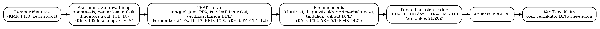

## II.1 Rekam Medis dan Dokumentasi Klinis dalam Konteks Klaim JKN

### II.1.1 Kewajiban dan Isi Rekam Medis Elektronik

Peraturan Menteri Kesehatan (Permenkes) Nomor 24 Tahun 2022 mewajibkan setiap fasilitas pelayanan kesehatan menyelenggarakan rekam medis elektronik (RME). Penyelenggaraannya meliputi registrasi pasien, pendistribusian data, pengisian dan pengolahan informasi klinis, penginputan data klaim, penyimpanan, penjaminan mutu, serta transfer isi RME (Pasal 3 dan Pasal 13, hlm. 3–6). Pengisian informasi klinis dilakukan oleh tenaga kesehatan pemberi pelayanan, sedangkan kegiatan lainnya dilakukan oleh tenaga perekam medis dan informasi kesehatan. RME terdiri atas dokumentasi administratif dan klinis, dengan dokumentasi klinis mencakup pelayanan yang diberikan kepada pasien (Pasal 27, hlm. 12). Sistem RME juga harus mengacu pada variabel dan metadata yang ditetapkan Kementerian Kesehatan, meliputi definisi, format, dan kodifikasi (Pasal 11, hlm. 5).

Keputusan Menteri Kesehatan (KMK) Nomor HK.01.07/MENKES/1596/2024 merinci ketentuan tersebut melalui kelompok standar Manajemen Rekam Medis dan Informasi Kesehatan (MRMIK). Rekam medis harus memuat informasi yang memadai untuk mengidentifikasi pasien, mendukung diagnosis dan pengobatan, mendokumentasikan pemeriksaan, serta menjaga kesinambungan pelayanan, termasuk melalui ringkasan pasien pulang (MRMIK 7, hlm. 163). Setiap catatan harus mencantumkan tanggal, waktu, nama, dan tanda tangan atau paraf tenaga kesehatan, serta mengikuti prosedur koreksi yang ditetapkan rumah sakit (MRMIK 8, hlm. 163–164).

Rumah sakit harus menetapkan kode, simbol, dan singkatan yang boleh maupun tidak boleh digunakan. Kode penyakit mengacu pada International Statistical Classification of Diseases and Related Health Problems, 10th Revision (ICD-10), sedangkan kode tindakan menggunakan International Classification of Diseases, 9th Revision, Clinical Modification (ICD-9-CM) (MRMIK 9, hlm. 164–165). Standar tersebut menyoroti risiko kegagalan komunikasi akibat tulisan yang tidak terbaca serta penggunaan singkatan, simbol, dan kode yang tidak seragam. Pengkajian rekam medis dilakukan secara berkala, sekurang-kurangnya setiap tahun, dengan memperhatikan ketepatan waktu, keterbacaan, kelengkapan, dan kesesuaian isi dengan peraturan (MRMIK 12, hlm. 167–168).

### II.1.2 Catatan Perkembangan Pasien Terintegrasi

Permenkes 24/2022 mengatur bahwa pencatatan informasi klinis harus dilakukan secara lengkap dan jelas setelah pasien menerima pelayanan, serta mencantumkan nama, waktu, dan tanda tangan tenaga kesehatan. Catatan disusun berurutan berdasarkan waktu pelayanan. Apabila pelayanan melibatkan beberapa jenis tenaga kesehatan, pencatatannya harus terintegrasi dalam satu dokumen yang memuat catatan para tenaga kesehatan tersebut (Pasal 16 dan Pasal 17, hlm. 7–8).

KMK 1596/2024 menyebut dokumen tersebut sebagai catatan perkembangan pasien terintegrasi (CPPT). Para profesional pemberi asuhan (PPA) mendokumentasikan perkembangan pasien pada CPPT, termasuk instruksi pemeriksaan laboratorium atau pemberian obat. Dokter Penanggung Jawab Pelayanan (DPJP) melakukan reviu berkala dan verifikasi harian terhadap asuhan terintegrasi. Pada unit intensif atau unit khusus, DPJP dapat mencatat perkembangan pasien pada lembar pemantauan khusus, sementara PPA lain menggunakan CPPT (Elemen Penilaian AKP 3, hlm. 215; PAP 1.1, hlm. 263; PAP 1.2, hlm. 266). Namun, format penulisan isi CPPT tidak ditetapkan secara khusus dalam teks KMK yang ditelaah.

Oktavia Az dan Sonia (2021) menjelaskan bahwa CPPT di rumah sakit yang mereka teliti ditulis menggunakan format Subjective, Objective, Assessment, dan Planning (SOAP), dengan mengacu pada standar akreditasi edisi sebelumnya. Penelitian tersebut mengevaluasi kelengkapan CPPT pada 200 berkas rekam medis rawat inap yang diambil secara acak dari sebuah rumah sakit ibu dan anak di Kota Bandung. Penilaian mencakup identitas pasien, nomor rekam medis, tanggal, waktu, bagian SOAP, serta tanda tangan atau paraf. Hasilnya menunjukkan bahwa identitas pasien lengkap pada 87,5% berkas, nomor rekam medis pada 78%, tanggal pada 51%, waktu pada 48%, dan tanda tangan atau paraf pada 80%. Bagian SOAP ditemukan pada seluruh berkas (hlm. 426–427, 432).

Penulis mengaitkan ketidaklengkapan tersebut dengan keterbatasan waktu, miskomunikasi, kurangnya disiplin PPA, serta kurangnya pengetahuan mengenai pedoman pengisian. Penelitian itu juga mencatat belum adanya prosedur operasional baku untuk pengisian CPPT di rumah sakit yang diteliti. Dengan demikian, penelitian tersebut memberikan gambaran empiris mengenai kelengkapan elemen dokumentasi CPPT, tetapi tidak menguji konsistensi isi CPPT dengan resume medis.

Nadi dan Fortunandha (2024) menelaah praktik CPPT di Indonesia melalui tinjauan naratif. Mereka mengelompokkan hambatan kelengkapan CPPT ke dalam tiga faktor, yaitu kurangnya komitmen manajemen, keterbatasan kapasitas tenaga kesehatan, dan infrastruktur yang belum memadai. Sebagai upaya perbaikan, mereka mengusulkan digitalisasi CPPT melalui RME dengan siklus Plan-Do-Study-Act. Pembahasan tersebut melengkapi penelitian Oktavia Az dan Sonia dengan memberikan gambaran faktor organisasi, sumber daya manusia, dan infrastruktur yang berkaitan dengan pengisian CPPT. Kedua penelitian ini menjadi konteks mengenai praktik dokumentasi perkembangan pasien, bukan bukti langsung mengenai penyebab ketidaksesuaian CPPT dan resume medis.

### II.1.3 Resume Medis

KMK 1596/2024 mewajibkan ringkasan pasien pulang (discharge summary) dibuat bagi seluruh pasien rawat inap yang keluar dari rumah sakit. Dokumen ini memuat indikasi pasien masuk dirawat, diagnosis dan komorbiditas, temuan fisik dan temuan penting lainnya, tindakan diagnostik dan prosedur terapi, obat selama rawat inap serta obat untuk digunakan di rumah, kondisi pasien saat pulang, dan instruksi tindak lanjut. DPJP menyusun ringkasan sebelum pasien keluar. Salinannya diberikan kepada tenaga kesehatan yang melanjutkan asuhan, pasien, dan penjamin (AKP 5.1, hlm. 218–219).

Permenkes 24/2022 menetapkan isi minimum rekam medis yang diberikan kepada pasien rawat inap saat pulang, yaitu identitas pasien, hasil pemeriksaan fisik dan penunjang, diagnosis, pengobatan, rencana tindak lanjut, serta nama dan tanda tangan tenaga kesehatan (Pasal 26, hlm. 11–12). Permenkes 26/2021 menggunakan istilah resume medis untuk dokumen sumber pengodean klaim, sedangkan Panduan SATUSEHAT memetakan resume medis rawat inap ke jenis dokumen Hospital Discharge Summary dengan kode LOINC 34105-7.

Dalam penelitian ini, resume medis merujuk pada ringkasan pasien pulang untuk rawat inap. Untuk rawat jalan dan IGD, dokumen pembanding disebut dokumen ringkasan pelayanan. Penamaan tersebut merupakan istilah operasional penelitian dan tidak menyatakan bahwa seluruh jenis pelayanan menggunakan formulir yang sama.

### II.1.4 Variabel dan Metadata Rekam Medis Elektronik Rawat Inap

Variabel dan metadata RME ditetapkan melalui KMK Nomor HK.01.07/MENKES/1423/2022 sebagai standar elemen data untuk mendukung kompatibilitas dan interoperabilitas sistem elektronik. Pedoman tersebut memuat lima dataset, yaitu IGD, rawat jalan, rawat inap, laboratorium, dan apotek. Setiap variabel disertai tipe data, format atau nilai, definisi operasional, dan referensi. Kelompok variabel dataset rawat inap dirangkum pada Tabel II.1.

Tabel II.1. Kelompok variabel dataset rawat inap menurut KMK HK.01.07/MENKES/1423/2022

| Kelompok | Contoh variabel | Tipe dan format | Halaman |
|---|---|---|---|
| I Lembar Identitas | Nama lengkap, nomor rekam medis, Nomor Induk Kependudukan (NIK), tanggal lahir, alamat | Karakter dan numerik; NIK 16 digit | 57–62 |
| II Cara Pembayaran | Metode pembayaran | Pilihan berkode | 62 |
| III Persetujuan Umum | Persetujuan pasien, petugas yang memberi penjelasan | Karakter | 62–64 |
| IV Formulir Rawat Inap | Anamnesis (keluhan utama, riwayat penyakit, alergi, pengobatan); pemeriksaan fisik (keadaan umum, tingkat kesadaran, tanda vital, pemeriksaan kepala sampai kaki); status psikologis, sosial ekonomi, dan spiritual | Teks bebas; pilihan berkode; angka bersatuan | 64–68 |
| V Pemeriksaan Spesialistik | Riwayat penggunaan obat, perencanaan pemulangan, rencana rawat, instruksi medik dan keperawatan | Teks bebas; pilihan berkode | 69 |
|  | Pemeriksaan penunjang laboratorium dan radiologi | Berkas, teks, kode pemeriksaan | 69–76 |
|  | Diagnosis awal atau masuk; diagnosis akhir primer dan sekunder | Teks bebas dan kode ICD-10 | 76–77 |
|  | Persetujuan atau penolakan tindakan | Karakter, tanggal, waktu | 77–78 |
|  | Terapi: nama tindakan; peresepan obat; pengkajian resep | Isian basis data sesuai ICD-9-CM; formularium | 78–81 |

Diagnosis awal menggambarkan kondisi pasien saat masuk sebelum pemeriksaan lanjutan, sedangkan diagnosis akhir primer dan sekunder merupakan keputusan DPJP ketika pasien akan dipulangkan. Rencana rawat serta instruksi medik dan keperawatan dicatat sebagai teks bebas. Dataset rawat inap tersebut tidak memuat variabel khusus untuk CPPT atau catatan perkembangan harian.

Keterkaitan dokumen yang diatur dalam regulasi pada satu episode rawat inap dan alurnya menuju klaim digambarkan pada Gambar II.1.

Gambar II.1. Dokumen dalam satu episode rawat inap dan alurnya menuju klaim (disusun dari Permenkes 24/2022, Permenkes 26/2021, KMK 1423/2022, dan KMK 1596/2024)

### II.1.5 Pengodean dan Verifikasi Klaim INA-CBG

Permenkes 26/2021 menetapkan bahwa pengelompokan INA-CBG didasarkan pada kode diagnosis akhir dan tindakan. Pengodean diagnosis menggunakan ICD-10 versi 2010, sedangkan pengodean tindakan menggunakan ICD-9-CM versi 2010. Sistem tersebut menghasilkan 1.075 kelompok kasus, terdiri atas 786 kelompok rawat inap dan 289 kelompok rawat jalan. Sumber utama data pengodean adalah diagnosis dan tindakan dalam resume medis, sedangkan berkas rekam medis dapat diperiksa apabila diperlukan. Ketepatan kode diagnosis dan tindakan berpengaruh terhadap hasil pengelompokan dalam aplikasi INA-CBG (hlm. 23).

Permenkes 26/2021 membagi tanggung jawab pengelolaan klaim kepada tiga pihak. Dokter menegakkan dan menuliskan diagnosis utama, diagnosis sekunder, serta tindakan, kemudian membuat resume medis yang lengkap, jelas, dan spesifik. Koder menerjemahkan diagnosis dan tindakan tersebut menjadi kode yang sesuai. Verifikator BPJS Kesehatan memeriksa kelengkapan berkas klaim serta kesesuaian diagnosis dan tindakan dalam resume medis dengan ICD-10 dan ICD-9-CM (hlm. 8–9). Permenkes 24/2022 menempatkan pengodean sebagai bagian pengolahan informasi RME. Penginputan data klaim merupakan kegiatan memasukkan kode klasifikasi penyakit ke aplikasi pembiayaan berdasarkan diagnosis dan tindakan yang ditulis tenaga kesehatan sesuai dengan rekam medis (Pasal 18–19).

Simbolon dan Gani (2023) merangkum lima artikel tahun 2020–2022 mengenai faktor yang berkaitan dengan klaim rawat inap tertunda (pending). Faktor yang ditemukan mencakup pengodean yang tidak sesuai, berkas yang tidak lengkap, serta perbedaan penegakan diagnosis antara DPJP dan verifikator BPJS. Salah satu penelitian yang dirangkum adalah Muroli dkk. (2020, sebagaimana dikutip dalam Simbolon & Gani, 2023) di RSAB Harapan Kita, Jakarta Barat. Berdasarkan ringkasan dalam tabel ulasan tersebut, resume medis tidak lengkap pada 38 berkas (41,8%), pengodean tidak tepat pada 44 berkas (48,4%), dan berkas klaim tidak lengkap pada 27 berkas (29,7%).

Angka tersebut berasal dari tabel ulasan Simbolon dan Gani, bukan dari pemeriksaan langsung terhadap artikel Muroli dkk. Ulasan tersebut juga tidak menjelaskan penilaian mutu terhadap lima artikel yang dimasukkan. Oleh karena itu, hasilnya digunakan sebagai gambaran faktor yang dilaporkan berkaitan dengan klaim pending, bukan sebagai bukti langsung bahwa ketidaksesuaian antara CPPT dan resume medis menyebabkan klaim pending.
