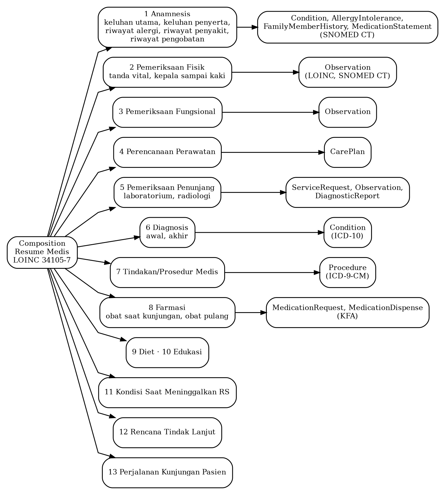
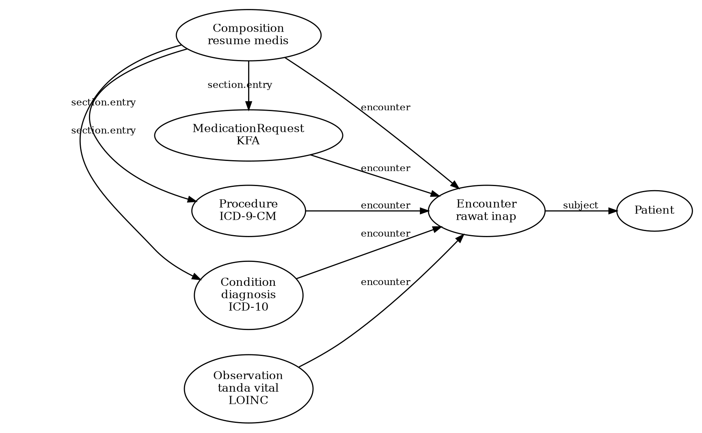

## II.2 Standar Interoperabilitas dan Terminologi Klinis di Indonesia

### II.2.1 SATUSEHAT dan Profil Rawat Inap Berbasis HL7 FHIR

Permenkes 24/2022 mewajibkan RME yang disimpan oleh fasilitas pelayanan kesehatan terhubung dengan platform interoperabilitas dan integrasi data kesehatan yang dikelola Kementerian Kesehatan (Pasal 21, hlm. 10). Platform tersebut adalah SATUSEHAT. Heryawan dkk. (2025) menjelaskan bahwa SATUSEHAT menggunakan server Health Level Seven Fast Healthcare Interoperability Resources (HL7 FHIR) untuk pertukaran data, server terminologi untuk menyediakan acuan istilah dan kode klinis, server data induk untuk identitas dan informasi fasilitas, serta developer hub sebagai lingkungan pengujian.

Server terminologi SATUSEHAT menyediakan ICD-10 untuk diagnosis, Logical Observation Identifiers Names and Codes (LOINC) untuk observasi, dan Systematized Nomenclature of Medicine Clinical Terms (SNOMED CT) untuk istilah klinis lainnya. Heryawan dkk. menganalisis pesan pada grup Telegram pengembang SATUSEHAT yang bekerja di lingkungan puskesmas dan klinik swasta. Mereka menemukan 61 persoalan terkait server FHIR, 37 persoalan terkait pemetaan data RME ke terminologi standar seperti SNOMED CT, dan 9 persoalan terkait pemilihan profil FHIR. Hasil tersebut menunjukkan bahwa interoperabilitas tidak hanya berkaitan dengan pertukaran data, tetapi juga pemetaan elemen dan pemilihan representasi data yang sesuai.

Panduan SATUSEHAT untuk modul rawat inap versi 6.0, tertanggal 10 Januari 2026, menetapkan urutan pengiriman data serta resource FHIR yang digunakan. Kunjungan direpresentasikan menggunakan Encounter. Anamnesis dikirim menggunakan Condition, AllergyIntolerance, dan MedicationStatement. Pemeriksaan fisik serta tanda vital menggunakan Observation, sedangkan rencana rawat dan instruksi medik maupun keperawatan menggunakan CarePlan. Diagnosis menggunakan Condition, tindakan menggunakan Procedure, peresepan menggunakan MedicationRequest, dan resume medis menggunakan Composition.

Pemetaan terminologi dalam panduan tersebut menggunakan ICD-10 untuk kode diagnosis, ICD-9-CM untuk tindakan, LOINC untuk tanda vital, SNOMED CT untuk temuan klinis dan lokasi tubuh, serta Kamus Farmasi dan Alat Kesehatan untuk obat. Resume medis dikirim sebagai Composition berjenis LOINC 34105-7 yang terdiri atas tiga belas bagian (section), masing-masing merujuk pada resource lain seperti ditunjukkan pada Gambar II.2. Alur integrasi rawat inap dalam panduan tersebut tidak memuat resource atau bagian khusus untuk CPPT.

Gambar II.2. Struktur resume medis rawat inap pada Panduan SATUSEHAT versi 6.0 (diolah dari Kementerian Kesehatan Republik Indonesia, 2026)

### II.2.2 Adopsi Terminologi Klinis

ICD-10 dan ICD-9-CM telah digunakan dalam pengodean klaim berdasarkan Permenkes 26/2021 serta pengodean rekam medis berdasarkan KMK 1596/2024. Adopsi SNOMED CT di Indonesia masih berada pada tahap awal. Pertiwi dkk. (2026) menelaah literatur dan dokumen kebijakan periode 2020–2024 dengan Korea Selatan sebagai contoh utama. Mereka menyimpulkan bahwa penerapan SNOMED CT di Indonesia masih berada pada tahap awal, dengan proyek percontohan di beberapa rumah sakit vertikal dan institusi pendidikan tinggi kesehatan.

Pertiwi dkk. mengidentifikasi tiga kendala utama, yaitu keterbatasan infrastruktur digital, ketimpangan sebaran sumber daya manusia terlatih, dan kebutuhan konten lokal. Pembahasan tersebut menunjukkan bahwa penggunaan terminologi klinis terstandar memerlukan kesiapan infrastruktur dan sumber daya manusia, selain ketersediaan standar terminologinya.

### II.2.3 Bagian SOAP dan Relasi antara Penilaian dan Rencana

Gao dkk. (2022) menyusun skema anotasi bertingkat untuk memahami catatan perkembangan harian (daily progress note) yang menggunakan format berorientasi masalah dan umumnya mengikuti bagian SOAP. Korpus yang digunakan terdiri atas 5.000 catatan perkembangan harian dari MIMIC-III, yaitu basis data rekam medis unit perawatan intensif berbahasa Inggris.

Anotasi dilakukan dalam tiga tahap. Tahap pertama memberi label pada bagian teks, seperti keluhan utama, riwayat penyakit sekarang, riwayat alergi, dan pemeriksaan fisik, kemudian memetakan setiap label ke salah satu komponen SOAP. Tahap kedua mengidentifikasi relasi antara bagian Assessment dan setiap subbagian Plan. Tahap ketiga menandai masalah dan diagnosis dalam setiap subbagian rencana secara terpisah dari tindakan yang direncanakan. Dengan demikian, skema tersebut tidak hanya mengelompokkan teks berdasarkan bagian SOAP, tetapi juga merepresentasikan hubungan antara penilaian klinis dan rencana asuhan.

Gao, Dligach, dkk. (2023) menggunakan tugas pengenalan relasi Assessment–Plan tersebut dalam *n2c2 2022 Track 3 shared task*. Setiap pasangan penilaian dan subbagian rencana diklasifikasikan ke dalam empat relasi. Relasi Direct diberikan apabila masalah dalam rencana merupakan alasan utama rawat inap atau berhubungan langsung dengan gejala dan hasil pemeriksaan. Relasi Indirect digunakan untuk masalah sekunder. Relasi Neither menunjukkan bahwa masalah dalam rencana tidak didokumentasikan dalam penilaian, sedangkan Not Relevant digunakan apabila subbagian rencana tidak memuat diagnosis atau masalah.

Delapan tim mengirimkan sistem untuk tugas tersebut. Nilai Macro-F1 terbaik mencapai 0,8212, sedangkan relasi Indirect menjadi kategori paling sulit dikenali dengan nilai rata-rata 0,6713. Penyelenggara juga mencatat bahwa ukuran sampel tidak dihitung secara formal sehingga pengujian mungkin kurang kuat untuk membedakan sistem yang memiliki skor berdekatan (hlm. 4–7). Kedua penelitian tersebut memberikan gambaran tentang cara menstrukturkan bagian SOAP dan mengidentifikasi hubungan antara penilaian serta rencana, tetapi tidak secara langsung menguji konsistensi antara CPPT dan resume medis.

### II.2.4 Graf Pengetahuan Berbasis Rekam Medis

Murali dkk. (2023) menelaah pembangunan graf pengetahuan medis dari data rekam medis melalui tiga aspek, yaitu representasi, ekstraksi, dan pelengkapan graf. Representasi yang umum digunakan adalah triple yang terdiri atas dua entitas dan satu relasi. Struktur tersebut dapat diperluas menjadi quadruple untuk menyimpan cap waktu kejadian. Ontologi dan terminologi seperti UMLS, SNOMED CT, dan ICD-10 digunakan sebagai sumber pengetahuan untuk menyatukan data dari berbagai format.

Tinjauan tersebut mengidentifikasi beberapa tantangan pembangunan KG berbasis rekam medis, yaitu kompleksitas dan dimensi data yang tinggi, kurangnya penggabungan pengetahuan, serta kebutuhan pembaruan graf secara dinamis. Dengan demikian, pembangunan KG dari rekam medis tidak hanya melibatkan pembentukan entitas dan relasi, tetapi juga kebutuhan menjaga konsistensi konsep dan perubahan informasi.

Xiao dkk. (2022) membangun KG klinis mengikuti spesifikasi FHIR dalam format Resource Description Framework (RDF). Sistem FHIR-Ontop-OMOP menerjemahkan basis data relasional berstandar Observational Medical Outcomes Partnership Common Data Model (OMOP CDM) menjadi graf virtual melalui lebih dari 100 pemetaan elemen data yang mencakup 11 resource FHIR.

Pada data MIMIC-III, graf yang dihasilkan memuat 46.520 instans Patient, 716.595 Condition, 1.063.525 Procedure, dan 365.181.104 Observation. Penelitian tersebut membandingkan lima pasang kueri SQL dan SPARQL, dan mendapatkan jumlah pasien yang identik. Graf untuk 100 pasien juga dinyatakan sepenuhnya sesuai dengan spesifikasi FHIR RDF. Nilai Condition.code dapat berupa kode SNOMED CT maupun teks. Ilustrasi struktur graf satu episode rawat inap berdasarkan resource FHIR ditunjukkan pada Gambar II.3.

Gambar II.3. Ilustrasi struktur graf satu episode rawat inap berdasarkan *resource* FHIR yang dipakai Xiao dkk. (2022) dan Panduan SATUSEHAT (Kementerian Kesehatan Republik Indonesia, 2026)

Kedua penelitian tersebut membahas representasi pengetahuan klinis dari rekam medis pada tingkat konsep, relasi, dan pemetaan data terstandar. Dalam konteks penelitian ini, KG merupakan salah satu pendekatan pendukung yang dapat dipertimbangkan dalam pembangunan RAG. Kontribusinya tidak diklaim secara terpisah apabila tidak dibandingkan melalui pengujian yang sesuai.
