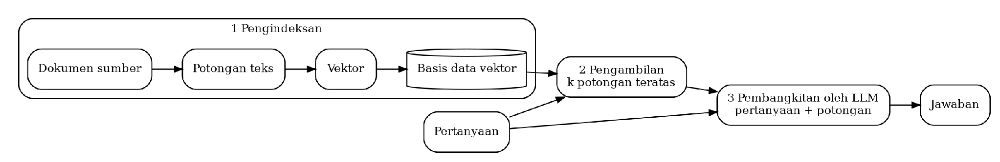

## II.4 Retrieval-Augmented Generation dan Penjangkaran Keluaran pada Bukti

### II.4.1 Konsep dan Mekanisme Retrieval-Augmented Generation

Lewis dkk. (2020) memperkenalkan retrieval-augmented generation (RAG), yaitu pendekatan yang menggabungkan memori parametrik berupa model bahasa sequence-to-sequence pralatih dengan memori nonparametrik berupa indeks dokumen yang diakses melalui neural retriever. Dalam rancangan tersebut, retriever mengambil dokumen yang relevan dengan masukan menggunakan Dense Passage Retriever. Model BART kemudian membangkitkan keluaran dengan mempertimbangkan masukan dan dokumen yang telah diambil.

Gao, Xiong, dkk. (2023) menjelaskan proses dasar RAG yang disebut Naive RAG dalam tiga tahap. Tahap pertama adalah pengindeksan, yaitu memecah dokumen menjadi potongan, mengubahnya menjadi vektor, dan menyimpannya dalam basis data vektor. Tahap kedua adalah pengambilan sejumlah potongan yang paling mirip secara semantik dengan pertanyaan. Tahap ketiga adalah pembangkitan jawaban oleh LLM berdasarkan pertanyaan dan potongan yang diambil.

Selain Naive RAG, Gao, Xiong, dkk. membahas Advanced RAG dan Modular RAG. Kedua pendekatan tersebut menambahkan atau menyusun ulang modul dalam proses RAG, termasuk mekanisme untuk memperbaiki pencarian dan pengambilan informasi. Perbedaan tersebut menunjukkan bahwa RAG tidak hanya merujuk pada satu susunan proses, tetapi dapat dikembangkan dengan penambahan modul pada tahapan retrieval maupun generation. Alur dasar RAG ditunjukkan pada Gambar II.4.

Gambar II.4. Alur dasar RAG (diolah dari Gao, Xiong, dkk., 2023, hlm. 3)

### II.4.2 Penerapan Retrieval dan Penjangkaran Bukti pada Informasi Klinis

Zhang dkk. (2026) membandingkan enam strategi pengambilan informasi pada catatan keperawatan fasilitas perawatan lansia di Australia. Indeks dibangun dari segmen catatan tersebut untuk dua tugas ekstraksi entitas, yang masing-masing diuji pada 208 rekaman. Hasil pengujian menunjukkan bahwa tanpa retrieval, F1 jawaban mencapai 0,702 untuk gejala agitasi pada demensia dan 0,722 untuk faktor risiko malnutrisi. Penggunaan dense reranking meningkatkan nilai tersebut menjadi 0,946 dan 0,953.

F1 jawaban dalam penelitian tersebut dihitung menggunakan BERTScore, yaitu ukuran kemiripan semantik terhadap anotasi acuan. Penulis membatasi kesimpulan penelitian pada dua tugas ekstraksi berbasis skema. Ekstraksi relasi, penalaran temporal, dan tanya jawab terbuka belum dievaluasi. Hasil tersebut memberikan contoh perbandingan strategi retrieval pada catatan klinis, tetapi belum menunjukkan kinerja pada tugas pemeriksaan konsistensi lintas dokumen seperti yang ditetapkan dalam penelitian ini.

Li dkk. (2026) menerapkan penjangkaran bukti pada sistem pendukung keputusan untuk bedah tulang belakang. Pangkalan pengetahuan penelitian tersebut memuat pedoman dan literatur yang masing-masing diberi identitas, sumber, tahun, serta tingkat bukti. Empat paragraf dengan peringkat tertinggi disisipkan ke masukan model. Keluaran disusun dalam format rekomendasi yang disertai paragraf kutipan. Model juga diinstruksikan untuk menjawab “no clear conclusions available” apabila literatur tidak memberikan kesimpulan yang pasti.

Evaluasi melibatkan lima ahli bedah yang menilai 200 kasus menggunakan rubrik sebelas dimensi, termasuk ketepatan bukti yang dikutip. Namun, perbandingan penelitian tersebut dilakukan terhadap empat agen LLM dalam satu kerangka RAG pada satu pusat layanan, bukan antara pendekatan RAG dan pendekatan tanpa RAG. Penelitian ini memberikan contoh penyajian rekomendasi yang disertai rujukan bukti untuk diperiksa, tetapi tidak secara langsung mengevaluasi pemeriksaan konsistensi dokumentasi klinis.
