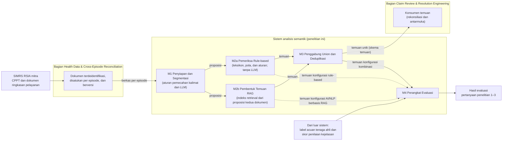

# Bab III — Analisis Masalah dan Rancangan Solusi

> **Status:** berkas ini memuat subbab III.1 dan III.2 versi padat (sasaran ≤ 3 halaman); versi lengkap ada di `bab3/arsip/Bab_III_Draft_lengkap.md`. Gambar III.1 ditulis sebagai diagram Mermaid dan perlu dirender menjadi gambar sebelum dimasukkan ke `.docx`. Daftar pustaka: `bab2/Daftar_Pustaka.md`.

---

## Naskah

## BAB III ANALISIS MASALAH DAN RANCANGAN SOLUSI

## III.1 Analisis Masalah

Menurut regulasi, verifikator Badan Penyelenggara Jaminan Sosial (BPJS) Kesehatan memeriksa kelengkapan berkas klaim serta kesesuaian diagnosis dan tindakan pada resume medis dengan klasifikasi ICD-10 dan ICD-9-CM (Kementerian Kesehatan Republik Indonesia, 2021, hlm. 9). Di dalam rumah sakit, pengkajian rekam medis dilakukan secara berkala setiap tahun dan menggunakan sampel yang mewakili (Kementerian Kesehatan Republik Indonesia, 2024, hlm. 168). Namun, tidak satu pun ketentuan yang ditelaah pada subbab I.1 dan II.1 menyebut pemeriksaan kesesuaian isi catatan perkembangan pasien terintegrasi (CPPT) dengan resume medis. Menurut keterangan pimpinan rumah sakit ibu dan anak (RSIA) mitra yang dihimpun tim capstone, pemeriksaan kesiapan dokumen sebelum pengajuan klaim masih manual. Unit, urutan tahap, dan penanggung jawab pemeriksaan itu belum dikonfirmasi sehingga uraian regulasi di atas belum terbukti berjalan sebagai prosedur di RSIA mitra.

Kondisi yang diharapkan adalah ketidaksesuaian antara CPPT dan dokumen ringkasan pelayanan dalam satu episode terdeteksi sebelum pengajuan klaim dan disajikan sebagai temuan yang memuat alasan, rujukan, dan lokasi bukti serta berkategori *omission*, *contradiction*, *unsupported addition*, atau *contextual/temporal mismatch*. Temuan merupakan bahan peninjauan, bukan keputusan klinis atau pengodean (subbab I.4).

Dietrich dan Stubbert (2026, hlm. 96–98, 100) memeriksa kesalahan sisipan di dalam satu catatan pemulangan dari MIMIC-IV-ED dan menyebut konsistensi lintas dokumen sebagai arah lanjutan, bukan bagian yang diuji. Zeba dkk. (2026, hlm. 1–4, 15) memeriksa ringkasan buatan model bahasa besar (*large language model*, LLM) terhadap rekam medis MIMIC-III dengan putusan akhir biner (didukung/tidak didukung) yang tidak membedakan jenis ketidaksesuaian. Data kedua karya itu berbahasa Inggris. Telaah naratif Ijadi Maghsoodi dkk. (2026, hlm. 1, 9) menilai rancangan hibrida paling kredibel pada tugas yang terikat aturan, sensitif terhadap audit, dan bergantung pada alur kerja, termasuk validasi dokumentasi, tetapi juga menyatakan bahwa basis empirisnya terbatas dan bukti prospektif masih jarang. Di antara sumber yang ditelaah pada subbab II.1–II.4 dan di atas, belum ada yang menguji pemeriksaan kesesuaian CPPT terhadap resume medis atau dokumen ringkasan pelayanan dalam satu episode pada teks klinis berbahasa Indonesia ataupun membandingkan pemeriksaan *rule-based*, kecerdasan artifisial serta pemrosesan bahasa alami (AI/NLP) berbasis *retrieval-augmented generation* (RAG), dan kombinasi keduanya pada data dan label acuan yang sama. Penelitian ini membandingkan ketiganya; hasilnya dibaca sebagai kinerja konfigurasi, bukan kinerja tiap teknik di dalamnya.

Dalam sistem capstone, bagian *Health Data & Cross-Episode Reconciliation* menyediakan dokumen dari sistem informasi manajemen rumah sakit (SIMRS); dokumen itu telah dideidentifikasi, disatukan per episode, dan diberi versi. Temuan diteruskan ke bagian *Claim Review & Resolution Engineering* dan diukur sebelum rekonsiliasi di bagian itu (subbab I.4). Komponen *rule-based* dibangun dalam lingkup penelitian ini sampai pembagian bidang ditetapkan tim [MENUNGGU KEPUTUSAN TIM: pemilik komponen *rule-based*].

## III.2 Gambaran Umum Solusi

Solusi yang dirancang adalah sistem analisis semantik yang membentuk temuan ketidaksesuaian dari pasangan CPPT dan dokumen ringkasan pelayanan dalam satu episode.

### III.2.1 Alternatif Solusi dan Pemilihannya

Alternatif untuk keempat persoalan turunan pada subbab I.2, yaitu satuan pembanding, pembentukan temuan, penggabungan, dan pengukuran, dipilih agar temuannya dapat menunjuk lokasi bukti, pendekatannya tidak bergantung pada data latih berlabel dalam jumlah besar, dan konfigurasinya dapat dibekukan sebelum data uji dipakai. Kecocokan pilihan berikut untuk teks klinis berbahasa Indonesia tidak disimpulkan dari penelitian lain, tetapi diperiksa secara informal oleh penulis pada data pengembangan. Angka pemeriksaan itu tidak dilaporkan sebagai hasil penelitian, dan pemeriksaan tersebut rentan terhadap bias karena penulis juga merancang aturan dan *prompt* yang diperiksanya.

Satuan pembanding berupa proposisi atomik karena dokumen utuh tidak dapat menunjuk entri bukti dan satu bagian SOAP (subjektif, objektif, asesmen, dan rencana) dapat memuat beberapa pernyataan. Biayanya adalah segmentasi tambahan yang dapat keliru. Temuan dibentuk dengan RAG karena proses *retrieval* dapat diamati dan rujukan asli dapat ditemukan dengan cepat (Gao, Xiong, dkk., 2023, hlm. 14), tetapi RAG tidak dianggap lebih tepat daripada LLM tanpa *retrieval* ataupun menghilangkan halusinasi. Perbandingan RAG dengan pemeriksaan tanpa *retrieval* tidak dijawab penelitian ini karena evaluasinya dibatasi pada tiga konfigurasi (subbab I.4). Penggabungan memakai *union* dengan deduplikasi karena irisan membuang temuan yang hanya ditemukan satu komponen, sedangkan pemungutan suara berbobot memerlukan kalibrasi pada data berlabel. *Recall* kombinasi tidak lebih rendah daripada *recall* komponen terbaik selama deduplikasi tidak menggabungkan dua temuan yang berbeda, tetapi *precision*-nya dapat turun. Pengukuran memakai pencocokan satu-ke-satu antara temuan dan label acuan, bukan penilaian per episode, karena unit evaluasinya adalah temuan (subbab I.4); hasil hitungannya bergantung pada aturan kecocokan yang ditetapkan sebelum pengujian (subbab I.3).

### III.2.2 Modul yang Diusulkan dan Diagram Blok Capstone

Gambar III.1 menempatkan lima modul di dalam sistem capstone. Penyiapan dan Segmentasi (M1) memilih versi terakhir dokumen ringkasan pelayanan yang dapat dibuktikan tersedia sebelum pengajuan klaim, lalu memecah CPPT dan dokumen itu menjadi proposisi atomik. Aturan menentukan batas kalimat dan posisinya, tetapi tidak dapat memecah kalimat yang memuat beberapa pernyataan. Karena itu, LLM memecah setiap kalimat menjadi proposisi yang mewarisi posisi kalimat asalnya sehingga lokasi bukti tidak bergantung pada teks keluaran LLM. Pemeriksa *Rule-based* (M2a) tidak memakai LLM sehingga istilah, singkatan, atau variasi ejaan di luar leksikonnya tidak dikenali, sedangkan Pembentuk Temuan RAG (M2b) memakai LLM. Penggabung *Union* dan Deduplikasi (M3) menyatukan temuan keduanya dan Perangkat Evaluasi (M4) mengukur ketiga konfigurasi terhadap label acuan. M1 dipakai bersama sehingga konfigurasi *rule-based* juga memakai LLM pada segmentasi. Akibatnya, pertanyaan penelitian 1 membandingkan cara pembentukan temuan pada proposisi yang sama, bukan sistem tanpa LLM dengan sistem yang memakai LLM. Kesalahan segmentasi memengaruhi kedua komponen dan, pada analisis per komponen dalam pertanyaan penelitian 2, dicatat sebagai kesalahan komponen yang memakai proposisi keliru itu. Diagram ini menggambarkan struktur fungsional, bukan *deployment*.

Gambar III.1. Diagram blok capstone: posisi modul M1–M4 di antara bagian capstone lain

### III.2.3 Kontrak Antarblok

Masukan berupa satu berkas terdeidentifikasi per episode yang memuat kedua dokumen, pengenal versi, cap waktu pengajuan klaim, dan kode kelompok pasien yang tersamar sebagai pengganti pengenal pasien agar data dapat dibagi pada tingkat pasien (subbab I.5). Keluaran M2a dan M2b mengikuti satu skema temuan yang memuat episode, kategori, objek informasi, konteks kejadian, kutipan dan lokasi bukti, alasan, serta komponen asal [MENUNGGU KEPUTUSAN TIM: skema temuan dan kontrak antarblok].

### III.2.4 Langkah Pengembangan dan Kakas

Seluruh langkah berikut dikerjakan pada data pengembangan dan dijadwalkan pada Bab IV. Langkah awal ialah (1) menetapkan format berkas masukan bersama tim dan menyusun pengurai dokumen [DATA BELUM TERSEDIA: format ekspor CPPT dan resume dari SIMRS]; (2) menyusun definisi operasional keempat kategori, termasuk kriteria informasi wajib untuk *omission*, sebelum pelabelan data uji; (3) menyepakati skema proposisi dan skema temuan dengan tim; (4) membangun M1 dan memeriksa segmentasi secara manual; dan (5) membangun *retrieval* M2b yang memadukan pencarian leksikal dan berbasis *embedding* serta memeriksa relevansi hasilnya secara manual, tanpa memeriksa secara sistematis proposisi pendukung yang terlewat. Langkah berikutnya ialah (6) menyusun *prompt* M2b dengan kutipan bukti wajib; (7) menyusun leksikon, pola, dan aturan M2a; (8) membangun M3 dan mengujinya dengan temuan tumpang tindih; (9) membangun M4 sesuai dengan subbab I.5; dan (10) membekukan LLM beserta versi dan parameter *decoding*-nya, model *embedding*, aturan pemecahan kalimat M1, *prompt*, parameter *retrieval*, leksikon dan aturan M2a, serta kriteria deduplikasi sebelum data uji dipakai.

Kakas yang dipakai adalah Python dengan pustaka pemrosesan teks, *embedding*, penyimpanan vektor, dan statistik, serta sistem kendali versi. Pilihan antara model lokal dan LLM melalui *application programming interface* (API), yang mengirim teks ke luar institusi, ditetapkan setelah koordinasi dengan pembimbing dan RSIA mitra [MENUNGGU KONFIRMASI PEMBIMBING: kebijakan LLM cloud vs model lokal untuk teks klinis terdeidentifikasi].
