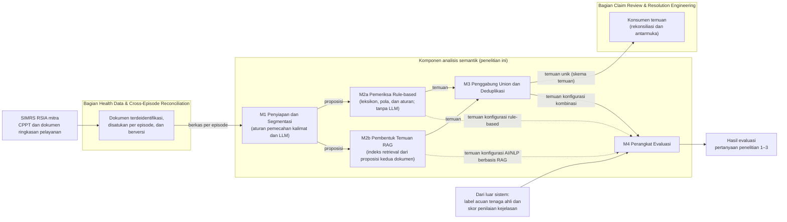

# Bab III — Analisis Masalah dan Rancangan Solusi

> **Status:** berkas ini memuat subbab III.1 dan III.2; Gambar III.1 ditulis sebagai diagram Mermaid dan perlu dirender menjadi gambar sebelum dimasukkan ke `.docx`. Daftar pustaka: `bab2/Daftar_Pustaka.md`.

---

## Naskah

## BAB III ANALISIS MASALAH DAN RANCANGAN SOLUSI

## III.1 Analisis Masalah

### III.1.1 Kondisi Saat Ini di RSIA Mitra

Menurut regulasi, catatan perkembangan pasien terintegrasi (CPPT) diisi para profesional pemberi asuhan selama pelayanan, sedangkan resume medis disusun Dokter Penanggung Jawab Pelayanan (DPJP) sebelum pasien pulang (subbab II.1.2 dan II.1.3). Peraturan Menteri Kesehatan (Permenkes) Nomor 26 Tahun 2021 mewajibkan koder melakukan klarifikasi dengan dokter apabila menemukan kesulitan atau ketidaksesuaian dengan aturan umum pengodean. Verifikator Badan Penyelenggara Jaminan Sosial (BPJS) Kesehatan memeriksa kelengkapan berkas klaim serta kesesuaian diagnosis dan tindakan pada resume medis dengan ICD-10 dan ICD-9-CM (Kementerian Kesehatan Republik Indonesia, 2021, hlm. 9).

Di dalam rumah sakit, Permenkes 24/2022 mengatur penjaminan mutu rekam medis elektronik melalui audit mutu berkala oleh tim reviu rekam medis, tanpa menyebut metode atau fokus isinya (Kementerian Kesehatan Republik Indonesia, 2022b, Pasal 23, hlm. 10). Keputusan Menteri Kesehatan (KMK) Nomor HK.01.07/MENKES/1596/2024 menetapkan pengkajian rekam medis setiap tahun berdasarkan sampel yang mewakili, dengan fokus yang paling sedikit mencakup ketepatan waktu, keterbacaan, kelengkapan, dan kesesuaian isi dengan peraturan (Kementerian Kesehatan Republik Indonesia, 2024, hlm. 167–168). Jadi, mekanisme tersebut menyasar pengodean, kelengkapan berkas dan klasifikasi kode, serta mutu rekam medis secara berkala. Permenkes 26/2021 menyatakan bahwa kelengkapan rekam medis yang ditulis dokter membantu koder dan verifikator (Kementerian Kesehatan Republik Indonesia, 2021, hlm. 8), tetapi tidak satu pun ketentuan yang ditelaah menyebut pemeriksaan kesesuaian isi CPPT dengan resume medis.

Kondisi di rumah sakit ibu dan anak (RSIA) mitra belum dapat dipetakan serinci ketentuan tersebut. Menurut keterangan pimpinan RSIA mitra yang dihimpun tim capstone, pemeriksaan kesiapan dokumen sebelum klaim masih dilakukan secara manual. Keterangan itu tidak merinci unit yang memeriksa, urutan tahapnya, atau penanggung jawab setiap tahap, dan ketiga hal tersebut belum dikonfirmasi kepada RSIA mitra. Karena itu, mekanisme di atas menggambarkan ketentuan regulasi, bukan prosedur yang terbukti berjalan di RSIA mitra.

Data klaim *pending* Mei 2026 yang disampaikan sebagai bahan awal (subbab I.1) akan ditabulasi per alasan *pending*. Alasan termasuk dalam lingkup apabila buktinya dapat dibaca dari CPPT dan dokumen ringkasan pelayanan dalam satu episode, dan berada di luar lingkup apabila memerlukan dokumen pendukung terpisah atau kunjungan lain [DATA BELUM TERSEDIA: tabulasi alasan klaim *pending* Mei 2026 menurut lingkup]. Kerepresentatifan data dan cara RSIA mitra mencatat alasan *pending* belum dikonfirmasi. Oleh sebab itu, data ini hanya dipakai untuk memetakan jenis alasan yang dapat dijangkau pemeriksaan, bukan untuk memperkirakan proporsi penyebab *pending* atau dampak sistem (subbab I.4).

### III.1.2 Kondisi yang Diharapkan dan Celah

Kondisi yang diharapkan adalah ketidaksesuaian antara CPPT dan dokumen ringkasan pelayanan dalam satu episode terdeteksi sebelum pengajuan klaim. Setiap ketidaksesuaian dikelompokkan ke dalam kategori *omission*, *contradiction*, *unsupported addition*, atau *contextual/temporal mismatch*, lalu disajikan sebagai temuan yang memuat alasan, rujukan, dan lokasi bukti pada kedua dokumen sehingga petugas dapat memeriksanya pada entri yang ditunjuk. Temuan merupakan bahan peninjauan, bukan keputusan klinis atau pengodean (subbab I.4), karena keluaran kecerdasan artifisial (AI) tidak dapat dianggap otomatis benar atau bebas bias dan tetap perlu dinilai dengan pertimbangan klinis (Wong dkk., 2025, hlm. 1449).

Mekanisme pada subbab III.1.1 belum menyasar kondisi tersebut, dan penelitian tentang CPPT di Indonesia yang ditelaah pun berfokus pada kelengkapan. Oktavia Az dan Sonia (2021, hlm. 426–427) menganalisis kelengkapan butir CPPT, seperti identitas, tanggal, waktu, tanda tangan, dan keberadaan bagian SOAP (subjektif, objektif, asesmen, rencana), pada sampel acak 200 berkas di sebuah rumah sakit ibu dan anak di Kota Bandung. Telaah naratif Nadi dan Fortunandha (2024, hlm. 87) menyatakan bahwa banyak rumah sakit di Indonesia masih bergantung pada pencatatan manual yang rawan galat dan bahwa pengendalian mutu CPPT berfokus pada kelengkapan. Keduanya tidak membahas konsistensi isi CPPT terhadap resume medis, dan keterangan tentang pemeriksaan manual di RSIA mitra tidak berasal dari keduanya.

Karya terdekat dapat dikelompokkan menurut objek yang diperiksa atau pendekatan yang dipakai. Kelompok pertama memeriksa kesalahan di dalam satu dokumen. Dietrich dan Stubbert (2026, hlm. 96–98) menguji empat model bahasa besar (*large language model*, LLM) untuk mengaudit catatan pemulangan instalasi gawat darurat dari MIMIC-IV-ED; 500 dari 600 catatan disisipi tepat satu kesalahan. Presisi mencapai 98,3–99,1% dan *recall* 92,8–94,6%, tetapi F1 kategori temuan klinis hanya 0,75–0,84, terutama karena *recall*-nya rendah. Kesalahan sisipan memberi acuan yang kebenarannya diketahui, tetapi tidak terjadi secara alami, dan pemeriksaan konsistensi lintas dokumen disebut penulis sebagai arah lanjutan, bukan bagian yang diuji (hlm. 100). Gao, Dligach, dkk. (2023, hlm. 7) melaporkan tugas bersama n2c2 2022 tentang relasi antara bagian penilaian dan rencana di dalam satu catatan perkembangan berbahasa Inggris. Kesalahan terbanyak terjadi pada label Indirect dan Neither karena informasi yang dibutuhkan berada di bagian lain catatan, dan tidak satu pun tugas memakai catatan utuh. Kedua kesulitan itu melekat pada perbandingan entri CPPT beberapa hari dengan satu resume medis.

Kelompok kedua membandingkan teks ringkasan dengan rekam medis sumber. Zeba dkk. (2026, hlm. 1–4) memecah ringkasan buatan LLM dan rekam medis MIMIC-III menjadi proposisi atomik, lalu memeriksa dukungan setiap proposisi dengan pemeriksa tanpa LLM. Presisi 0,8904 dan *recall* 0,8234 dihitung untuk kelas proposisi yang didukung. Pada kelas yang tidak didukung, yaitu kelas yang paling dekat dengan temuan ketidaksesuaian, hanya 69,49% yang dikenali dengan benar (hlm. 14). Kinerjanya juga menurun pada domain yang jarang, termasuk gangguan metabolik anak, dan keluarannya berupa vonis biner (hlm. 15). Karya ini sudah membandingkan ringkasan dengan sumbernya pada satuan yang halus, tetapi objeknya ringkasan buatan model, bukan resume yang ditulis dokter, dan keluarannya tidak membedakan jenis ketidaksesuaian.

Kelompok ketiga memakai *retrieval-augmented generation* (RAG) pada informasi klinis. Zhang dkk. (2026, hlm. 1, 4, 11) membandingkan enam strategi *retrieval* untuk ekstraksi entitas dari catatan keperawatan fasilitas perawatan lansia di Australia dan tidak mengevaluasi ekstraksi relasi maupun penalaran temporal. Li dkk. (2026, hlm. 1, 4, 9) menautkan setiap rekomendasi bedah tulang belakang ke literatur atau pedoman sumbernya, tetapi tidak menyertakan pembanding tanpa RAG. Karya pertama menunjukkan pengaruh *retrieval* pada ekstraksi, bukan pada pemeriksaan kesesuaian, sedangkan karya kedua mengambil bukti dari literatur dan pedoman. Perbandingan RAG dengan pemeriksaan tanpa *retrieval* juga tidak dijawab penelitian ini karena evaluasinya dibatasi pada tiga konfigurasi (subbab I.4).

Kelompok keempat membahas kombinasi aturan dan AI. Telaah naratif Ijadi Maghsoodi dkk. (2026, hlm. 1, 9) menilai rancangan hibrida paling kredibel pada tugas yang terikat aturan, sensitif terhadap audit, dan bergantung pada alur kerja, termasuk validasi dokumentasi, tetapi juga menyatakan bahwa basis empirisnya terbatas dan bukti prospektif masih jarang. Untuk pola ekstraksi neural yang divalidasi lapis simbolik, telaah itu mengutip laporan lain tanpa mengujinya sendiri (hlm. 4, 7), dan lapis simbolik disebut membawa beban, antara lain akuisisi pengetahuan, konflik aturan, dan pemeliharaan (hlm. 1, 5, 9).

Di antara sumber yang ditelaah penulis, belum ada yang menguji pemeriksaan kesesuaian CPPT terhadap resume medis atau dokumen ringkasan pelayanan dalam satu episode pada teks klinis berbahasa Indonesia. Di antara karya yang dibahas di atas, belum ada pula yang membandingkan tiga konfigurasi, yaitu pemeriksaan *rule-based*, pemeriksaan AI/NLP (pemrosesan bahasa alami) berbasis RAG, dan kombinasi keduanya, pada data dan label acuan yang sama. Penelitian ini memeriksa ketidaksesuaian pada dokumen nyata kasus kebidanan dan anak, bukan kesalahan sisipan, memilahnya ke dalam empat kategori, dan menguji ketiga konfigurasi pada data uji yang sama. Hasilnya menunjukkan kinerja konfigurasi, bukan kinerja tiap teknik di dalamnya. Keunggulan kombinasi juga tidak diasumsikan. Mekanisme *union* tidak membuang temuan benar dari komponen mana pun sehingga *recall* kombinasi tidak lebih rendah daripada komponen terbaik selama deduplikasi tidak menggabungkan dua temuan yang berbeda. Sebaliknya, presisi kombinasi dapat turun karena positif palsu kedua komponen ikut terbawa.

### III.1.3 Persoalan Turunan dan Kaitannya dengan Bagian Capstone Lain

Persoalan pertama adalah memasangkan CPPT dan dokumen ringkasan pelayanan dalam satu episode serta mengubah isinya menjadi satuan informasi yang dapat dibandingkan. CPPT bertambah setiap hari dari beberapa profesional pemberi asuhan dan tersusun menurut urutan waktu, sedangkan resume medis merangkum episode pada akhir perawatan. Pada rawat jalan, bentuk dokumen pembandingnya juga belum tentu sama dengan resume rawat inap (subbab I.1). Zeba dkk. (2026, hlm. 4) menilai akurasi pada satuan proposisi, bukan kalimat atau dokumen utuh, dan mencatat bahwa pemetaan ke kategori populasi, intervensi, pembanding, dan luaran (PICO) yang lebih kasar dapat menyembunyikan galat dosis, waktu, atau komorbiditas (hlm. 3). Apabila pasangan dokumen salah, temuan membandingkan informasi dari konteks yang berbeda dan menjadi positif palsu. Apabila satuannya terlalu kasar, ketidaksesuaian dapat terlewat dan lokasi buktinya tidak dapat menunjuk entri tertentu.

Persoalan kedua adalah membentuk temuan sesuai empat kategori taksonomi, lengkap dengan alasan, rujukan, dan lokasi bukti. Kesulitannya terletak pada pembedaan ketidaksesuaian dari perbedaan yang wajar, misalnya diagnosis yang berkembang selama episode sehingga entri awal CPPT berbeda dari resume medis (subbab I.1). Kategori *contextual/temporal mismatch* menuntut penafsiran klinis atas urutan pencatatan sehingga tidak cukup diperiksa dengan mencocokkan isi kedua dokumen. Kategori *unsupported addition* hanya dapat dinilai terhadap isi pasangan dokumen yang diteliti (subbab I.4). Apabila persoalan ini tidak diselesaikan, perbedaan yang wajar muncul sebagai temuan keliru, temuan tanpa lokasi bukti tidak dapat diverifikasi petugas, dan kesalahan kategori membuat analisis kontribusi per kategori pada pertanyaan penelitian kedua tidak dapat ditafsirkan.

Persoalan ketiga adalah menggabungkan keluaran pemeriksaan *rule-based* dan AI/NLP berbasis RAG tanpa temuan ganda. Kedua komponen dapat menemukan ketidaksesuaian yang sama dengan alasan dan lokasi bukti yang berbeda, misalnya satu menunjuk isian diagnosis pada resume medis dan yang lain menunjuk entri CPPT yang bertentangan dengannya. Kesamaan temuan ditentukan berdasarkan episode, objek informasi, kategori, dan konteks kejadian (subbab I.5), tetapi batas substansi yang sama tidak selalu tegas. Kriteria yang terlalu longgar menggabungkan dua temuan yang berbeda sehingga *recall* turun, sedangkan kriteria yang terlalu ketat meninggalkan duplikat. Karena setiap label acuan dipasangkan dengan paling banyak satu temuan, duplikat yang tersisa dihitung sebagai positif palsu dan menurunkan presisi kombinasi. Asal setiap temuan juga harus tetap tercatat agar kontribusi tiap komponen dapat dihitung.

Persoalan keempat adalah mengukur ketepatan deteksi terhadap label acuan tenaga ahli serta kejelasan alasan dan rujukan temuan. Berbeda dengan kesalahan sisipan pada Dietrich dan Stubbert (2026, hlm. 96–97), kebenaran pada dokumen nyata tidak diketahui sejak awal sehingga label acuan harus disusun tenaga ahli. Kesepakatan antarpenilai juga tidak dapat diasumsikan. Gao dkk. (2022) melatih anotator hingga kappa melampaui 0,80 (hlm. 5489), sedangkan kesepakatan untuk relasi penilaian dan rencana pada sepuluh catatan sebesar 0,74 (hlm. 5490). Penyelenggara n2c2 2022 tidak menghitung ukuran sampel sehingga, menurut penulisnya, pengujian mungkin kurang kuat untuk membedakan sistem yang skornya berdekatan (Gao, Dligach, dkk., 2023, hlm. 7). Tanpa label yang disepakati, jumlah data yang memadai, dan ambang yang ditetapkan sebelum pengujian, perbedaan presisi dan *recall* antarkonfigurasi tidak dapat ditafsirkan, dan pertanyaan penelitian tidak dapat dijawab secara sah. Kejelasan alasan dan rujukan dinilai manusia, bukan dihitung dari label, sehingga memerlukan kesepakatan penilai tersendiri.

Dalam sistem capstone, sistem informasi manajemen rumah sakit (SIMRS) RSIA mitra menjadi sumber CPPT dan resume medis. Bagian capstone *Health Data & Cross-Episode Reconciliation* menyediakan dokumen yang telah dideidentifikasi, disatukan per episode, dan berversi, beserta skema lokasi bukti yang menunjuk versi tertentu. Karena penelitian ini memakai dokumen tersebut, ketepatan pemasangan pada persoalan pertama bergantung pada ketepatan penyatuan episode di bagian tersebut. Temuan diteruskan ke bagian capstone *Claim Review & Resolution Engineering*, dan pengukuran penelitian ini dilakukan sebelum rekonsiliasi di bagian itu (subbab I.4). Sesuai subbab I.5, komponen *rule-based* yang keluarannya digabungkan pada persoalan ketiga dibangun dalam lingkup penelitian ini sampai pembagian bidang ditetapkan tim [MENUNGGU KEPUTUSAN TIM: pemilik komponen *rule-based*].

## III.2 Gambaran Umum Solusi

Solusi yang dirancang adalah komponen analisis semantik yang membentuk temuan ketidaksesuaian dari pasangan CPPT dan dokumen ringkasan pelayanan dalam satu episode. Temuan komponen AI/NLP berbasis RAG digabungkan dengan temuan pemeriksaan *rule-based* melalui mekanisme *union*, lalu dideduplikasi, dan ketiga konfigurasi diukur terhadap label acuan tenaga ahli. Ukuran keberhasilan dan prosedur evaluasi mengikuti subbab I.3 dan I.5 sehingga tidak diulang di sini.

### III.2.1 Alternatif Solusi per Persoalan dan Pemilihannya

Alternatif untuk setiap persoalan ditimbang dengan empat kriteria. Pertama, temuan harus dapat menunjuk lokasi bukti pada entri tertentu karena kejelasan rujukan dinilai pada pertanyaan penelitian 3. Kedua, solusi tidak boleh bergantung pada data latih berlabel dalam jumlah besar karena label acuan tenaga ahli disusun untuk data uji (subbab I.5) sehingga tidak dapat dipakai untuk melatih model. Ketiga, solusi harus tetap berada dalam tiga konfigurasi yang dievaluasi (subbab I.4). Keempat, seluruh bagian solusi harus dapat dibekukan sebelum data uji dipakai. Pilihan pada Tabel III.1 merupakan rancangan awal. Kecocokannya untuk teks klinis berbahasa Indonesia diperiksa pada data pengembangan dan tidak disimpulkan dari keberhasilan metode yang sama pada penelitian lain.

Tabel III.1. Alternatif solusi per persoalan dan pilihan sementara

| Persoalan | Alternatif | Pilihan sementara | Alasan dan *trade-off* |
| --- | --- | --- | --- |
| Pertama: pemasangan dokumen dan satuan pembanding | (a) dokumen utuh; (b) bagian SOAP dan isian resume; (c) proposisi atomik | (c), dengan entri dan bagian sebagai atribut lokasi | Satuan terkecil yang dapat dinilai didukung atau tidak didukung serta dapat menunjuk entri sumbernya. Segmentasi menambah langkah yang dapat keliru dan dapat memutus konteks antarkalimat. |
| Kedua: pembentukan temuan | (a) LLM tanpa *retrieval*; (b) RAG atas proposisi CPPT dan dokumen ringkasan pelayanan episode yang sama; (c) RAG dengan graf pengetahuan; (d) model NLI yang dilatih khusus | (b) | Setiap temuan dijangkarkan pada potongan sumber yang dapat dikutip tanpa memerlukan data latih berlabel. Mutu temuan bergantung pada mutu *retrieval* dan perilaku LLM. (c) tidak dimasukkan ke rancangan yang dievaluasi; (d) ditolak. |
| Ketiga: penggabungan keluaran | (a) *union* dan deduplikasi; (b) irisan (*intersection*); (c) pemungutan suara berbobot (*weighted voting*) | (a) | Tidak membuang temuan benar dari komponen mana pun. Positif palsu kedua komponen ikut terbawa sehingga presisi dapat turun. |
| Keempat: pengukuran | (a) pencocokan satu-ke-satu antara temuan dan label acuan; (b) penilaian per episode | (a) | Sesuai dengan unit evaluasi berupa temuan dan memungkinkan tabulasi per kategori serta per komponen asal. Hasil hitungan bergantung pada aturan kecocokan yang harus ditetapkan sebelum pengujian. |

Pada persoalan pertama, perbandingan dokumen utuh paling sederhana, tetapi CPPT satu episode terdiri atas banyak entri sehingga temuan tidak dapat menunjuk entri yang menjadi buktinya. Segmentasi per bagian SOAP dan per isian resume sudah mengikuti struktur dokumen, tetapi satu bagian dapat memuat beberapa pernyataan, misalnya beberapa diagnosis atau tindakan, sehingga ketidaksesuaian pada satu pernyataan dapat tertutup oleh pernyataan lain. Informasi yang diperlukan untuk menilai satu bagian juga dapat berada di bagian lain, seperti pada kesalahan terbanyak tugas bersama n2c2 2022 (subbab III.1.2). Proposisi atomik dipilih karena setiap proposisi dapat dinilai didukung atau tidak didukung secara terpisah dan tetap dapat menunjuk entri sumbernya. Zeba dkk. (2026, hlm. 2, 4) memakai satuan ini dengan memecah ringkasan dan rekam medis sumber menjadi proposisi lalu membandingkannya satu per satu. Namun, argumen mereka tentang satuan yang terlalu kasar ditujukan pada pemetaan ke kategori PICO (hlm. 3), dan studi tersebut tidak membandingkan granularitas proposisi dengan granularitas bagian secara empiris. Biaya pilihan ini adalah langkah segmentasi tambahan yang dapat keliru. Karena itu, setiap proposisi membawa entri, bagian, dan posisinya pada dokumen sumber agar kesalahan segmentasi dapat ditelusuri, dan mutu segmentasi diperiksa secara manual pada data pengembangan. Pemasangan dokumen per episode tidak dirancang ulang karena memakai penyatuan episode dari bagian capstone lain (subbab III.1.3).

Proposisi atomik dapat dibentuk dengan tiga cara. Aturan pemecahan kalimat bersifat deterministik dan menjaga posisi setiap kalimat pada dokumen, tetapi tidak dapat memecah satu kalimat atau baris yang memuat beberapa pernyataan, misalnya beberapa diagnosis sekaligus. Zeba dkk. (2026, hlm. 7, 13) memecah kalimat semacam itu dengan pengenal entitas klinis dan normalisasi ke SNOMED-CT, RxNorm, dan LOINC, tetapi ekstraktornya dibangun untuk teks berbahasa Inggris. LLM dapat memecah kalimat majemuk tanpa leksikon, tetapi proposisi keluarannya dapat menyimpang dari teks sumber dan posisinya pada dokumen harus dicocokkan ulang. M1 memadukan keduanya: aturan menentukan batas kalimat dan posisinya, lalu LLM memecah setiap kalimat menjadi proposisi yang mewarisi posisi kalimat asalnya. Dengan cara ini, lokasi bukti tidak bergantung pada teks keluaran LLM, tidak diperlukan data latih berlabel, dan model serta *prompt* segmentasi dapat dibekukan bersama bagian lain. Karena M1 dipakai bersama oleh kedua komponen agar keduanya memeriksa satuan yang sama, konfigurasi *rule-based* juga memakai LLM pada tahap segmentasi (subbab III.2.2).

Pada persoalan kedua, LLM tanpa *retrieval* dapat menerima seluruh CPPT satu episode sekaligus. Survei Gao, Xiong, dkk. (2023, hlm. 14) menyatakan bahwa pada RAG proses *retrieval* dapat diamati dan rujukan asli dapat ditemukan dengan cepat, sedangkan generasi yang hanya mengandalkan konteks panjang tetap berupa kotak hitam. Karena kriteria pertama menuntut temuan menunjuk entri tertentu, M2b memakai RAG agar proposisi yang menjadi dasar setiap temuan tercatat sebagai bagian dari proses, bukan hanya disebut dalam keluaran LLM. Indeks *retrieval* setiap episode memuat proposisi CPPT dan proposisi dokumen ringkasan pelayanan keluaran M1 sehingga setiap proposisi yang diambil sudah membawa dokumen, entri, bagian, dan posisinya. Setiap proposisi dokumen ringkasan pelayanan menjadi kueri terhadap proposisi CPPT, lalu LLM menentukan kategori, alasan, dan kutipan bukti. Untuk *omission*, arah pemeriksaan dibalik: proposisi CPPT menjadi kueri terhadap proposisi dokumen ringkasan pelayanan episode yang sama. Pemeriksaan ke arah ini berpegang pada kriteria informasi yang wajib muncul pada dokumen ringkasan pelayanan (subbab III.2.4) karena dokumen ringkasan tidak memuat seluruh isi CPPT; tanpa kriteria tersebut, setiap informasi CPPT yang tidak dirangkum akan menjadi temuan *omission*. Pilihan ini tidak didasarkan pada anggapan bahwa RAG lebih tepat daripada LLM tanpa *retrieval*. Kenaikan Answer F1 karena *retrieval* yang dilaporkan Zhang dkk. (2026, hlm. 6) diperoleh pada ekstraksi entitas, bukan pada pemeriksaan kesesuaian, dan perbandingan kedua pendekatan tidak dijawab penelitian ini (subbab III.1.2). Zeba dkk. (2026, hlm. 5) juga mencatat bahwa RAG tidak memverifikasi proposisi setelah generasi dan tetap bergantung pada perilaku LLM. Lokasi bukti diturunkan dari proposisi yang diambil sehingga dapat diperiksa, tetapi kutipan dan alasan tetap ditulis LLM dan dapat tidak sesuai dengan proposisi yang dirujuk. Kutipan bukti yang wajib diisi dan penilaian kejelasan oleh manusia membantu mengenali ketidaksesuaian semacam itu, tetapi tidak mencegahnya, dan RAG tidak dianggap menghilangkan halusinasi.

Graf pengetahuan dapat menyediakan jalur relasi yang dapat dilacak, tetapi pembangunannya memerlukan pengetahuan pakar (Murali dkk., 2023, hlm. 1). Pada fusi atau integrasi graf antarinstitusi, ketiadaan pustaka pemetaan relasi yang baku juga sering memaksa pemetaan manual (hlm. 10). Contoh yang ditelaah, yaitu Xiao dkk. (2022, hlm. 3–5), membangun graf klinis dari data terstruktur, sedangkan CPPT dan resume medis berupa teks bebas. Karena itu, graf pengetahuan tidak dimasukkan ke rancangan yang dievaluasi. Model *natural language inference* (NLI) yang dilatih khusus ditolak karena memerlukan korpus berlabel yang ketersediaannya untuk teks klinis berbahasa Indonesia belum dipastikan. Gao dkk. (2022, hlm. 5484) mencatat bahwa korpus beranotasi untuk memodelkan penalaran diagnostik klinis masih sedikit. Penelusuran khusus korpus klinis berbahasa Indonesia yang berlabel untuk pemeriksaan kesesuaian tidak dilakukan, dan korpus semacam itu tidak ditemukan di antara sumber yang ditelaah.

*Retrieval* pada M2b dapat memakai pencarian leksikal, pencarian berbasis *embedding*, atau paduan keduanya, dan ketiganya tidak memerlukan data latih berlabel. Pencarian leksikal menemukan singkatan, angka, dan istilah yang ditulis sama persis, tetapi melewatkan proposisi yang menyatakan informasi yang sama dengan kata lain. Pencarian berbasis *embedding* dapat menemukan parafrasa, tetapi kemampuannya pada singkatan dan istilah klinis berbahasa Indonesia bergantung pada data latih model *embedding* yang berada di luar kendali penelitian ini. Proposisi yang terlewat oleh *retrieval* tidak sampai ke LLM sehingga kontradiksi dapat terlewat dan informasi yang sebenarnya tercatat dapat dinilai sebagai *unsupported addition* atau *omission*. Karena itu, paduan keduanya dipilih. Biayanya, paduan menambah parameter, seperti bobot kedua skor dan jumlah proposisi yang diambil, yang harus ditetapkan pada data pengembangan dan dibekukan. Perbandingan enam strategi *retrieval* oleh Zhang dkk. (2026, hlm. 1, 4) dilakukan pada ekstraksi entitas sehingga tidak dijadikan dasar pilihan ini.

Pada persoalan ketiga, irisan hanya meneruskan temuan yang dihasilkan kedua komponen. Presisi dapat naik, tetapi temuan yang hanya ditemukan satu komponen hilang sehingga *recall* hasil irisan tidak dapat melebihi *recall* komponen yang lebih rendah. Pemungutan suara berbobot dengan dua komponen memerlukan bobot atau skor keyakinan yang dikalibrasi pada data berlabel, sedangkan aturan pada komponen *rule-based* hanya menghasilkan keputusan terpenuhi atau tidak. Mekanisme *union* dipilih sesuai dengan konfigurasi kombinasi pada subbab I.4, dengan konsekuensi yang telah diuraikan pada subbab III.1.2: *recall* kombinasi tidak lebih rendah daripada komponen terbaik selama deduplikasi tidak menggabungkan dua temuan yang berbeda, tetapi presisinya dapat turun. Deduplikasi memakai kesamaan episode, objek informasi, kategori, dan konteks kejadian (subbab I.5), sedangkan komponen asal setiap temuan tetap dicatat.

Pada persoalan keempat, penilaian per episode lebih mudah dilabeli, tetapi menyatukan beberapa ketidaksesuaian dalam satu episode menjadi satu keputusan. Dietrich dan Stubbert (2026, hlm. 96–97) dapat menilai per catatan karena setiap catatan yang diuji berisi tepat satu kesalahan sisipan, sedangkan dokumen nyata dapat memuat beberapa ketidaksesuaian. Pencocokan satu-ke-satu dipilih karena unit evaluasi penelitian ini adalah temuan (subbab I.4) dan pertanyaan penelitian 2 memerlukan hitungan temuan benar, positif palsu, dan negatif palsu per kategori serta per komponen asal. Konsekuensinya, hasil hitungan bergantung pada aturan yang menentukan kapan temuan sistem cocok dengan label acuan. Aturan tersebut ditetapkan sebelum pengujian bersama prosedur analisis lainnya (subbab I.3).

### III.2.2 Modul yang Diusulkan dan Diagram Blok Capstone

Solusi terdiri atas lima modul (Tabel III.2). M1 menjawab persoalan pertama, M2b persoalan kedua, M3 persoalan ketiga, dan M4 persoalan keempat. M2a adalah komponen *rule-based* yang keluarannya digabungkan M3; pembangunannya berada dalam lingkup penelitian ini sesuai dengan subbab III.1.3, dan aturannya diarahkan pada keempat kategori yang sama dengan M2b (subbab I.5). M2a tidak memakai LLM. Entitas bertipe, seperti diagnosis dan tindakan, serta tanggal diekstraksi M2a dari proposisi M1 dengan leksikon dan pola, termasuk normalisasi singkatan dan sinonim. Akibatnya, istilah, singkatan, atau variasi ejaan bahasa Indonesia yang tidak tercakup leksikon tidak dikenali M2a, dan ketidaksesuaian yang melibatkannya dapat terlewat.

Kelima modul berperan pada ketiga pertanyaan penelitian. Temuan M2a, M2b, dan M3 merupakan keluaran ketiga konfigurasi yang diukur pada pertanyaan penelitian 1 dan 2, dan seluruhnya dibentuk dari proposisi M1. Pertanyaan penelitian 3 menilai alasan dan rujukan pada temuan keluaran M3. Alasan tersebut berasal dari M2a dan M2b, sedangkan lokasi bukti pada rujukannya diturunkan dari proposisi M1. M4 menghitung dan merekap hasil untuk ketiga pertanyaan penelitian.

Tabel III.2. Modul yang diusulkan

| Modul | Fungsi | Masukan | Keluaran |
| --- | --- | --- | --- |
| M1 Penyiapan dan Segmentasi | Memilih versi terakhir dokumen ringkasan pelayanan yang tersedia sebelum pengajuan klaim dan mencatat episode yang bukti waktunya tidak ada; mengurai CPPT dan dokumen ringkasan pelayanan menjadi entri dan bagian; memecahnya menjadi proposisi atomik beserta lokasinya dengan aturan pemecahan kalimat dan LLM | Berkas episode yang terdeidentifikasi dan berversi, termasuk cap waktu pengajuan klaim | Daftar proposisi berlabel dokumen, entri, bagian, dan posisi |
| M2a Pemeriksa *Rule-based* | Mengekstraksi entitas bertipe dan tanggal serta menormalkan singkatan dan sinonim dengan leksikon dan pola, lalu menjalankan aturan eksplisit, misalnya diagnosis pada resume medis yang tidak muncul di CPPT atau tanggal yang tidak konsisten; tanpa LLM | Proposisi dari M1 | Temuan sesuai dengan skema temuan |
| M2b Pembentuk Temuan RAG | Membangun indeks *retrieval* dari proposisi CPPT dan dokumen ringkasan pelayanan episode yang sama, mengambil proposisi yang relevan dari dokumen pasangan setiap proposisi kueri, lalu meminta LLM menentukan kategori, alasan, dan kutipan bukti | Proposisi kedua dokumen dari M1 sebagai kueri dan isi indeks | Temuan sesuai dengan skema temuan |
| M3 Penggabung *Union* dan Deduplikasi | Menyatukan temuan M2a dan M2b melalui *union*, menggabungkan dua temuan yang merujuk ketidaksesuaian yang sama dengan mempertahankan lokasi bukti dan alasan keduanya, dan mencatat komponen asal | Temuan M2a dan M2b | Daftar temuan unik |
| M4 Perangkat Evaluasi | Mencocokkan temuan dengan label acuan; menghitung presisi dan *recall* mikro beserta interval kepercayaan *paired cluster bootstrap*; menabulasi hasil per kategori dan komponen asal; merekap skor kejelasan dan kesepakatan penilai | Temuan M2a, M2b, dan M3; label acuan; skor penilaian kejelasan | Tabel hasil untuk pertanyaan penelitian 1–3 |

Aliran data berjalan satu arah. M1 menyiapkan proposisi yang sama untuk M2a dan M2b sehingga kedua komponen memeriksa satuan yang sama. M2a dan M2b bekerja terpisah, dan keluarannya menjadi hasil konfigurasi *rule-based* dan konfigurasi AI/NLP berbasis RAG. Karena segmentasi M1 memakai LLM, konfigurasi *rule-based* memakai LLM hanya pada tahap segmentasi, sedangkan pembentukan temuannya sepenuhnya berbasis aturan. Dengan demikian, pertanyaan penelitian 1 membandingkan cara pembentukan temuan pada proposisi yang sama, bukan sistem tanpa LLM dengan sistem yang memakai LLM. Kesalahan segmentasi juga memengaruhi kedua komponen dan, pada analisis per komponen di pertanyaan penelitian 2, tercatat sebagai kesalahan komponen yang memakai proposisi tersebut. M3 menghasilkan temuan konfigurasi kombinasi. M4 menerima keluaran ketiga konfigurasi agar ketiganya diukur dengan data dan label acuan yang sama.

Gambar III.1 menempatkan modul tersebut di dalam sistem capstone. Bagian *Health Data & Cross-Episode Reconciliation* menerima dokumen dari SIMRS dan menyediakan dokumen yang telah dideidentifikasi, disatukan per episode, dan berversi. Modul M1–M4 membentuk dan mengukur temuan, sedangkan temuan unik dari M3 diteruskan ke bagian *Claim Review & Resolution Engineering* untuk rekonsiliasi dan penyajian kepada pengguna. Label acuan tenaga ahli dan skor penilaian kejelasan berasal dari luar sistem dan hanya masuk ke M4 sehingga tidak memengaruhi temuan yang dibentuk M2a, M2b, dan M3. Diagram ini menggambarkan struktur fungsional solusi, bukan *deployment* atau lokasi fisik komponen.

Gambar III.1. Diagram blok capstone: posisi modul M1–M4 di antara bagian capstone lain

### III.2.3 Kontrak Antar-Blok

Masukan dari bagian *Health Data & Cross-Episode Reconciliation* berupa satu berkas per episode yang memuat CPPT dan dokumen ringkasan pelayanan yang telah dideidentifikasi. Berkas itu membawa id episode, jenis perawatan, id versi dokumen, cap waktu versi, dan cap waktu pengajuan klaim, tetapi tidak memuat pengenal pasien. Agar pembagian data pada tingkat pasien dan *paired cluster bootstrap* pada subbab I.5 dapat dilakukan, berkas itu juga perlu memuat kode kelompok pasien yang tersamar, bukan pengenal pasien, dan kebutuhan ini termasuk hal yang disepakati tim dalam kontrak antar-blok. Dengan kedua cap waktu tersebut, M1 memilih versi terakhir dokumen ringkasan yang dapat dibuktikan tersedia sebelum klaim diajukan dan mencatat episode yang bukti waktunya tidak tersedia (subbab I.4).

Di dalam blok penulis, M1 menyerahkan proposisi kepada M2a dan M2b. Setiap proposisi membawa id proposisi, teks, dokumen asal, entri, bagian, dan posisi pada versi dokumen yang sama sehingga lokasi bukti temuan dapat diturunkan langsung dari proposisi yang dipakai. Kontrak ini sama bagi kedua komponen. Entitas bertipe, tanggal, dan bentuk baku istilah tidak termasuk atribut proposisi, tetapi diekstraksi sendiri oleh M2a (subbab III.2.2).

Keluaran ke M3, M4, dan bagian *Claim Review & Resolution Engineering* mengikuti satu skema temuan (Tabel III.3). M2a dan M2b memakai skema yang sama agar M3 dapat membandingkan temuan kedua komponen. Skema itu juga memuat atribut yang dicatat pada label acuan, yaitu episode, objek informasi, kategori, dan konteks kejadian (subbab I.5), sehingga M4 dapat mencocokkan temuan dengan label acuan. M2a mengisi objek informasi dari leksikon dan polanya, sedangkan M2b mengisinya dari keluaran LLM. Nilai untuk informasi yang sama dapat berbeda, misalnya singkatan pada satu temuan dan bentuk panjangnya pada temuan lain, sehingga M3 dapat gagal mengenali keduanya sebagai ketidaksesuaian yang sama dan meninggalkan duplikat yang menurunkan presisi kombinasi (subbab III.1.3). Bila M3 menggabungkan dua temuan, lokasi bukti, kutipan bukti, dan alasan dari kedua komponen dipertahankan sebagai daftar dalam satu temuan, dan komponen asalnya ditulis "keduanya". Lokasi bukti mengikuti skema yang ditetapkan bersama bagian *Health Data & Cross-Episode Reconciliation* sehingga setiap lokasi menunjuk versi dokumen tertentu (subbab III.1.3) [MENUNGGU KEPUTUSAN TIM: skema temuan dan kontrak antar-blok].

Tabel III.3. Skema temuan

| Kolom | Isi |
| --- | --- |
| id temuan | Pengenal unik temuan |
| id episode | Episode asal pasangan dokumen |
| id versi dokumen | Versi CPPT dan versi dokumen ringkasan pelayanan yang diperiksa |
| kategori | Salah satu dari *omission*, *contradiction*, *unsupported addition*, atau *contextual/temporal mismatch* |
| objek informasi | Informasi klinis yang tidak sesuai, misalnya diagnosis atau tindakan |
| konteks kejadian | Keterangan waktu atau tahap perawatan yang membedakan ketidaksesuaian ini dari ketidaksesuaian lain pada objek informasi yang sama |
| proposisi sumber | Proposisi dari M1 yang menjadi titik awal pemeriksaan |
| kutipan bukti | Kutipan teks pada setiap lokasi bukti |
| lokasi bukti | Dokumen, entri, bagian, dan posisi pada versi tertentu; temuan yang buktinya berada pada kedua dokumen memuat lokasi pada keduanya |
| alasan singkat | Penjelasan mengapa kedua informasi dinilai tidak sesuai; berupa daftar bila dua temuan digabungkan |
| komponen asal | *Rule-based*, RAG, atau keduanya bila dua temuan digabungkan |

### III.2.4 Langkah Teknis Pengembangan

Langkah berikut merinci tahap pembangunan pemeriksaan pada subbab I.5 dan seluruhnya dikerjakan pada data pengembangan. Jadwal pelaksanaannya diuraikan pada Bab IV.

1. Menetapkan format berkas masukan bersama bagian *Health Data & Cross-Episode Reconciliation*, lalu menyusun pengurai yang mengubah CPPT, termasuk bagian SOAP, dan dokumen ringkasan pelayanan menjadi struktur entri dan bagian [DATA BELUM TERSEDIA: format ekspor CPPT dan resume dari SIMRS].
2. Menyusun definisi operasional keempat kategori ketidaksesuaian, termasuk kriteria informasi yang wajib muncul pada dokumen ringkasan pelayanan sebagai dasar penilaian *omission*. Definisi dan kriteria ini ditetapkan sebelum pelabelan data uji karena tenaga ahli melabeli berdasarkan kategori yang telah ditetapkan (subbab I.5). Keduanya juga menjadi dasar aturan M2a dan *prompt* M2b.
3. Merancang skema proposisi dan skema temuan, lalu menyepakatinya dengan tim.
4. Membangun segmentasi M1 yang menentukan batas kalimat dan posisinya dengan aturan, lalu memecah setiap kalimat menjadi proposisi atomik dengan LLM; hasilnya diperiksa secara manual pada sejumlah kecil episode sintetis atau episode terdeidentifikasi.
5. Membangun indeks *retrieval* pada M2b dari proposisi CPPT dan dokumen ringkasan pelayanan keluaran M1 untuk setiap episode dengan memadukan pencarian leksikal dan pencarian berbasis *embedding*, lalu memeriksa relevansi proposisi yang diambil pada kedua arah pemeriksaan secara manual.
6. Menyusun *prompt* pembentukan temuan untuk setiap kategori taksonomi dengan keluaran terstruktur sesuai dengan skema temuan dan kutipan bukti yang wajib diisi.
7. Menyusun leksikon dan pola M2a untuk mengekstraksi entitas bertipe dan tanggal serta menormalkan singkatan dan sinonim, lalu menulis aturan *rule-based* untuk ketidaksesuaian yang dapat dirumuskan secara eksplisit pada setiap kategori.
8. Membangun penggabung *union* dan deduplikasi, lalu mengujinya dengan kasus yang sengaja dibuat tumpang tindih, termasuk dua temuan yang mirip tetapi berbeda, untuk memastikan bahwa deduplikasi tidak menggabungkan keduanya.
9. Membangun perangkat evaluasi yang mencakup pencocokan temuan, perhitungan presisi dan *recall*, *paired cluster bootstrap*, tabulasi per kategori dan per komponen asal, serta rekap skor kejelasan dan kesepakatan penilai.
10. Membekukan konfigurasi, yaitu model beserta versinya, parameter *decoding* seperti *temperature*, *prompt*, parameter *retrieval*, leksikon, aturan, dan kriteria deduplikasi, sebelum data uji dipakai.

Langkah 4 sampai 8 dapat diulang pada data pengembangan, tetapi hasilnya tidak diubah lagi setelah langkah 10. Pembekuan ini mencegah data uji memengaruhi pilihan rancangan. Selama iterasi, acuannya berupa pemeriksaan informal oleh penulis atas sebagian kecil keluaran karena label acuan tenaga ahli hanya disusun untuk data uji (subbab I.5). Angka dari pemeriksaan ini hanya dipakai untuk iterasi dan tidak dilaporkan sebagai hasil penelitian. Pemeriksaan tersebut dapat bias karena penulis juga merancang aturan dan *prompt* yang diperiksanya sehingga perbaikan yang tampak pada data pengembangan belum tentu terulang pada data uji. Selain itu, Dietrich dan Stubbert (2026, hlm. 100) mencatat bahwa hasil pemeriksaan berbasis LLM dapat berubah bila versi model atau *prompt* berubah. Karena itu, versi yang dibekukan dicatat bersama hasil pengujian. Keluaran LLM juga dapat berbeda antarpengulangan dengan masukan dan konfigurasi yang sama, sedangkan interval kepercayaan *paired cluster bootstrap* hanya mencerminkan variasi akibat pemilihan data dan tidak mencakup variasi antarpengulangan tersebut.

### III.2.5 Kakas

Pengembangan memakai bahasa pemrograman Python beserta pustaka pemrosesan teks, pustaka *embedding*, dan penyimpanan vektor ringan untuk indeks *retrieval*. Perangkat evaluasi memakai pustaka statistik untuk menghitung metrik, interval kepercayaan *bootstrap*, dan Krippendorff's alpha. Label acuan dan skor kejelasan dikumpulkan dengan alat pelabelan sederhana, misalnya lembar kerja atau antarmuka ringan, yang tidak menampilkan keluaran sistem kepada tenaga ahli saat pelabelan. Konfigurasi, *prompt*, dan aturan disimpan dalam sistem kendali versi agar konfigurasi yang dibekukan dapat ditelusuri.

Pilihan LLM bergantung pada kebijakan pemrosesan data. Model lokal menjaga teks klinis tetap berada di lingkungan yang dikendalikan, tetapi ukurannya dibatasi perangkat keras yang tersedia. LLM yang diakses melalui antarmuka pemrograman aplikasi (*application programming interface*, API) tidak memerlukan perangkat keras tersebut, tetapi teks dikirim ke penyedia layanan di luar institusi. Deidentifikasi tidak menghapus pertimbangan ini. Pedoman HHS Office for Civil Rights (2012) di Amerika Serikat menyatakan bahwa data yang telah dideidentifikasi dengan benar masih menyisakan risiko identifikasi yang sangat kecil tetapi tidak nol (hlm. 6). Pedoman itu juga menyebut ringkasan pulang dan catatan perkembangan sebagai contoh teks bebas yang dapat memuat informasi yang memungkinkan identifikasi (hlm. 29). Wong dkk. (2025, hlm. 1449, 1452) menganjurkan agar data pasien yang sensitif tidak diunggah ke platform eksternal tanpa keamanan yang ketat serta persetujuan institusi dan pasien. Bila data ditransfer ke luar wilayah hukum Indonesia, pengendali data pribadi wajib memastikan bahwa negara penerima memiliki tingkat pelindungan data pribadi yang setara atau lebih tinggi. Bila syarat itu tidak terpenuhi, harus terdapat pelindungan data pribadi yang memadai dan bersifat mengikat (Republik Indonesia, 2022, Pasal 56, hlm. 24). Model dan cara pemrosesannya ditetapkan setelah koordinasi dengan pembimbing dan RSIA mitra [MENUNGGU KONFIRMASI PEMBIMBING: kebijakan LLM cloud vs model lokal untuk teks klinis terdeidentifikasi], dan model yang dipilih tidak diganti setelah konfigurasi dibekukan.
