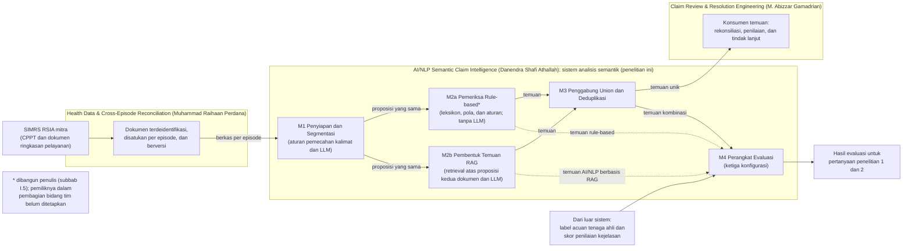

# Bab III — Analisis Masalah dan Rancangan Solusi

> **Status:** `SIAP DITINJAU`. Berkas ini memuat subbab III.1 dan III.2 versi padat (batas 3 halaman, diukur pada render Microsoft Word) dan mengacu pada Bab I resmi yang memuat dua pertanyaan penelitian (`modular/TA1 bab 1.docx`). Kontrak antarblok digabung ke III.2.2 agar batas halaman terpenuhi. Versi lengkap sebelum pemadatan ada di `bab3/arsip/Bab_III_Draft_lengkap.md`. Gambar III.1 dirender dari `tools/render_gambar_III_1.py` ke `bab3/gambar/gambar-III-1.png`; blok Mermaid di bawah adalah sumber diagram yang setara. Daftar pustaka: `bab2/Daftar_Pustaka.md`.

---

## Naskah

## BAB III ANALISIS MASALAH DAN RANCANGAN SOLUSI

## III.1 Analisis Masalah

Resume medis menjadi sumber data pengodean klaim, tetapi ketentuan verifikasi klaim dan pengkajian rekam medis pada subbab I.1 dan II.1 tidak menyebut pemeriksaan kesesuaian isinya dengan catatan perkembangan pasien terintegrasi (CPPT). Di rumah sakit ibu dan anak (RSIA) mitra, pemeriksaan kesiapan dokumen sebelum pengajuan klaim masih manual menurut keterangan pimpinan yang dihimpun tim capstone, sedangkan unit, tahap, dan penanggung jawabnya belum dikonfirmasi. Kondisi yang diharapkan adalah ketidaksesuaian antara CPPT dan dokumen ringkasan pelayanan dalam satu episode teridentifikasi sebelum pengajuan klaim sebagai temuan yang memuat kategori, alasan, rujukan, dan lokasi bukti. Temuan menjadi bahan peninjauan, bukan keputusan klinis atau pengodean otomatis (subbab I.4).

Dietrich dan Stubbert (2026, hlm. 96–98, 100) memeriksa kesalahan sisipan dalam satu catatan pemulangan dan menyebut konsistensi lintas dokumen sebagai arah lanjutan. Zeba dkk. (2026, hlm. 1–4, 15) memeriksa ringkasan buatan model bahasa besar (LLM) dengan putusan biner yang tidak membedakan jenis ketidaksesuaian. Data keduanya berbahasa Inggris. Ijadi Maghsoodi dkk. (2026, hlm. 1, 9) menilai rancangan hibrida paling kredibel pada tugas yang terikat aturan, sensitif terhadap audit, dan bergantung pada alur kerja, tetapi menyebut basis empirisnya terbatas. Di antara sumber pada subbab II.1–II.4 dan ketiga karya itu, belum ada yang menguji kesesuaian CPPT terhadap dokumen ringkasan pelayanan pada teks klinis berbahasa Indonesia ataupun membandingkan pemeriksaan *rule-based*, AI/NLP berbasis *retrieval-augmented generation* (RAG), dan kombinasinya pada data dan label acuan yang sama.

## III.2 Gambaran Umum Solusi

Solusi yang diusulkan adalah sistem analisis semantik yang membentuk temuan ketidaksesuaian dari pasangan CPPT dan dokumen ringkasan pelayanan dalam satu episode. Seluruh pilihan pada Tabel III.1 masih sementara dan belum diuji.

### III.2.1 Alternatif Solusi dan Pemilihannya

Tabel III.1. Keputusan rancangan teknis, alternatif, dan pilihan sementara

| Keputusan rancangan | Alternatif | Pilihan sementara, alasan, dan *trade-off* |
| --- | --- | --- |
| Satuan pembanding (M1) | Dokumen utuh; bagian SOAP; proposisi atomik | Proposisi atomik. Dokumen utuh tidak menunjuk entri bukti; bagian SOAP dapat memuat beberapa pernyataan. Proposisi dinilai satu per satu (Zeba dkk., 2026, hlm. 2, 4), tetapi segmentasi dapat keliru. |
| Pembentukan temuan (M2a, M2b) | LLM tanpa *retrieval*; RAG; RAG dengan graf pengetahuan | RAG atas proposisi kedua dokumen. *Retrieval* dapat diamati dan rujukan asli cepat ditemukan (Gao, Xiong, dkk., 2023, hlm. 14). RAG tidak dianggap menghilangkan halusinasi; perbandingannya dengan LLM tanpa *retrieval* tidak dijawab penelitian ini (subbab I.4). Graf pengetahuan memerlukan pengetahuan pakar (Murali dkk., 2023, hlm. 1). |
| Penggabungan temuan (M3) | *Union*; irisan (*intersection*); pemungutan suara berbobot (*weighted voting*) | *Union* dengan deduplikasi. Irisan membuang temuan yang hanya dihasilkan satu komponen; pemungutan suara berbobot memerlukan kalibrasi pada data berlabel. *Recall* tidak lebih rendah daripada komponen terbaik selama deduplikasi tidak menggabungkan dua temuan berbeda, tetapi *precision* dapat turun. |
| Pengukuran (M4) | Pencocokan satu-ke-satu; penilaian per episode | Pencocokan satu-ke-satu dengan label acuan. Unit evaluasi adalah temuan, dan satu episode dapat memuat beberapa temuan (subbab I.4). Aturan kecocokan ditetapkan sebelum pengujian (subbab I.3). Hasil dibaca sebagai kinerja konfigurasi, bukan kinerja tiap teknik. |

### III.2.2 Modul, Diagram Blok Capstone, dan Kontrak Antarblok

Gambar III.1 menempatkan modul itu di antara bagian capstone lain. Karena M1 dipakai bersama, konfigurasi *rule-based* ikut memakai LLM saat segmentasi. Jadi, pertanyaan penelitian 1 membandingkan cara pembentukan temuan pada proposisi yang sama, bukan sistem tanpa LLM dengan sistem yang memakai LLM. M2a dibangun penulis (subbab I.5) [MENUNGGU KEPUTUSAN TIM: pemilik M2a].

M3 hanya menyatukan temuan dari satu pemeriksaan; rekonsiliasi sesudahnya ditangani bagian *Claim Review & Resolution Engineering* (subbab I.4). Kontrak masukan adalah berkas terdeidentifikasi per episode berisi kedua dokumen, pengenal versi, cap waktu pengajuan klaim, dan kode kelompok pasien tersamar (subbab I.5). Kontrak keluaran adalah skema temuan berisi kategori, objek informasi, konteks kejadian, kutipan dan lokasi bukti, alasan, serta komponen asal [MENUNGGU KEPUTUSAN TIM: kontrak antarblok].

Gambar III.1. Diagram blok capstone dan penanggung jawab tiap bagian

### III.2.3 Langkah Pengembangan dan Kakas

Tabel III.2 merinci tahap pembangunan pemeriksaan (subbab I.5) pada data pengembangan; jadwalnya ada pada Bab IV. Kakas pengembangan adalah Python dengan pustaka pemrosesan teks, *embedding*, penyimpanan vektor, dan statistik serta sistem kendali versi. Pilihan LLM lokal atau *cloud* mengikuti kebijakan pemrosesan data [MENUNGGU KONFIRMASI PEMBIMBING: kebijakan LLM].

Tabel III.2. Langkah pengembangan dan keluarannya

| Langkah | Aktivitas teknis | Keluaran |
| --- | --- | --- |
| 1. Definisi dan kontrak | Menetapkan format berkas masukan [DATA BELUM TERSEDIA: format ekspor SIMRS], definisi operasional kategori (termasuk kriteria *omission*), dan skema temuan sebelum pelabelan data uji | Definisi kategori dan kontrak antarblok |
| 2. Modul M1 | Menyusun pengurai dokumen, pemilihan versi, aturan pemecahan kalimat, dan *prompt* pemecah proposisi yang mewarisi posisi kalimat asalnya | Proposisi beserta posisinya |
| 3. Modul M2a dan M2b | Menyusun leksikon, pola, dan aturan M2a; membangun *retrieval* leksikal dan *embedding* serta *prompt* M2b dengan kutipan bukti wajib. Perbaikan dinilai lewat pemeriksaan informal penulis (rentan bias; angkanya tidak dilaporkan) | Temuan sesuai dengan skema temuan |
| 4. Modul M3 dan M4 | Membangun penggabung dan perangkat evaluasi; menguji integrasi M1–M4 dengan temuan tumpang tindih buatan | Temuan unik dan perangkat evaluasi |
| 5. Pembekuan | Membekukan LLM beserta versi dan parameter *decoding*-nya, model *embedding*, aturan pemecahan kalimat, *prompt*, parameter *retrieval*, leksikon dan aturan M2a, serta kriteria deduplikasi sebelum data uji dipakai | Catatan konfigurasi berversi |
