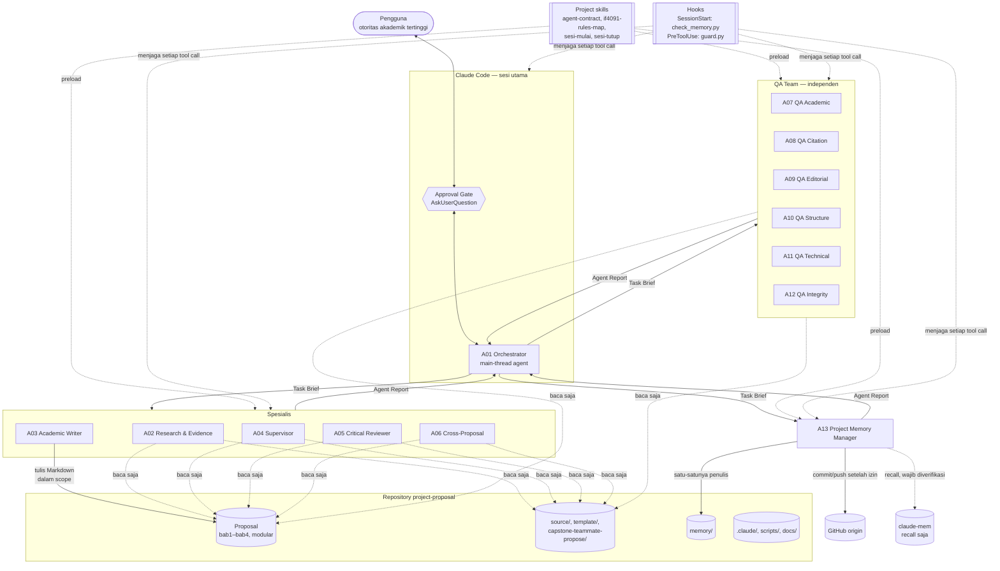
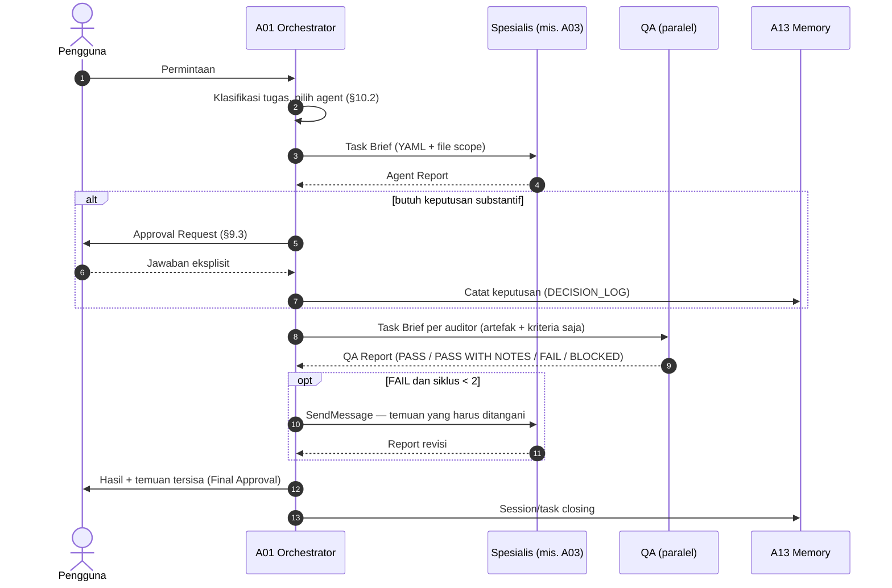
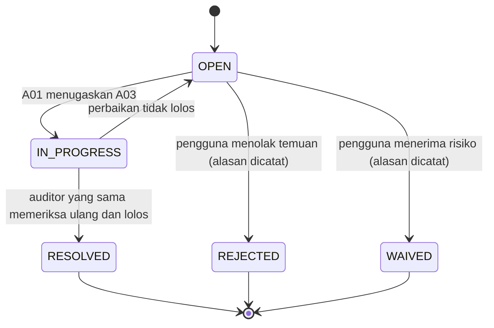
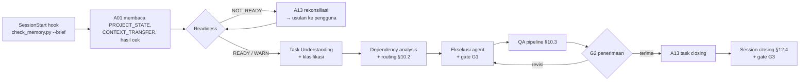
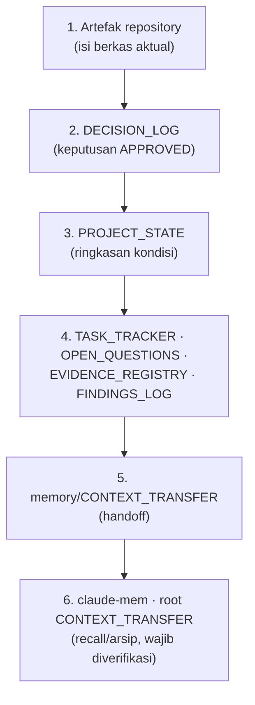

# Arsitektur Orkestrasi 13 Fixed Agents — Proposal Tugas Akhir Capstone IF4091

| Atribut | Nilai |
|---|---|
| Versi dokumen | 0.6 (catatan implementasi Phase 3; changelog di Lampiran B) |
| Tanggal | 5 November 2026 |
| Status dokumen | `SIAP DITINJAU`. Seluruh keputusan desain sudah diputuskan pengguna (§19, bukti di Lampiran C); implementasi belum dimulai |
| Lingkungan terverifikasi | Claude Code 2.1.316, Windows 11 (Git Bash), ekstensi VS Code, Python 3.13/3.14, `pdftotext`, `pdfinfo`, LibreOffice |
| Dasar audit | Laporan Phase 0 (5 November 2026) |

**Status keputusan dalam dokumen ini:**

- `APPROVED`: sudah ditetapkan pengguna.
- `PROPOSED`: rekomendasi yang masih menunggu persetujuan.
- `PENDING`: belum dapat diputuskan.
- `DEFERRED`: sengaja ditunda.

**Status verifikasi fitur:**

- `VERIFIED-DOC`: dipastikan dari dokumentasi resmi.
- `NEEDS_VERIFICATION`: perlu diuji setelah implementasi.

Dokumen ini hanya merancang. Isi proposal tidak diubah, dan tidak ada commit maupun push selama Phase 1.

---

## 1. Ringkasan keputusan

| ID | Keputusan | Status |
|---|---|---|
| A-01 | Platform Claude Code; 13 fixed specialized agents; hybrid autonomy; pengguna sebagai otoritas akademik tertinggi | `APPROVED` |
| A-02 | Agent 01 berjalan di sesi utama, Agent 02–13 sebagai subagent | `APPROVED` secara prinsip, menunggu bentuk teknis (A-03) |
| A-03 | Agent 01 didefinisikan sebagai `.claude/agents/a01-orchestrator.md` dan dijalankan sebagai *main-thread agent* (`claude --agent a01-orchestrator`). Fallback-nya skill `/orkestrasi` bila tidak didukung di VS Code | `APPROVED` bersyarat uji T-01 (D-01) |
| A-04 | Topologi *hub-and-spoke*: hanya Orchestrator yang memanggil agent; subagent tidak boleh memanggil subagent (`CLAUDE_CODE_MAX_SUBAGENT_SPAWN_DEPTH=1` dan tool `Agent` tidak diberikan ke subagent) | `APPROVED` (D-02) |
| A-05 | Persistent memory berupa berkas Markdown di `memory/` yang di-commit ke GitHub; `claude-mem` hanya alat bantu recall; tanpa database | `APPROVED` (D-04) |
| A-06 | Isolasi CLAUDE.md induk IF4071 lewat `claudeMdExcludes` di `.claude/settings.local.json`, ditambah `omitClaudeMd: true` pada subagent | `APPROVED` bersyarat uji T-02/T-03 (D-03) |
| A-07 | Penjaga izin deterministik: hook `PreToolUse` → `scripts/guard.py`, membaca `agent_type` dan kebijakan tunggal `.claude/policy/write_scopes.json` | `PROPOSED` (bagian dari implementasi D-03/D-10) |
| A-08 | `.gitignore` mengecualikan `RSIA-source/` agar tidak ter-commit. **Bukan** mekanisme pengamanan akses (§8) | `APPROVED`, sudah dibuat dan diverifikasi |
| A-15 | Agent boleh membaca dan memakai `RSIA-source/` sesuai kebutuhan tugas dan Task Brief. Berkas asli tidak boleh diubah; data turunan disimpan di `.scratch/rsia/`; tanpa pengenal di keluaran; tidak pernah di-stage (§8.2, R-1–R-8) | `APPROVED` (D-17, menggantikan D-10) |
| A-16 | Satu repository utama untuk seluruh proyek. Worktree setup bukan repository terpisah (§15.2) | `APPROVED` (D-18) |
| A-09 | Single-writer untuk memory: hanya Agent 13 yang menulis `memory/**`. Agent 13 adalah administrator pencatatan, bukan pemilik otoritas keputusan (§9.6) | `APPROVED` (D-04, revisi B.3) |
| A-10 | Siklus revisi otomatis maksimal 2 kali, lalu eskalasi ke pengguna | `APPROVED` (D-06) |
| A-11 | Konflik K1–K7 dicatat sebagai `PENDING` dan tidak diselesaikan sistem | `APPROVED` |
| A-12 | Tidak ada commit/push tanpa approval. Implementasi memakai **Git worktree terpisah** dari commit bersih, staging per path eksplisit, tanpa `git add -A`, tanpa force push (§15) | `APPROVED` (D-13, revisi B.2) |
| A-13 | Agent Report memisahkan `execution_status` dari `qa_status` | `APPROVED` (revisi B.5) |
| A-14 | Pencatatan kinerja sederhana: hook `SubagentStart`/`SubagentStop` menulis jejak mentah lokal; A13 merangkumnya ke bagian *Run Log* di `TASK_TRACKER` (§12.6) | `PROPOSED` (memenuhi revisi B.6) |

---

## 2. Hasil verifikasi fitur native Claude Code

Sumber: dokumentasi resmi di `code.claude.com/docs/en/` (halaman `sub-agents`, `memory`, `skills`, `hooks`, `settings`, `settings-reference`, `permissions`, `sandboxing`, `vs-code`), diakses 5 November 2026.

| Fitur | Temuan | Status | Dampak pada rancangan |
|---|---|---|---|
| Lokasi subagent | `.claude/agents/` (project) prioritas 3, `~/.claude/agents/` prioritas 4. Wajib `name` dan `description` | `VERIFIED-DOC` | 13 berkas di `.claude/agents/` agar ikut repo |
| Frontmatter subagent | `tools`, `disallowedTools`, `model`, `permissionMode`, `maxTurns`, `skills`, `hooks`, `memory`, `omitClaudeMd`, `effort`, `color`, `background`, `isolation` | `VERIFIED-DOC` | Identitas dan batas tiap agent dinyatakan di frontmatter |
| Subagent memanggil subagent | **Bisa**, sampai 3 lapis di bawah sesi utama. Diatur dengan `CLAUDE_CODE_MAX_SUBAGENT_SPAWN_DEPTH`; nilai `1` mematikan nesting | `VERIFIED-DOC` | Asumsi Phase 0 ("tidak bisa") **keliru**. Nesting sengaja dimatikan (A-04) |
| Konteks subagent | Jendela konteks sendiri. Subagent tidak melihat riwayat percakapan; menerima prompt delegasi, CLAUDE.md (kecuali `omitClaudeMd`), git status, dan skill dari `skills` | `VERIFIED-DOC` | Konteks dikirim lewat *Task Brief* (§5) |
| Hasil subagent | Kembali ke sesi utama sebagai ringkasan. Transkrip lengkap disimpan lokal di `~/.claude/projects/.../subagents/` dan dihapus setelah 30 hari | `VERIFIED-DOC` | Laporan agent yang perlu awet dicatat Agent 13 ke `memory/` |
| Melanjutkan subagent | `SendMessage` dengan ID/nama agent; riwayat lengkap dipertahankan. Tidak memerlukan *agent teams*. Agent bawaan Explore/Plan tidak bisa dilanjutkan. Agent yang dihentikan pengguna (`x` di `/tasks`) menolak pesan | `VERIFIED-DOC` | Dipakai untuk siklus revisi Writer dan wawancara Supervisor |
| `SendMessage` di sesi main-thread agent dengan allowlist `tools` | Dokumentasi tidak menyatakan apakah `SendMessage` (dan `AskUserQuestion`) tetap tersedia bila tidak tercantum di `tools` A01. Di lingkungan ini keduanya termasuk *deferred tool* yang skemanya dimuat lewat `ToolSearch` | `NEEDS_VERIFICATION` | Uji T-08/T-09. Fallback §5.4 |
| Payload hook `SubagentStart`/`SubagentStop` | Hook di dalam subagent menerima `agent_id` dan `agent_type`. Isi persis payload `SubagentStop` (mis. path transkrip) belum dibaca | `NEEDS_VERIFICATION` | Uji T-10 sebelum `Run Log` bergantung padanya |
| `permissions.blockReadsOutsideWorkingDirectories` | Tool file bawaan menolak membaca di luar direktori kerja; nilai `true` dari scope mana pun dihormati. Tersedia sejak v2.1.257. Tidak membatasi skrip | `VERIFIED-DOC` | **Tidak dipakai**: data RSIA tetap di repo (D-17) |
| `ask` rule di auto mode | Urutan evaluasi deny → ask → allow. Apakah `ask` tetap memunculkan prompt saat sesi berada di auto mode belum dinyatakan eksplisit | `NEEDS_VERIFICATION` | Uji T-14; dipakai untuk gate deterministik `git commit`/`git push` |
| Git worktree | `git worktree add` membuat working tree terpisah dari commit tertentu; berkas untracked/ignored tidak ikut. Untuk sesi di worktree, `.claude/settings.local.json` dibaca dari root checkout utama (dokumentasi `settings`) | `VERIFIED-DOC` | Isolasi setup (§15) |
| Main-thread agent | `claude --agent <name>` atau `"agent"` di settings. Prompt agent **menggantikan** system prompt bawaan; CLAUDE.md tetap dimuat; `omitClaudeMd` diabaikan; `Agent(a, b)` di `tools` menjadi allowlist | `VERIFIED-DOC` | Agent 01 dibatasi hanya bisa memanggil Agent 02–13 |
| Main-thread agent di ekstensi VS Code | Dokumentasi VS Code tidak menyebutnya | `NEEDS_VERIFICATION` | Uji T-01. Fallback: terminal terintegrasi atau skill `/orkestrasi` |
| `claudeMdExcludes` | Melewati berkas CLAUDE.md tertentu berdasarkan glob path absolut; bisa diletakkan di `.claude/settings.local.json` | `VERIFIED-DOC` | Mengisolasi CLAUDE.md induk tanpa menyentuhnya |
| Exclude untuk import `@` milik berkas induk | Tidak dinyatakan eksplisit untuk CLAUDE.md | `NEEDS_VERIFICATION` | Uji T-02 dengan `/memory` atau `/context all` |
| `.claude/rules/` dengan `paths` | Aturan dimuat saat berkas yang cocok dibaca atau diedit | `VERIFIED-DOC` | `DEFERRED`: memerlukan pemecahan RULES.md (perubahan instruksi) |
| Ukuran CLAUDE.md | Disarankan < 200 baris; berkas dimuat penuh sampai 4 MiB | `VERIFIED-DOC` | CLAUDE.md proyek 662 baris (94 KB). Pemangkasan `PENDING` (D-09) |
| Skills | `.claude/skills/<nama>/SKILL.md`. Deskripsi selalu di konteks, isi penuh dimuat saat dipanggil. Frontmatter: `disable-model-invocation`, `user-invocable`, `allowed-tools`, `context: fork`, `agent`, `paths` | `VERIFIED-DOC` | Kontrak bersama dan prosedur sesi dijadikan skill |
| `.claude/commands/` | Masih didukung, tetapi sudah digabung ke skills | `VERIFIED-DOC` | Tidak dipakai; cukup skills |
| Hooks | Event yang relevan: `SessionStart`, `PreToolUse`, `SubagentStart`, `SubagentStop`, `Stop`, `InstructionsLoaded`. `PreToolUse` dapat memblokir lewat exit code 2 atau `permissionDecision: deny`. Input hook di dalam subagent memuat `agent_id` dan `agent_type` | `VERIFIED-DOC` | Penjaga izin per agent bisa dibuat deterministik |
| Hook di Windows | Default shell `bash` = Git Bash di Windows | `VERIFIED-DOC` | `python scripts/guard.py` bisa dipanggil dari hook |
| Mode izin subagent | Jika sesi utama berada di `auto`, `acceptEdits`, atau `bypassPermissions`, subagent mengikuti mode itu dan mengabaikan `permissionMode` sendiri | `VERIFIED-DOC` | Sesi Anda berada di auto mode, jadi batas tulis **wajib** lewat hook dan deny rule, bukan mode izin |
| Deny rule `Read`/`Edit` | Berlaku untuk tool bawaan dan perintah Bash yang dikenali (`cat`, `head`, `sed`, redirection). **Tidak** berlaku untuk skrip Python/Node yang membuka berkas sendiri | `VERIFIED-DOC` | Deny `Edit` melindungi berkas asli RSIA dari penulisan oleh tool bawaan; tidak ada deny `Read` (D-17, §8.3) |
| Sandbox OS-level | Hanya macOS, Linux, dan WSL2. Windows native berjalan tanpa sandbox | `VERIFIED-DOC` | Tidak bisa diandalkan di mesin ini |
| `memory` pada subagent | Direktori memory per agent di `.claude/agent-memory/<nama>/` | `VERIFIED-DOC` | Tidak dipakai (§12.1) |
| `permissions.deny` dengan `Agent(name)` | Memblokir subagent tertentu | `VERIFIED-DOC` | Dipakai hanya pada mode fallback |

---

## 3. Arsitektur keseluruhan



**Prinsip arsitektur:**

1. **Satu pintu ke pengguna.** Hanya A01 yang berkomunikasi langsung dengan pengguna. Pertanyaan dari A04 atau temuan yang membutuhkan keputusan diteruskan A01 apa adanya.
2. **Satu pintu delegasi.** Subagent tidak memanggil subagent lain. Semua handoff melewati A01, sehingga alurnya dapat dilacak.
3. **Satu penulis per kelas artefak.** Teks proposal hanya ditulis A03, memory hanya ditulis A13, dan agent lain hanya membaca.
4. **Penegakan deterministik di atas instruksi.** Batas yang tidak boleh dilanggar ditegakkan oleh hook, deny rule, dan `.gitignore`. Prompt agent hanya menjelaskan batas tersebut, bukan satu-satunya penjaga.
5. **Repository sebagai kebenaran.** Memory adalah ringkasan yang selalu dicocokkan ulang dengan artefak aktual (§12).

---

## 4. Identitas agent dan batas tanggung jawab

### 4.1 Jaminan tetap 13 fixed agents

| Mekanisme | Cara kerja |
|---|---|
| Berkas tetap | Tepat 13 berkas `.claude/agents/aNN-<peran>.md` dengan `name` unik (`a01-orchestrator` … `a13-memory-manager`) |
| Allowlist pemanggilan | Frontmatter A01: `tools: Agent(a02-research-evidence, …, a13-memory-manager), …`. Agent bawaan (`general-purpose`, `Explore`, `Plan`) tidak dapat dipanggil dari sesi orkestrasi |
| Tanpa nesting | `env.CLAUDE_CODE_MAX_SUBAGENT_SPAWN_DEPTH = "1"` di `.claude/settings.json`, dan tool `Agent` tidak tercantum di `tools` A02–A13 |
| Pemeriksaan statis | `scripts/check_agents.py` memastikan 13 berkas ada, ID unik, frontmatter wajib terisi, tidak ada agent ke-14, dan setiap agent memiliki bagian *Batas* serta *Kontrak keluaran* |
| Identitas dalam keluaran | Setiap *Agent Report* wajib memuat `agent_id`. Hook `SubagentStart` dan `SubagentStop` mencatat `agent_type` (opsional, §12.5) |

### 4.2 Roster dan batas inti

| ID | `name` | Tanggung jawab inti | Tidak boleh | Tulis | Model (usulan) |
|---|---|---|---|---|---|
| A01 | `a01-orchestrator` | Memahami permintaan, memecah tugas, routing, approval gate, konsolidasi | Menulis proposal; menulis memory; memberi penilaian QA; menjawab pertanyaan akademik atas nama pengguna | Tidak ada | `inherit` (opus) |
| A02 | `a02-research-evidence` | Menelusuri sumber primer, membaca PDF, mengekstrak bukti per halaman, memverifikasi metadata | Menulis naskah; menyatakan dukungan tanpa bukti halaman | `tools/claims_*.json`, `.scratch/**` | opus |
| A03 | `a03-academic-writer` | Menulis/merevisi Markdown proposal berdasarkan bukti terverifikasi dan keputusan `APPROVED` | Menambah klaim/metode tanpa keputusan; mengarang sumber; menilai tulisannya sendiri sebagai lolos | `bab1/…bab4/**/*.md`; menjalankan `tools/build_*.py` | opus |
| A04 | `a04-supervisor` | Simulasi pembimbing: pertanyaan substantif, uji alur argumen dan keterkaitan Bab I | Menjawab pertanyaannya sendiri; menulis teks; selalu setuju | Tidak ada | opus |
| A05 | `a05-critical-reviewer` | *Devil's advocate*: membantah argumen, mencari *overclaim*, celah logika, asumsi tersembunyi | Mengusulkan arah baru sebagai keputusan; memberi rekomendasi pembimbingan (itu peran A04) | Tidak ada | opus |
| A06 | `a06-cross-proposal` | Konsistensi internal, antarproposal anggota, dan terhadap acuan kelompok | Mengubah dokumen anggota lain; memutuskan konflik tim | `.scratch/**` | sonnet |
| A07 | `a07-qa-academic` | Kekuatan argumen, *research gap*, keselarasan masalah–tujuan–solusi | Memperbaiki teks | Tidak ada | opus |
| A08 | `a08-qa-citation` | Kecocokan klaim–sumber–halaman, metadata, sitasi teks, daftar pustaka | Memperbaiki teks; mengubah gaya sitasi (K1 `PENDING`) | `.scratch/**` | sonnet |
| A09 | `a09-qa-editorial` | Ejaan, morfologi, kalimat efektif, paragraf, pola AI slop (RULES.md §6, §8.5) | Memperbaiki teks; menormalkan kutipan atau data autentik | Tidak ada | opus |
| A10 | `a10-qa-structure` | Struktur bab/subbab sesuai templat Individu, penomoran, ketentuan formal | Menyamakan contoh dengan ketentuan resmi | `.scratch/**` | sonnet |
| A11 | `a11-qa-technical` | Kelayakan metode, metrik yang terukur, alur sistem, justifikasi teknologi | Mengusulkan desain baru sebagai final | Tidak ada | opus |
| A12 | `a12-qa-integrity` | Integritas Markdown, docx, dan pdf: tabel, caption, rujukan silang, halaman kosong, truncation, kecocokan sumber dengan hasil ekspor | Memperbaiki dokumen | `.scratch/**` | sonnet |
| A13 | `a13-memory-manager` | Status proyek, keputusan, tugas, isu terbuka, registry bukti, temuan, handoff, sinkronisasi Git | Mengubah keputusan akademik; menimpa catatan yang bertentangan tanpa rekonsiliasi; mengklaim push berhasil sebelum diverifikasi | `memory/**`; staging per path eksplisit | sonnet |

Pemilihan model dicatat sebagai keputusan D-07. Spesifikasi lengkap 16 butir per agent dikerjakan di Phase 2 (`docs/AGENT_SPECIFICATIONS.md`).

### 4.3 Pemisahan peran yang rawan tumpang tindih

| Pasangan | Pembeda tegas |
|---|---|
| A04 vs A05 | A04 **membimbing**: bertanya untuk mematangkan dan mengarahkan pengguna. A05 **membantah**: berusaha menggugurkan klaim secara independen. Keduanya menerima brief terpisah dan tidak melihat laporan satu sama lain sebelum selesai |
| A05 vs A07 | A05 menyerang argumen tanpa daftar periksa. A07 menilai terhadap kriteria tetap (RULES.md §7, §8.2) dan memberi status `PASS/FAIL` |
| A02 vs A08 | A02 **mencari dan mengekstrak** bukti sebelum menulis. A08 **mengaudit** naskah jadi terhadap bukti. A08 tidak memakai catatan A02 sebagai kebenaran; ia memeriksa ulang ke PDF |
| A06 vs A07 | A06 membandingkan antar dokumen. A07 menilai mutu di dalam satu dokumen |
| A10 vs A12 | A10 menilai kepatuhan isi terhadap aturan struktur. A12 menilai kerusakan teknis berkas |
| A01 vs semua | A01 tidak menghasilkan substansi. Jika A01 merangkum, ringkasan itu bukan temuan baru |

---

## 5. Protokol komunikasi dan handoff

### 5.1 Topologi



### 5.2 Format kontrak

**Format yang dipilih:** blok YAML di awal pesan, diikuti Markdown (`PROPOSED`).

Alasannya:

1. Antarmuka native Claude Code adalah teks prompt dan teks ringkasan. Tidak ada saluran JSON terstruktur antara agent.
2. YAML dapat dibaca manusia saat ditinjau, sekaligus dapat diurai `scripts/` bila perlu.
3. JSON murni rapuh ditulis model untuk isi panjang (escape kutipan Bahasa Indonesia).
4. Markdown setelah YAML memberi ruang untuk penjelasan bukti.

Kontrak ditulis **sekali** di skill `agent-contract` dan dipreload ke A02–A13, tidak disalin ke 13 berkas agent.

**Task Brief (A01 → agent):**

```yaml
task_id: TSK-012
agent_id: a08-qa-citation
type: qa_audit             # research | write | revise | interview | review | qa_audit | consistency | memory_op
objective: "Audit kecocokan klaim–sumber–halaman pada bab2/Bab_II_Revisi_Notulensi.md bagian II.3"
inputs:                    # HANYA berkas/bagian ini yang boleh dibaca tanpa izin tambahan
  - path: bab2/Bab_II_Revisi_Notulensi.md
    section: "## II.3"     # anchor heading; agent membaca dengan offset/limit
  - path: source/INDEKS.md
approved_decisions: [D-003, D-011]   # keputusan APPROVED yang menjadi batas kerja
constraints:
  - "Gaya sitasi K1 masih PENDING: jangan menandai format sitasi sebagai FAIL"
write_scope: []            # kosong = read-only; harus subset dari write_scopes.json
sensitive_access: null     # mis. {source: rsia, scope: "data pending Mei 2026", reason: "..."}; null = tidak membuka RSIA (§8.2 R-1)
external_lookup: off       # off | metadata — hanya dengan izin pengguna untuk tugas ini (P2-01)
claims_changed: false      # true bila ada klaim utama baru/berubah → memicu A05 pada R1 (P2-05)
budget: {max_findings: 20, report_tokens: 1500}
cycle: 0                   # 0 = pertama; 1–2 = revisi otomatis
return_to: a01-orchestrator
```

**Agent Report (agent → A01):**

```yaml
agent_id: a08-qa-citation
task_id: TSK-012
execution_status: COMPLETE # COMPLETE | PARTIAL | BLOCKED | FAILED — apakah tugas selesai dikerjakan
qa_status: FAIL            # PASS | PASS_WITH_NOTES | FAIL | BLOCKED | NOT_APPLICABLE — hasil audit (hanya A07–A12)
summary: "14 klaim dicek; 11 cocok, 2 halaman salah, 1 sumber tidak ada di repo."
inputs: [bab2/Bab_II_Revisi_Notulensi.md#II.3, source/INDEKS.md]
artifacts_created: []
findings:                  # format §5.3
  - {id: F-A08-0031, severity: HIGH, location: "bab2/Bab_II_Revisi_Notulensi.md:142", ...}
open_questions:
  - "PDF Maleki dkk. (2026) belum ada di repo; unggah atau keluarkan klaimnya?"
requires_user_approval: false
skills_used: []            # nama skill dan tujuannya, bila ada
metrics: {files_read: 3, pdf_pages_checked: 9, retries: 0}   # hitungan yang dapat diketahui agent sendiri
handoff_to: [a03-academic-writer]   # USULAN; keputusan routing tetap di A01
next_action: "A03 memperbaiki dua nomor halaman; A02 mencari PDF Maleki"
```

**Aturan kombinasi status:**

| `execution_status` | `qa_status` yang sah | Makna |
|---|---|---|
| `COMPLETE` | `PASS` · `PASS_WITH_NOTES` · `FAIL` (QA); `NOT_APPLICABLE` (non-QA) | Pemeriksaan atau tugas selesai; hasil audit bisa lolos atau gagal |
| `PARTIAL` | `BLOCKED` (QA); `NOT_APPLICABLE` (non-QA) | Sebagian scope tidak selesai (mis. `maxTurns`). Auditor tidak boleh memberi `PASS` atas scope parsial |
| `BLOCKED` | `BLOCKED` (QA); `NOT_APPLICABLE` (non-QA) | Data atau akses tidak tersedia |
| `FAILED` | `BLOCKED` (QA); `NOT_APPLICABLE` (non-QA) | Kegagalan eksekusi (error tool, keluaran tak terurai) |

A01 hanya membaca `qa_status` untuk exit criteria (§10.3) dan hanya membaca `execution_status` untuk retry atau eskalasi (§11). Kombinasi di luar tabel dianggap laporan tidak valid dan diminta ulang sekali.

### 5.3 Format temuan QA

| Field | Isi |
|---|---|
| `id` | `F-<agent>-<nomor urut 4 digit>`, unik sepanjang proyek |
| `agent_id` | Agent penemu |
| `location` | `path:line` atau `path#heading`, untuk docx berupa `path › paragraf n` |
| `description` | Masalah dalam satu kalimat |
| `severity` | `CRITICAL` · `HIGH` · `MEDIUM` · `LOW` · `INFO` |
| `evidence` | Kutipan naskah dan dasar aturan (mis. "RULES.md §8.2 no. 3") atau halaman sumber |
| `recommendation` | Tindakan; bukan teks pengganti siap tempel untuk isu substantif |
| `requires_decision` | `true` bila perbaikannya menyentuh kelas keputusan L2/L3 (§9.1) |
| `status` | `OPEN` · `IN_PROGRESS` · `RESOLVED` · `REJECTED` · `WAIVED` |



`RESOLVED` hanya boleh ditetapkan oleh **auditor penemu** setelah pemeriksaan ulang, bukan oleh A03. `REJECTED` dan `WAIVED` hanya boleh ditetapkan oleh pengguna.

### 5.4 Aturan handoff

1. Field `handoff_to` hanya **usulan**. A01 yang memutuskan dan wajib menyebut alasannya di brief berikutnya.
2. Agent penerima tidak menerima laporan mentah agent sebelumnya. Ia hanya menerima temuan atau bukti yang relevan, agar independensi QA terjaga.
3. Pertanyaan A04 untuk pengguna diteruskan A01 **apa adanya** (verbatim) melalui `AskUserQuestion`. Jawabannya dikembalikan ke A04 lewat `SendMessage` agar konteks wawancara utuh.
4. Siklus revisi memakai `SendMessage` ke instance A03 yang sama, sehingga A03 tidak perlu membaca ulang seluruh konteks.

### 5.5 Ketergantungan pada `SendMessage` dan fallback

Butir 3 dan 4 bergantung pada kemampuan A01 melanjutkan instance subagent. Ketersediaannya di sesi main-thread agent dengan allowlist `tools` belum terverifikasi (§2). Karena itu frontmatter A01 mencantumkan `SendMessage`, `AskUserQuestion`, dan `ToolSearch` secara eksplisit, dan uji berikut wajib lolos sebelum mekanisme ini dipakai:

| Uji | Yang dibuktikan | Kriteria lolos |
|---|---|---|
| T-08 | A01 dapat melanjutkan subagent bernama lewat `SendMessage` | Instance yang dilanjutkan dapat menyebut isi Task Brief pertamanya tanpa diberi ulang |
| T-09 | `SendMessage` dan `AskUserQuestion` tersedia di sesi `claude --agent a01-orchestrator` | Kedua tool muncul dan dapat dipanggil |
| T-15 | Hook `PreToolUse` (guard) tetap berlaku pada instance yang dilanjutkan | Percobaan menulis di luar scope pada giliran lanjutan tetap ditolak |

**Fallback bila T-08 atau T-09 gagal:** A01 memanggil instance **baru** dari agent yang sama dengan *revision packet*. Isinya:

- Task Brief asli.
- Path artefak hasil siklus sebelumnya.
- Temuan yang harus ditangani.
- Jawaban pengguna (verbatim).

Fallback ini lebih mahal karena konteks dibaca ulang, tetapi tidak mengubah topologi maupun jumlah agent. Untuk wawancara A04, setiap putaran memuat seluruh riwayat tanya-jawab sebelumnya.

---

## 6. Context isolation dan token management

### 6.1 Masalah yang ditangani

| Sumber beban | Ukuran | Dimuat oleh |
|---|---|---|
| `Semester 7/CLAUDE.md` (IF4071) + `@SPECIFICATION.md` + `@RULES.md` induk | ± 87 KB | Setiap sesi dan setiap subagent (bawaan) |
| `CLAUDE.md` proyek | 94 KB | Setiap sesi dan setiap subagent (bawaan) |
| `RULES.md` proyek | 204 KB | Dibaca bila diperintahkan |
| Berkas proposal dan sumber | DRAFT 6 Bab II 58 KB; 143 PDF | Bila dibaca |

Tanpa isolasi, 12 subagent yang dipanggil akan memuat ± 180 KB instruksi masing-masing sebelum mulai bekerja, termasuk instruksi korpus Bahasa Jawa yang tidak relevan.

### 6.2 Lapisan isolasi

| Lapisan | Mekanisme | Status |
|---|---|---|
| L1 Isolasi CLAUDE.md induk di sesi utama | `.claude/settings.local.json` (tidak di-commit, karena path-nya khas mesin ini): `"claudeMdExcludes": ["**/Semester 7/CLAUDE.md", "**/Semester 7/RULES.md", "**/Semester 7/SPECIFICATION.md"]`. Pola ini tidak cocok dengan `…/IF4091 Penyusunan Proposal/RULES.md`. Berkas induk tidak disentuh | `PROPOSED`, uji T-02 |
| L2 Subagent tanpa CLAUDE.md | `omitClaudeMd: true` pada A02–A13. Ini sekaligus membuang CLAUDE.md induk dan CLAUDE.md proyek 94 KB dari konteks subagent | `PROPOSED` |
| L3 Aturan yang dibutuhkan saja | Skill `if4091-rules-map` dipreload: **peta** (bukan salinan) dari jenis tugas ke heading `RULES.md` dan `CLAUDE.md` yang wajib dibaca. Contoh: A09 → RULES.md §6.1–6.10 dan §8.5; A07 → RULES.md §3, §7, §8 | `PROPOSED` |
| L4 Scope berkas | Task Brief menyebut `inputs` dengan anchor heading. Agent membaca dengan `Grep` (mencari baris heading) dan `Read` (`offset`/`limit`). Membaca berkas di luar `inputs` dianggap permintaan konteks tambahan dan dilaporkan di `open_questions` | `PROPOSED` |
| L5 Larangan baca penuh | `RULES.md`, `CLAUDE.md`, dan PDF tidak boleh dibaca utuh. PDF dibaca per halaman lewat `pdftotext -f N -l N` ke `.scratch/` | `PROPOSED` |
| L6 Anggaran keluaran | `budget.report_tokens` (bawaan 1.500) dan `max_findings` (bawaan 20, urut severity; sisanya dihitung saja) | `PROPOSED` |
| L7 Batas putaran | `maxTurns` per agent (usulan awal: A02/A03 = 60, QA = 40, A13 = 40), dikalibrasi setelah uji | `PROPOSED` |
| L8 Pemilihan agent | Routing table (§10.2) memanggil hanya agent yang relevan; QA dipilih per jenis perubahan | `PROPOSED` |

**Trade-off L2.** Dengan `omitClaudeMd`, subagent tidak otomatis menerima aturan CLAUDE.md. Risikonya, aturan penting terlewat jika peta di `if4091-rules-map` tidak lengkap. Mitigasinya: setiap baris peta menunjuk heading sumber asli (tanpa salinan, sehingga tidak ada drift), dan `check_agents.py` memeriksa bahwa setiap heading yang dirujuk masih ada di RULES.md/CLAUDE.md.

**Catatan sesi utama.** Main-thread agent tetap memuat CLAUDE.md proyek (94 KB), dan perilaku ini tidak dapat diubah dengan `omitClaudeMd`. Penghematan di sesi utama hanya datang dari L1 dan dari pemangkasan CLAUDE.md di masa depan (D-09, `PENDING`).

---

## 7. Arsitektur izin

### 7.1 Kelas artefak

| Kelas | Isi | Siapa boleh menulis |
|---|---|---|
| **P0 Tanpa tulis** | `capstone-teammate-propose/**`, `template/**`, `material/**` (baca hanya A10, P2-03), `source/**`, PDF/docx di root, `Penyelarasan Pemahaman Capstone.md` | Tidak ada agent |
| **P0-S Data sensitif sumber** | `RSIA-source/**`. Baca sesuai kebutuhan dan Task Brief (D-17, §8.2); tidak pernah diubah atau di-stage | Tidak ada agent (turunan ke `.scratch/rsia/`) |
| **P1 Substansi proposal** | `bab1/`–`bab4/**/*.md`; docx di `modular/` hanya lewat `tools/build_modular.py` (prompt `ask` per eksekusi, P2-02). Docx resmi di `bab2/` tidak disentuh agent; `build_docx.py` dan `build_with_toc.py` tidak dijalankan agent | Hanya A03, dengan Task Brief yang memuat `write_scope` dan keputusan `APPROVED` terkait |
| **P2 Instruksi dan sistem** | `CLAUDE.md`, `RULES.md`, `Panduan Prinsip Penulisan.md`, `CONTEXT_TRANSFER.md` (root), `.claude/**`, `scripts/**`, `tools/*.py`, `docs/**`, `.gitignore` | Tidak ada agent. Hanya pengguna atau sesi setup dengan persetujuan per perubahan |
| **P3 Memory** | `memory/**` | Hanya A13 |
| **P4 Berkas kerja** | `tools/claims_*.json` (A02), `.scratch/**` (semua; di-gitignore) | Sesuai `write_scopes.json` |

### 7.2 Lapisan penegakan

| Lapisan | Mekanisme | Berlaku untuk |
|---|---|---|
| E1 `.gitignore` | `RSIA-source/` (sudah), lalu `.scratch/`, `.claude/settings.local.json`. **Hanya mencegah commit**; tidak membatasi pembacaan berkas | Git |
| E2 Deny rule proyek | `.claude/settings.json` → `permissions.deny`: `Edit(./RSIA-source/**)` (mencakup `Edit`, `Write`, `NotebookEdit`). Tidak ada deny `Read` untuk RSIA (D-17). Tidak menjangkau skrip yang membuka berkas sendiri | Semua sesi dan agent (tool bawaan dan Bash yang dikenali) |
| E3 Allowlist tool per agent | Frontmatter `tools` dan `disallowedTools`. Agent read-only tidak diberi `Write`/`Edit` | Per agent |
| E4 Penjaga path dan perintah | Hook `PreToolUse` (matcher `Read\|Grep\|Glob\|Edit\|Write\|NotebookEdit\|Bash\|Agent`) → `python scripts/guard.py`. Membaca `agent_type` dari stdin, mencocokkan target dengan `.claude/policy/write_scopes.json`, lalu menolak (exit 2 + alasan). Untuk tulis: hanya scope agent. Untuk baca: `material/**` hanya A10 (P2-03); akses ke `RSIA-source/**` dicatat ke log akses (§8.3). Untuk Bash: hanya prefiks perintah yang diizinkan per agent; selalu menolak `git add -A`, `git add .`, `git add -f`, `git commit -a`, `git push --force`/`-f`, `git reset --hard`, `git clean`, dan perintah yang menulis, memindah, menghapus, atau mengekstrak di tempat ke `RSIA-source/` | Semua subagent. Sesi utama tanpa `agent_type` hanya terkena aturan perlindungan berkas asli RSIA dan Git berbahaya |
| E5 Instruksi agent | Prompt menjelaskan batas dan alasannya; agent dilarang mencari jalan memutar bila diblokir | Per agent |
| E6 Tinjauan manusia | Pengguna meninjau `git diff` sebelum A13 melakukan commit | Semua perubahan |

`write_scopes.json` adalah **satu-satunya** sumber kebijakan izin tulis. Tabel §4.2 dan prompt agent merujuk ke sana, tidak menyalinnya.

**Keterbatasan yang dinyatakan terbuka:**

- E4 mem-parsing perintah Bash secara *best effort*, sebab dokumentasi pun menyebut pencocokan `if` hook sebagai best effort.
- E2 tidak berlaku untuk skrip Python yang membuka berkas sendiri.
- Sandbox tidak tersedia di Windows native.

Karena itu, E1–E5 bersama-sama **mencegah** commit data RSIA dan **mengurangi** peluang berkas aslinya berubah, tetapi tidak dapat menjamin keduanya terhadap skrip yang berjalan dengan akun Windows Anda. Pembacaan RSIA memang diizinkan (D-17). Risiko sisanya, yang diterima pengguna, dirinci di §8.3.

### 7.3 Izin keputusan

| Agent | Boleh memutuskan sendiri | Wajib eskalasi |
|---|---|---|
| A01 | Urutan dan pemilihan agent, retry operasional | Semua kelas L2/L3 (§9.1) |
| A02 | Relevansi teknis sumber (sebagai temuan) | Menambah atau menghapus sumber dari daftar referensi (aturan pengguna di CONTEXT_TRANSFER §4) |
| A03 | Diksi dan susunan kalimat dalam batas keputusan | Klaim baru, perubahan struktur subbab, penghapusan batasan atau bukti |
| A04–A12 | Isi temuan dan status QA | Status `WAIVED`/`REJECTED` |
| A13 | Format, struktur, dan rekonsiliasi teknis memory (mis. memperbaiki hash, menandai berkas `PENDING_VERIFICATION`) | Setiap pencatatan `APPROVED`, `SUPERSEDED`, `REJECTED`, `WAIVED` hanya boleh dilakukan dengan bukti persetujuan eksplisit (§9.6); commit dan push hanya setelah G3 |

---

## 8. Penanganan data sensitif

### 8.1 Kondisi terverifikasi (5 November 2026)

| Pemeriksaan | Hasil |
|---|---|
| Riwayat Git seluruh branch (136 path yang pernah di-track) | Tidak ada berkas `RSIA-source/`, `.xlsx`, `.zip`, gambar CPPT/resume, atau berkas pasien. Satu-satunya yang cocok pola "pending" adalah artikel jurnal Simbolon & Gani (publikasi) |
| `.gitignore` baru | `RSIA-source/` terabaikan (`git check-ignore -v` cocok untuk `.zip`, `.jpeg`, `.xlsx`); `source/` tidak ikut terabaikan |
| Data RSIA | Tidak dipindah, dihapus, diubah, atau dienkripsi. Isinya belum dibuka sistem. Pada audit Phase 0, satu nama berkas di dalam `RANAP.zip` tampil di keluaran terminal (perintah `unzip -l`); nama itu tidak ditulis ke berkas mana pun |
| Nama berkas di dalam arsip RSIA | Memuat nomor yang menyerupai nomor kunjungan/SEP (pola `…V` diikuti enam digit `.pdf`; contoh tidak dicantumkan). Jadi **nama berkas itu sendiri adalah pengenal** dan diperlakukan seperti isi berkas |
| Teks yang memuat pengenal kunjungan | `Penyelarasan Pemahaman Capstone.md` (untracked) memuat nomor SEP/kunjungan (nomor berpola `V` diikuti enam digit; contoh tidak dicantumkan) dan angka klaim pending. `[REVISI] Breakdown Proposal (2).pdf` (tracked, sudah ada di GitHub) memuat angka klaim pending agregat |
| `claude-mem` | Runtime `worker` lokal (`~/.claude-mem/settings.json`); tidak ditemukan konfigurasi sinkronisasi cloud. Observasi otomatis dapat merekam isi yang dibaca agent ke basis data lokal (T-21) |
| ACL `RSIA-source/` | Akun `DANEN\HYPE R Series` memiliki *Full Control*; semua proses Claude berjalan dengan akun ini |

### 8.2 Kebijakan akses RSIA (D-17)

D-17 menggantikan D-10. Agent **boleh membaca dan memakai** data `RSIA-source/` bila relevan dengan tugas, dengan delapan aturan berikut.

| Kode | Aturan |
|---|---|
| **R-1 Akses sesuai kebutuhan** | Agent membuka RSIA hanya bila Task Brief mencantumkan berkas atau kategori RSIA di `inputs` dan memuat `sensitive_access: {source: rsia, reason: "<alasan>"}`. A01 memasukkannya hanya untuk tugas yang memerlukannya, misalnya analisis klaim pending untuk latar belakang atau kelayakan data untuk evaluasi. Tidak ada pembacaan seluruh folder tanpa alasan; scope ditetapkan per berkas atau per kategori (mis. "data pending Mei 2026", "contoh CPPT terisi") |
| **R-2 Berkas asli tidak berubah** | Berkas di `RSIA-source/` tidak boleh diubah, dihapus, dipindah, diganti nama, ditimpa, atau diekstrak di tempat. Arsip `.zip` hanya boleh dilihat isinya (`unzip -l`), dibaca per berkas ke stdout (`unzip -p`), atau diekstrak ke `.scratch/rsia/` |
| **R-3 Data turunan di lokasi kerja lokal** | Hasil ekstraksi atau data turunan hanya disimpan di `.scratch/rsia/` (di-gitignore). Isinya dibagi dua: `raw/` untuk hasil ekstraksi yang masih dapat memuat pengenal, dan `agregat/` untuk ringkasan agregat atau beranonim. Agent yang tidak membaca RSIA langsung hanya memakai `agregat/` |
| **R-4 Tanpa pengenal di keluaran** | Pengenal tidak ditulis ke Agent Report, `memory/**`, Run Log, log hook, naskah proposal, pesan commit, atau pertanyaan ke pengguna. Yang termasuk pengenal: nama pasien, NIK, No. RM, No. SEP, No. Rawat, No. SPRI, nomor/kode kunjungan (termasuk yang tertanam di nama berkas RSIA), tanggal lahir, alamat, dan nomor telepon. Bila suatu temuan perlu dirujuk per kasus, gunakan pseudonim (`Kasus-01`). Tabel pemetaan pseudonim hanya ada di `.scratch/rsia/raw/` |
| **R-5 Pengecualian Git** | `.gitignore` tetap mengecualikan `RSIA-source/`, ditambah `.scratch/`. Keduanya tidak pernah di-stage, di-commit, atau di-push, dan tidak dimasukkan ke artefak yang dibagikan |
| **R-6 D-11 tetap berlaku; D-19 menutup jalan memutar** | `Penyelarasan Pemahaman Capstone.md` tidak di-stage sampai pengguna menyatakan sudah diperiksa. Angka **yang tercantum** di `[REVISI] Breakdown Proposal (2).pdf` menunggu pembahasan tim sebelum dipakai atau dibagikan (D-11). Angka yang **dihitung independen** dari data RSIA boleh dianalisis dan dilaporkan kepada pengguna dalam bentuk agregat (D-19). Namun, bila hasilnya **sama** dengan angka di PDF Breakdown atau dokumen Penyelarasan, angka itu belum dimasukkan ke naskah sampai dibahas dengan tim. Angka agregat lainnya masuk naskah melalui G1 (R-8). Izin D-17 tidak boleh menjadi jalan tidak langsung untuk melewati D-11 |
| **R-7 Memory otomatis** | Pengenal dan isi data RSIA tidak ditulis ke auto memory (D-08). A13 tidak memakai pengenal sebagai kata kunci pencarian claude-mem. Bila observasi claude-mem memuat pengenal, hal itu dilaporkan ke pengguna; agent tidak menyalinnya |
| **R-8 Pemakaian dalam proposal** | Angka atau temuan dari data RSIA yang dimasukkan ke naskah adalah klaim (kelas L2). Klaim itu memerlukan G1, wajib dalam bentuk agregat, dan wajib tercatat di `EVIDENCE_REGISTRY` dengan sumber berupa kategori data (bukan nama berkas) |

Untuk berkas lain yang memuat pengenal (Penyelarasan, dokumen anggota), R-4 berlaku sama.

### 8.3 Penegakan dan risiko sisa

| Lapisan | Yang ditegakkan | Sifat |
|---|---|---|
| E1 `.gitignore` | `RSIA-source/` dan `.scratch/` tidak ikut commit normal | Deterministik untuk `git add` biasa; dapat ditembus `git add -f` (ditolak E4) |
| `check_staged.py` + pre-commit (D-12) | Menolak path `RSIA-source/**`, `.scratch/**`, dan Penyelarasan. Juga memindai isi berkas teks yang di-stage untuk pola pengenal (mis. `V\d{6}`, 16 digit berturut-turut, `No\.? ?(RM\|SEP\|Rawat\|SPRI)` diikuti angka) | Deterministik; pemindaian pola bersifat heuristik |
| E2 deny `Edit(./RSIA-source/**)` | Tool `Edit`, `Write`, dan `NotebookEdit` tidak dapat mengubah atau membuat berkas di `RSIA-source/`. Tidak ada deny `Read` (D-17) | Deterministik untuk tool bawaan |
| E4 `guard.py` | Menolak perintah Bash yang menyebut `RSIA-source` sekaligus menulis, memindah, atau menghapus: `rm`, `mv`, `cp … RSIA-source/`, redirection `>`/`>>` atau `tee` ke dalamnya, `sed -i`, `touch`, `chmod`/`icacls`/`attrib`, `git add`, dan `unzip` tanpa `-l`/`-p`/`-d .scratch/rsia/` | *Best effort* parsing |
| Log akses (guard) | Setiap tool call yang menyentuh `RSIA-source/` mencatat waktu, `agent_type`, dan **hash** path (bukan path asli) ke `.scratch/agent_runs.jsonl`. A01 dapat mencocokkannya dengan brief yang memuat `sensitive_access` | Transparansi, bukan pencegahan |
| `check_memory.py` S11 | Memindai `memory/**` dan laporan yang akan dicatat untuk pola pengenal; bila ada, `NOT_READY` | Deterministik; pola heuristik |
| `check_memory.py` S12 | Integritas berkas asli: membandingkan sha256 berkas `RSIA-source/` dengan manifest lokal `.scratch/rsia/manifest.sha256`. Manifest dibuat sekali oleh A13 (`--init-rsia-manifest`) pada inisialisasi pertama, sebelum agent mana pun membuka RSIA. Laporan hanya menyebut **jumlah** berkas yang berubah atau hilang, tanpa nama berkas | Deteksi setelah kejadian |

**Risiko sisa yang diterima pengguna (D-17):**

1. **Akses tanpa brief.** Agent yang memiliki tool `Read` secara teknis dapat membuka `RSIA-source/` tanpa brief. Hal ini tidak dicegah, hanya terdeteksi lewat log akses.
2. **Perubahan lewat skrip.** Skrip yang diizinkan dapat mengubah berkas asli lewat path yang dibangun sendiri. Tidak ada pencegahan OS-level di Windows native; perubahan terdeteksi oleh S12 setelah terjadi.
3. **Salinan di luar repo.** Isi yang dibaca agent tersimpan secara lokal di transkrip subagent (`~/.claude/projects/…/subagents/`, dihapus setelah 30 hari) dan dapat terekam di basis data claude-mem. Keduanya berada di luar repo dan tidak masuk GitHub. Sinkronisasi cloud claude-mem harus tetap mati (T-21).
4. **Sinkronisasi OneDrive.** `.scratch/rsia/` berada di dalam folder OneDrive, sehingga data turunan ikut tersinkron ke OneDrive seperti berkas aslinya.

**Opsi yang tidak dijalankan (sesuai D-17):** pemindahan data ke luar repo, enkripsi arsip, ACL Windows, akun Windows terpisah, dan WSL2 dengan sandbox. Lokasi dan bentuk data RSIA tidak diubah.

### 8.4 Pre-commit hook lokal (D-12)

`core.hooksPath=scripts/git-hooks` menjalankan `check_staged.py` juga untuk commit yang dibuat di luar Claude Code.

**Kondisi saat ini** (diperiksa 5 November 2026):

- `core.hooksPath` tidak disetel di scope local, global, maupun system.
- `.git/hooks/` hanya berisi berkas `*.sample` (tidak ada hook aktif).

Jadi tidak ada hook lain yang tergeser. Konfigurasi hanya ditulis di scope `--local`. Cara mengembalikannya: `git config --local --unset core.hooksPath`. Bila kelak ada hook lain, `scripts/git-hooks/pre-commit` memanggil hook lama lebih dulu.

Staging tetap per path eksplisit oleh A13 setelah G3 (§15.4).

---

## 9. Persetujuan dan otoritas keputusan

### 9.1 Kelas keputusan

| Kelas | Contoh | Otoritas |
|---|---|---|
| L0 Operasional baca | Membaca, menganalisis, melaporkan, QA, menyusun alternatif dalam laporan | Agent, mandiri |
| L1 Operasional tulis dalam scope | Memperbarui status tugas; menyusun berkas klaim; draf teks yang **hanya** menerapkan keputusan `APPROVED` (tetap `DRAF` sampai G2) | Agent, mandiri, tercatat |
| L2 Substantif individual | Daftar §4.2 instruksi induk: rumusan masalah, tujuan, kontribusi, ruang lingkup, metodologi, arsitektur, klaim utama, interpretasi akademik, mengganti keputusan `APPROVED` | **Pengguna** |
| L3 Tingkat tim | Pembagian tanggung jawab; konflik antarproposal; istilah dan skema bersama | Pengguna **dan** bukti kesepakatan tim (mis. dokumen Penyelarasan). Persetujuan pengguna saja dicatat sebagai `APPROVED (pengguna) · MENUNGGU TIM` |
| L4 Keluar repo | Commit, push, mengubah konfigurasi P2 | Pengguna, per tindakan |

### 9.2 Gate

| Gate | Kapan | Isi |
|---|---|---|
| G1 Arah akademik | Sebelum A03 menulis teks yang memuat keputusan L2/L3 baru | Approval Request (§9.3) |
| G2 Penerimaan akhir | Setelah QA selesai | Ringkasan perubahan, `git diff --stat`, temuan tersisa, status QA |
| G3 Keluar repo | Saat penutupan sesi | Daftar path yang akan di-stage, pesan commit, target branch |

### 9.3 Approval Request

Disampaikan A01 lewat `AskUserQuestion` (pilihan + "Other"), dengan konteks lengkap di teks sebelumnya:

1. Konteks dan lokasi.
2. Masalah yang ditemukan, beserta agent penemunya.
3. Alternatif (2–4).
4. Keuntungan dan konsekuensi tiap alternatif, termasuk dampak ke bab lain dan proposal anggota lain.
5. Rekomendasi agent, beserta alasannya.
6. Keputusan yang harus dibuat, dirumuskan sebagai satu pertanyaan.

Rekomendasi pada butir 5 diberi label jelas sebagai rekomendasi agent, dan opsi lain tetap tersedia. Aturan ini berbeda dari pertanyaan wawancara A04: A04 **tidak** menyertakan jawaban yang direkomendasikan (P2-04), karena tujuannya menggali pemikiran pengguna, bukan meminta persetujuan atas usulan.

### 9.4 Aturan penafsiran jawaban

- Diam, tidak membalas, atau melanjutkan topik lain **bukan** persetujuan.
- "Lanjutkan", "ok", dan sejenisnya hanya dianggap persetujuan bila pertanyaannya **hanya menawarkan satu tindakan eksplisit**. Bila pertanyaannya menawarkan beberapa opsi, jawaban seperti ini dianggap belum memilih dan ditanyakan ulang sekali. Dasarnya: CONTEXT_TRANSFER keputusan 9, 11, 13, dan 14 mencatat jawaban "lanjutkan" tanpa memilih opsi anggaran.
- Persetujuan berlaku untuk lingkup yang ditanyakan saja (persetujuan dalam satu konteks tidak meluas ke konteks lain).
- Keputusan yang dahulu dibuat agent "dalam batas aturan pengguna" (mis. CONTEXT_TRANSFER keputusan 7, 8, 10, 12) **bukan** keputusan pengguna. Saat dimigrasikan, statusnya `PENDING_VERIFICATION`, bukan `APPROVED`.

### 9.5 Catatan persetujuan

Setiap entri `DECISION_LOG` memuat: ID, keputusan, kelas, tanggal, pertanyaan yang diajukan (kutipan), jawaban pengguna (kutipan), lingkup, alternatif yang ditolak, konsekuensi, berkas yang harus diperbarui, dan status (`APPROVED` · `SUPERSEDED by D-xxx`).

### 9.6 Kedudukan Agent 13: administrator pencatatan, bukan pemilik otoritas

A13 **mencatat** keputusan. A13 tidak **membuat**, **menyimpulkan**, atau **meningkatkan status** keputusan.

**Bukti persetujuan yang sah** adalah blok `approval_evidence` yang diteruskan A01 dalam Task Brief:

```yaml
approval_evidence:
  question: "<teks pertanyaan persis seperti yang diajukan ke pengguna>"
  options_offered: ["<opsi 1>", "<opsi 2>"]
  user_answer: "<jawaban pengguna verbatim>"
  answered_at: 2026-11-05T21:40+07:00
  session_ref: "<id sesi atau rujukan pesan>"
  scope: "<lingkup persis yang disetujui>"
```

**Aturan yang mengikat A13:**

1. Tanpa `approval_evidence` yang lengkap, A13 hanya boleh mencatat butir sebagai `PENDING` (di `OPEN_QUESTIONS`) atau `PENDING_VERIFICATION`, **tidak pernah** `APPROVED`.
2. Sumber berikut **tidak** sah sebagai bukti persetujuan:
   - Isi artefak (naskah yang sudah memuat sesuatu tidak berarti disetujui).
   - Root `CONTEXT_TRANSFER.md`.
   - Observasi claude-mem.
   - Laporan agent lain.
   - Kesimpulan A01 tanpa kutipan jawaban pengguna.
3. Jawaban yang tidak memenuhi §9.4 (mis. "lanjutkan" atas pertanyaan multi-opsi) tidak memenuhi syarat, meskipun dikutip lengkap.
4. Dua catatan yang bertentangan tidak boleh diselesaikan A13 dengan memilih salah satunya. A13 menyusun ringkasan konflik, dan A01 meneruskannya ke pengguna.
5. Migrasi keputusan dari root `CONTEXT_TRANSFER.md`:
   - Butir yang memuat kutipan pengguna tetap dicatat `PENDING_VERIFICATION` sampai pengguna mengonfirmasinya di sesi berjalan.
   - Keputusan yang dibuat agent tidak pernah dimigrasikan sebagai `APPROVED`.
6. `check_memory.py` (S10) menandai `NOT_READY` setiap entri `APPROVED` tanpa `approval_evidence`.

---

## 10. Workflow

### 10.1 Siklus sesi



**Readiness:**

- `READY`: tidak ada temuan stale.
- `READY_WITH_WARNINGS`: ada temuan non-blocking. Dilaporkan, lalu kerja tetap dilanjutkan.
- `NOT_READY`: ada konflik keputusan, artefak hilang, atau memory belum di-commit dari sesi sebelumnya. Tidak boleh ada kerja substantif sebelum direkonsiliasi.

### 10.2 Routing table

| Jenis tugas | Agent (urut) | QA wajib | Gate |
|---|---|---|---|
| R1 Tulis/revisi paragraf atau subbab | A02 (bila butuh bukti baru) → A03 → A05 (bila `claims_changed: true` atau pengguna meminta kritik adversarial; tidak untuk perubahan kosmetik, ejaan, atau penyuntingan kalimat biasa) | A09; + A08 bila ada sitasi; + A07 bila ada klaim/argumen; + A10 bila struktur berubah; + A11 bila metode/teknis disentuh | G1 bila ada L2; G2 |
| R2 Evaluasi *research gap* atau kontribusi | A02 → A04 ∥ A05 | A07 | G1 |
| R3 Wawancara kesiapan bab (Supervisor) | A04 ↔ pengguna (lewat A01) | — | Keputusan → G1 |
| R4 Konsistensi tim/antarproposal | A06 | — | Konflik → L3 |
| R5 Pemeriksaan dokumen akhir/ekspor docx | A10 ∥ A12 (+ A09 bila teks berubah) | — | G2 |
| R6 Audit sitasi | A08 (+ A02 bila sumber hilang) | — | — |
| R7 Metodologi/teknis | A11 ∥ A05 (+ A04) | A07 | G1 |
| R8 Komentar pembimbing | A04 (tafsir sementara, ditandai) → A13 (catat) → R1 | Sesuai R1 | Tafsir ambigu → tanya |
| R9 Operasi state/sesi | A13 | — | G3 untuk Git |

`∥` = dijalankan paralel. A01 boleh memangkas daftar ini, tetapi tidak boleh menambah agent tanpa alasan tertulis di brief. Tugas di luar tabel diklasifikasikan ke jenis terdekat. Jika tidak ada yang cocok, A01 bertanya ke pengguna.

### 10.3 QA pipeline dan exit criteria

1. Auditor hanya menerima artefak, kriteria, dan keputusan `APPROVED` yang relevan. Mereka tidak menerima penalaran atau penilaian diri A03.
2. Auditor yang tidak saling bergantung dijalankan paralel.
3. **Exit criteria tugas:**
   - Semua QA wajib berstatus `PASS` atau `PASS WITH NOTES`.
   - Tidak ada temuan `CRITICAL`/`HIGH` yang `OPEN`, kecuali `WAIVED` oleh pengguna.
   - Tidak ada QA `BLOCKED` tanpa catatan alasan.
4. QA `PASS` **bukan** persetujuan Supervisor dan bukan persetujuan pengguna. Penerimaan hanya lewat G2.

### 10.4 Siklus revisi

- **Siklus otomatis maksimal 2** (A-10). Siklus ke-3 memerlukan keputusan pengguna.
- Yang ditangani otomatis hanya temuan `CRITICAL`–`MEDIUM` dengan `requires_decision: false`. Temuan yang membutuhkan keputusan masuk `OPEN_QUESTIONS`, bukan diperbaiki diam-diam.
- Temuan A05 yang menantang keputusan `APPROVED` tidak pernah diperbaiki otomatis. Temuan itu dilaporkan ke pengguna.
- Setiap siklus dicatat di `TASK_TRACKER`: temuan yang ditangani, perubahan, temuan tersisa, dan risiko tersisa.

---

## 11. Failure recovery dan eskalasi

| Kegagalan | Deteksi | Tindakan | Eskalasi |
|---|---|---|---|
| Agent mencapai `maxTurns` atau error | Report `PARTIAL`/`FAILED` | Lanjutkan sekali via `SendMessage` dengan sisa scope | Gagal kedua → pengguna, beserta pilihan memecah tugas |
| Sumber atau PDF tidak ada | Report `BLOCKED` | Catat di `OPEN_QUESTIONS` sebagai "perlu diunggah"; klaim terkait ditandai `[PERLU VERIFIKASI SUMBER]` | Pengguna |
| Temuan antaragent bertentangan (mis. A04 vs A05) | A01 membandingkan laporan | Tidak diselesaikan otomatis; kedua posisi disajikan berdampingan | Pengguna (Approval Request) |
| Hook memblokir tindakan | Exit 2 + alasan | Agent melaporkan dan **dilarang mencari jalan memutar** (path atau perintah lain) | A01 → pengguna bila tindakannya memang perlu |
| Memory tidak konsisten | `check_memory.py` → `NOT_READY` | A13 menyusun usulan rekonsiliasi; tidak menimpa sepihak | Pengguna mengonfirmasi |
| Konflik atau gagal push | `git` exit ≠ 0, atau status *diverged* | Berhenti dan laporkan; tidak force, rebase, atau reset | Pengguna |
| Konteks terlalu besar | Agent melaporkan scope tidak muat | A01 memecah brief per subbab | — |
| Skill tidak tersedia | Skill tidak ditemukan | Lanjut tanpa skill; dicatat di `skills_used` | — |
| Siklus revisi habis | `cycle = 2` dan masih `FAIL` | Hentikan otomasi | Pengguna dengan daftar temuan tersisa |

---

## 12. Persistent memory

### 12.1 Perbandingan opsi

| Opsi | Kelebihan | Kekurangan | Putusan |
|---|---|---|---|
| **M1 Markdown di `memory/`, di-commit ke GitHub** | Terbaca manusia; tersinkron lintas mesin dan sesi cloud; dapat di-diff; tanpa infrastruktur | Perlu disiplin commit; konflik merge mungkin | **Dipilih** (A-05) |
| M2 M1 + sinkronisasi otomatis tiap sesi | Lebih jarang tertinggal | Push tanpa tinjauan bertentangan dengan A-12 dan gate G3 | Ditolak; sinkronisasi tetap melalui G3 |
| M3 Memory subagent native (`memory: project`) | Native | Tersebar per agent (13 direktori); melanggar single-writer; tidak membentuk satu status proyek | Ditolak |
| M4 Auto memory native | Otomatis | Lokal per mesin, tidak ikut Git; ditulis bebas oleh model | Hanya untuk preferensi pengguna (D-08) |
| M5 `claude-mem` | Pencarian semantik riwayat | Lokal; observasi otomatis bisa usang; memuat data sensitif | Alat bantu recall saja; setiap fakta wajib dicek ulang ke repo |
| M6 Database/vector DB | Kueri | Infrastruktur baru tanpa kebutuhan nyata; volume kecil | Ditolak |

### 12.2 Berkas memory

Setiap berkas punya satu tanggung jawab. CHANGELOG dan AGENT_LOG tidak dibuat (`PROPOSED`): riwayat perubahan sudah dicatat oleh `git log`, dan jejak aktivitas agent per tugas dicatat di `TASK_TRACKER`.

| Berkas | Fungsi | Isi pokok |
|---|---|---|
| `memory/PROJECT_STATE.md` | Ringkasan kondisi aktual | Status per bab; **Artifact Map** (path, fungsi, kelas P0–P4, pemilik, `sha256[:12]`, tanggal verifikasi); **Team Docs Manifest** (§13); daftar dokumen `SUPERSEDED` |
| `memory/DECISION_LOG.md` | Keputusan yang disetujui | Entri D-xxx sesuai §9.5; hanya `APPROVED`/`SUPERSEDED` |
| `memory/OPEN_QUESTIONS.md` | Isu terbuka dan permintaan persetujuan | Q-xxx, termasuk K1–K7: pertanyaan, alasan penting, terdampak, PIC, ditanyakan ke, status (`TERBUKA` · `MENUNGGU DATA` · `MENUNGGU ANGGOTA` · `MENUNGGU PEMBIMBING` · `DIPUTUSKAN → D-xxx` · `DITUTUP DENGAN ALASAN`) |
| `memory/TASK_TRACKER.md` | Tugas, dependensi, jejak agent | Bagian **Tasks** (TSK-xxx; dibedakan dari ID uji teknis `T-xx`: tujuan, agent yang dipanggil, siklus, artefak keluaran, status, gate) dan bagian **Run Log** (§12.6) |
| `memory/EVIDENCE_REGISTRY.md` | Claim–Evidence Log tingkat klaim | C-<bab>-xxx: lokasi klaim, sumber, halaman, status (`TERVERIFIKASI` · `DIDUKUNG SEBAGIAN` · `TIDAK DIDUKUNG` · `BERTENTANGAN` · `BELUM DIVERIFIKASI`). Indeks tingkat sumber tetap di `source/INDEKS.md` dan tidak diduplikasi |
| `memory/FINDINGS_LOG.md` | Temuan QA lintas sesi | Format §5.3, hanya temuan non-`INFO` |
| `memory/CONTEXT_TRANSFER.md` | Handoff sesi berikutnya | Dibangkitkan dari berkas lain + "where we left off". Bukan sumber keputusan |

**Root `CONTEXT_TRANSFER.md`** tidak diubah (P2; D-05 opsi a). Di `PROJECT_STATE` statusnya dicatat `SUPERSEDED` sebagai arsip. Migrasi isinya dilakukan A13 pada sesi pertama setelah implementasi, mengikuti §9.6 butir 5.

**Auto memory native** (D-08 opsi a) hanya boleh berisi preferensi umum cara bekerja, misalnya gaya komunikasi. Fakta proyek, data, angka, keputusan, dan status tidak boleh dicatat di sana. Semuanya masuk `memory/`. Aturan ini dicantumkan di prompt A01 dan A13.

### 12.3 Hierarki sumber kebenaran



Bila level bawah bertentangan dengan level atas, level atas yang berlaku dan konfliknya dicatat. Pengecualian: bila artefak bertentangan dengan `DECISION_LOG` (mis. naskah memuat rumusan masalah yang belum disetujui), artefak **tidak** dianggap benar secara akademik. Konflik itu menjadi temuan `HIGH` untuk diputuskan pengguna.

Setiap berkas memory diawali front matter:

```yaml
---
file: PROJECT_STATE
revision: 12
status: CURRENT            # CURRENT | PENDING_VERIFICATION | SUPERSEDED
updated: 2026-11-05T21:10+07:00
updated_by: a13-memory-manager
based_on_commit: 7d59b85   # HEAD saat berkas disusun
---
```

### 12.4 Inisialisasi dan penutupan sesi

**Inisialisasi:**

1. Hook `SessionStart` menjalankan `python scripts/check_memory.py --brief`. Hasilnya (fakta singkat, bukan instruksi) masuk sebagai `additionalContext`.
2. A01 membaca `PROJECT_STATE`, `DECISION_LOG` (indeks), `TASK_TRACKER` (yang terbuka), dan `memory/CONTEXT_TRANSFER`.
3. Bila ada warning, A01 memanggil A13 untuk rekonsiliasi.
4. A01 melaporkan readiness kepada pengguna sebelum mengerjakan hal substantif.

**Penutupan** (A13, dipicu `/sesi-tutup` atau permintaan pengguna):

1. Validasi artefak yang dibuat atau diubah (hash, keberadaan).
2. Perbarui `TASK_TRACKER`.
3. Catat keputusan baru hanya yang memiliki catatan persetujuan (§9.5).
4. Perbarui `OPEN_QUESTIONS`, `EVIDENCE_REGISTRY`, dan `FINDINGS_LOG` bila relevan.
5. Perbarui `PROJECT_STATE` (Artifact Map dan revisi).
6. Bangkitkan `memory/CONTEXT_TRANSFER.md`.
7. Jalankan `check_memory.py --strict`.
8. Periksa `git status`.
9. Ajukan G3.
10. Commit dan push hanya setelah disetujui.
11. Verifikasi push (`git status -sb` tidak *ahead*, dan `git ls-remote` cocok dengan HEAD).

### 12.5 Deteksi memory usang

`scripts/check_memory.py` bersifat deterministik dan hanya membaca. Satu-satunya mode yang menulis adalah `--init-rsia-manifest`: menulis ke `.scratch/rsia/manifest.sha256` saja, dijalankan A13 sekali pada inisialisasi pertama.

| Kode | Pemeriksaan | Level |
|---|---|---|
| S1 | Hash artefak di Artifact Map ≠ hash aktual (artefak berubah, state belum diperbarui) | WARN |
| S2 | `memory/CONTEXT_TRANSFER` lebih tua daripada `PROJECT_STATE` (revisi atau `based_on_commit`) | WARN |
| S3 | Tugas `DONE` yang path keluarannya tidak ada | NOT_READY |
| S4 | Rujukan ke D-xxx yang tidak ada, atau butir `CURRENT` yang merujuk keputusan `SUPERSEDED` | NOT_READY |
| S5 | Path sumber di `EVIDENCE_REGISTRY` tidak ada di disk | WARN |
| S6 | Butir `OPEN_QUESTIONS` tanpa pembaruan lebih dari 7 hari | INFO |
| S7 | Ada perubahan `memory/**` yang belum di-commit dari sesi sebelumnya | NOT_READY |
| S8 | Hash dokumen anggota tim ≠ manifest | WARN |
| S9 | Front matter hilang atau `status` tidak valid | NOT_READY |
| S10 | Entri `APPROVED`/`REJECTED`/`WAIVED` tanpa `approval_evidence` lengkap (§9.6) | NOT_READY |
| S11 | Pola pengenal pasien/kunjungan di `memory/**` (§8.3) | NOT_READY |
| S12 | Berkas asli `RSIA-source/` berubah atau hilang dibanding manifest lokal `.scratch/rsia/manifest.sha256`. Hanya jumlah yang dilaporkan, tanpa nama berkas | NOT_READY |

Hash dipilih karena sederhana dan mendeteksi perubahan isi. Timestamp berkas tidak dipakai karena OneDrive dapat mengubahnya tanpa perubahan isi. Tidak ada versioning tambahan di luar Git.

### 12.6 Pemantauan kinerja (tanpa dashboard atau database)

**Tujuan.** Memberi bahan evaluasi D-07 (pemilihan model) dan efisiensi routing: agent mana yang sering dipanggil, berapa siklus revisi per tugas, seberapa sering QA gagal pada pemeriksaan pertama, dan skill apa yang benar-benar dipakai.

**Sumber data (dua lapis):**

1. **Jejak mentah otomatis.** Hook `SubagentStart` dan `SubagentStop` menjalankan `python scripts/log_run.py`. Skrip ini menambahkan satu baris JSON ke `.scratch/agent_runs.jsonl` (lokal, di-gitignore) berisi waktu, `agent_type`, `agent_id`, dan event. Durasi dihitung dari pasangan start/stop. Hook tidak menulis ke `memory/`, sehingga prinsip single-writer tetap utuh. Isi payload perlu diuji (T-10).
2. **Data laporan.** Dari setiap Agent Report: `task_id`, `cycle`, `execution_status`, `qa_status`, jumlah temuan per severity, `skills_used`, dan `metrics`. Jumlah token dan durasi yang ditampilkan Claude Code pada hasil pemanggilan agent dicatat A01 bila terlihat. Bila tidak terlihat, ditulis `n/a` dan tidak ditebak.

**Run Log** (bagian dari `TASK_TRACKER`, ditulis A13 saat penutupan tugas):

```markdown
| Tanggal | Task | Agent | Cycle | Exec | QA | Temuan C/H/M/L | Skill | Durasi | Token |
|---|---|---|---|---|---|---|---|---|---|
| 2026-11-06 | TSK-012 | a08-qa-citation | 0 | COMPLETE | FAIL | 0/2/1/0 | — | 4m10s | n/a |
```

**Ringkasan efisiensi.** Dihitung `scripts/check_memory.py --metrics` dari Run Log saat penutupan sesi:

- Jumlah pemanggilan per agent.
- Rata-rata siklus per tugas.
- Persentase QA `FAIL` pada siklus 0.
- Persentase tugas yang mencapai batas 2 siklus.
- Retry per agent.
- Pemakaian skill.

Ringkasan dimuat di `PROJECT_STATE` (bagian *Efisiensi*, sekitar 10 baris), bukan di berkas baru. Struktur 7 berkas memory (D-04) tetap.

**Evaluasi berkala.** Setelah sekitar 10 tugas atau pada akhir pekerjaan Bab I, A01 menyajikan ringkasan efisiensi kepada pengguna sebagai bahan evaluasi ulang D-07. Perubahan model tetap keputusan pengguna.

---

## 13. Akses lintas proposal dan manajemen versi

| Aspek | Rancangan |
|---|---|
| Acuan kelompok | `Penyelarasan Pemahaman Capstone.md` (keputusan tim 30 Oktober) berstatus P0 dan dibaca A06 sebagai acuan tingkat kelompok. Templat Utama belum dikerjakan (keputusan pengguna terdahulu) |
| Dokumen anggota | `capstone-teammate-propose/` berstatus P0. Isinya **snapshot**, bukan versi hidup |
| Manifest | Bagian *Team Docs Manifest* di `PROJECT_STATE`: berkas, pemilik (diisi pengguna; tidak ditebak dari metadata), bab, tanggal diterima, `sha256[:12]`, sumber (mis. Drive/chat), status (`CURRENT`/`SUPERSEDED`) |
| Penerimaan versi baru | Pengguna menaruh berkas baru di `capstone-teammate-propose/` → A13 mencatatnya di manifest dan menandai versi lama `SUPERSEDED` (berkas lama tidak dihapus) |
| Ekstraksi | A06 mengekstrak teks ke `.scratch/` (`pdftotext`, atau pembacaan `.docx` via Python). Hasil ekstraksi tidak di-commit |
| Laporan A06 | Selalu menyebut versi dan hash yang dibandingkan. Bila dokumen anggota tidak ada atau lebih dari 14 hari lebih tua daripada acuan kelompok, status perbandingannya `BELUM DAPAT DIVERIFIKASI`, bukan `KONSISTEN` |
| Kondisi saat ini | Ada Bab I dan II Raihaan (snapshot sekitar 20 Oktober) dan `Draft Bab 1 (1)` dengan pemilik belum diketahui. Bab Abizzar belum ada. Pemeriksaan tiga arah belum bisa penuh |
| Konflik | Dicatat sebagai Q-xxx kelas L3 dengan PIC. A06 tidak pernah menyunting dokumen anggota |

---

## 14. Integrasi skills

### 14.1 Project skills yang akan dibuat

| Skill | Fungsi | Dipanggil oleh | Frontmatter kunci |
|---|---|---|---|
| `agent-contract` | Satu-satunya definisi Task Brief, Agent Report, format temuan, dan severity | Dipreload A02–A13 | `user-invocable: false` |
| `if4091-rules-map` | Peta jenis tugas → heading RULES.md/CLAUDE.md yang wajib dibaca. Tidak menyalin aturan | Dipreload A03, A04, A05, A07, A09, A10, A11 | `user-invocable: false` |
| `sesi-mulai` | Prosedur inisialisasi §12.4 | Pengguna (`/sesi-mulai`) | `disable-model-invocation: true` |
| `sesi-tutup` | Prosedur penutupan §12.4 | Pengguna (`/sesi-tutup`) | `disable-model-invocation: true` |
| `orkestrasi` | **Fallback** bila main-thread agent tidak berjalan di ekstensi VS Code: memuat protokol A01 ke sesi biasa | Pengguna (`/orkestrasi`) | Dibuat hanya jika T-01 gagal |

### 14.2 Skill eksternal opsional (user-level, hanya ada di mesin ini)

Kebijakan:

- Skill bersifat opsional dan tidak dipreload secara default.
- Agent tetap berfungsi tanpa skill.
- Keluaran skill diperiksa seperti keluaran agent lain.
- Skill tidak berwenang atas keputusan.
- Pemakaian skill dicatat di `skills_used`.
- Rekan tim yang meng-clone repo tidak memiliki skill ini.

Isi setiap kandidat sudah ditinjau pada Phase 2. Hasil lengkap, termasuk kutipan baris yang menjadi dasar penilaian, ada di `docs/AGENT_SPECIFICATIONS.md` §5. Ringkasannya:

| Kandidat | Putusan | Agent |
|---|---|---|
| `docx` (skrip `office/validate.py`, `unpack.py`) | Opsional, tidak dipreload | A12, A10 |
| `pdf` (skrip `convert_pdf_to_images.py`, pypdf) | Opsional, tidak dipreload | A02, A12 |
| `academic-paper` | Tidak dipakai di agent mana pun: mekanisme SCR tersembunyi (A04), *auto-correct silently* pada sitasi (A08), gaya bawaan bertentangan dengan RULES.md (A03) | — |
| `grilling` | Tidak dipakai: memerintahkan agent memberi jawaban yang direkomendasikan untuk tiap pertanyaan dan menunggu pengguna secara langsung | — |
| `stop-slop` | Tidak dipakai: aturannya (tanpa kalimat pasif, tanpa adverbia, menyapa "you", tanpa tanda pisah) bertentangan dengan RULES.md §6 | — |
| `academic-writing` | `DEFERRED` (hanya relevan bila prodi meminta pengungkapan penggunaan LLM) | — |
| claude-mem (tool MCP) | Recall riwayat; hasil wajib diverifikasi | A13 |

---

## 15. Protokol GitHub dan sinkronisasi

### 15.1 Mengapa tidak memakai `git switch -c` di working tree utama

Working tree utama saat ini memuat banyak perubahan yang belum di-commit:

- Tiga berkas yang diubah: `CLAUDE.md`, `source/INDEKS.md`, `tools/verify_claims.py`.
- 27 PDF lama yang dihapus dari `source/external/`.
- Folder dan berkas untracked: restrukturisasi `source/`, DRAFT 6, Penyelarasan, dan dokumen anggota.

`git switch -c` **tidak** memindahkan atau melindungi perubahan itu. Seluruh perubahan ikut terbawa ke branch baru sebagai perubahan working tree. Akibatnya:

- Staging yang keliru satu path saja akan mencampur pekerjaan proposal ke commit setup.
- Penghapusan 27 PDF bisa ter-stage tanpa sengaja.
- Saat kembali ke `main`, Git bisa menolak perpindahan bila ada konflik berkas.

Branch saja tidak memisahkan working tree.

### 15.2 Isolasi dengan Git worktree terpisah (dipilih)

```text
git worktree add -b setup/orchestration "<PATH_WORKTREE>" 7d59b85
```

- **Dasar commit bersih.** `7d59b85` (= `origin/main` saat ini) adalah commit terakhir yang sudah ada di GitHub.
- **Apa yang ada di worktree.** Hanya berkas yang di-track pada commit itu. Berkas untracked (`RSIA-source/`, folder baru `source/`, DRAFT 6, Penyelarasan) dan perubahan yang belum di-commit **tidak ada** di worktree. Pekerjaan setup tidak dapat menyentuhnya secara tidak sengaja.
- **Lokasi `<PATH_WORKTREE>`** (D-18, `APPROVED`): `C:\Users\HYPE R Series\worktrees\project-proposal-setup`, **di luar OneDrive dan di luar folder `Semester 7`**. Alasannya:
  1. Sinkronisasi OneDrive tidak bentrok dengan berkas kerja Git.
  2. CLAUDE.md induk IF4071 secara alami tidak termuat di sesi yang dibuka dari sana.

  Konsekuensinya, berkas di worktree tidak ikut tercadang ke OneDrive sampai di-merge atau di-push (keduanya menunggu persetujuan).
- **Satu repository utama** (D-18). Worktree **bukan** repository terpisah, melainkan working tree kedua dari repository `danenftyessir/project-proposal` yang sama. Setelah merge, `.claude/`, `memory/`, `scripts/`, dan `docs/` berada di repository utama bersama proposal. Tidak ada repository terpisah untuk konfigurasi agent, arsitektur, memory, skrip, maupun dokumen sistem.
- **Sesi Claude Code untuk setup** dibuka dengan direktori kerja `<PATH_WORKTREE>`. Menurut dokumentasi, `.claude/settings.local.json` untuk sesi di worktree dibaca dari root checkout utama. Ini dicatat untuk uji T-11.
- **`.git` bersama.** Worktree memakai repositori `.git` yang sama, jadi commit di `setup/orchestration` langsung terlihat dari checkout utama. Worktree tidak menyalin data atau riwayat.

### 15.3 Penggabungan kembali ke `main` (terpisah, dengan persetujuan)

Penggabungan **bukan** bagian dari implementasi setup. Penggabungan diajukan sebagai gate tersendiri setelah setup diuji, dan menunggu persetujuan Anda (D-18 butir 5).

**Kondisi yang diperiksa** (5 November 2026, read-only, Git 2.51.0):

| Path setup | Di working tree utama | Konsekuensi saat merge |
|---|---|---|
| `.gitignore` | Ada, **untracked** (berisi `RSIA-source/` saja) | Git menolak merge karena akan menimpa berkas untracked. Versi di branch akan lebih lengkap (`RSIA-source/`, `.scratch/`, `.claude/settings.local.json`) sehingga isinya **tidak identik** |
| `docs/ORCHESTRATION_ARCHITECTURE.md`, `docs/AGENT_SPECIFICATIONS.md` | Ada, **untracked** | Sama: merge ditolak. Isi branch dapat berbeda bila dokumen terus disunting di worktree |
| `.claude/`, `memory/`, `scripts/`, `.scratch/` | Tidak ada | Tidak ada tabrakan |
| `CLAUDE.md`, `source/INDEKS.md`, `tools/verify_claims.py` (Anda ubah, belum di-commit) | Tracked, berubah | Tidak disentuh setup, jadi tidak tertimpa. Git hanya menolak merge bila branch mengubah berkas yang sama, dan rancangan ini tidak mengubahnya (D-09, D-16 ditunda) |

**Aturan selama setup berjalan:**

1. Pada awal implementasi, ketiga berkas untracked di atas disalin ke worktree dan menjadi isi commit setup pertama (setelah approval commit). Sejak saat itu, **salinan kanonik ada di worktree**. Salinan di working tree utama dibekukan dan tidak disunting lagi.
2. Mohon `.gitignore` dan `docs/` tidak di-commit di `main` selama setup berjalan, karena itu akan menimbulkan konflik *add/add*.

**Prosedur merge** (setiap langkah yang mengubah sesuatu meminta persetujuan Anda):

1. **Prediksi tanpa mengubah apa pun.** `git merge-tree --write-tree main setup/orchestration` untuk memastikan tidak ada konflik isi. Lalu cocokkan daftar path baru dari branch dengan daftar berkas untracked di working tree utama.
2. **Pemeriksaan isi.**
   - `.gitignore` di branch harus memuat semua baris versi untracked (superset).
   - Kedua dokumen di working tree utama harus identik dengan versi yang pernah di-commit di branch (hash cocok dengan salah satu commit di riwayat branch).
   - Bila tidak cocok, berhenti dan laporkan.
3. **Catat kondisi awal.** Simpan `git status --porcelain` dan `git diff --name-only` sebagai pembanding.
4. **Hapus salinan untracked** (`.gitignore`, `docs/*.md`) hanya setelah izin Anda, lalu **langsung** merge tanpa perintah lain di antaranya. Selama jeda yang singkat ini `.gitignore` tidak ada, jadi tidak boleh ada `git add` di antara kedua langkah.
5. **Verifikasi.**
   - `git check-ignore RSIA-source/` aktif kembali.
   - `git diff --name-only` untuk berkas Anda sama dengan kondisi awal di langkah 3.
   - Tidak ada berkas `RSIA-source/` atau `.scratch/` yang ter-stage.
6. **Laporkan.** Push ke `origin` adalah gate G3 terpisah.

D-16 (perbaikan `tools/verify_claims.py`) tetap ditunda agar setup tidak menyentuh berkas yang sedang Anda ubah.

### 15.4 Aturan umum

1. **Staging.** Path eksplisit saja; daftarnya ditampilkan dulu di G3. `check_staged.py` dijalankan sebelum commit. Berkas sensitif dan berkas yang belum disetujui (termasuk `Penyelarasan Pemahaman Capstone.md`, D-11) ditolak.
2. **Gate deterministik.** `permissions.ask` untuk `Bash(git commit *)` dan `Bash(git push *)` memaksa prompt persetujuan Anda di luar penilaian model. Perilakunya di auto mode diuji di T-14. Bila tidak memaksa prompt, `guard.py` menolak keduanya kecuali dari A13, dan A13 hanya menjalankannya setelah G3.
3. **Commit.** Format `setup: …` untuk sistem dan `memory: …` untuk state, ditutup baris atribusi yang diwajibkan.
4. **Push.** Hanya setelah persetujuan G3.
   - Sebelum push, jalankan `git fetch`; bila *diverged*, berhenti.
   - Tidak pernah force push.
   - Push diverifikasi (`git status -sb` tidak *ahead*, dan `git ls-remote origin <branch>` = HEAD lokal) sebelum dilaporkan berhasil.
5. **Konflik.** Berhenti dan laporkan. Tidak ada resolusi yang membuang perubahan pengguna. Tidak ada `stash`, `reset --hard`, `checkout -- <file>`, `clean`, atau `worktree remove --force` tanpa persetujuan per tindakan.
6. **Pembersihan worktree.** Hanya `git worktree remove "<PATH_WORKTREE>"` tanpa `--force`, setelah branch ter-merge atau atas permintaan Anda.

---

## 16. Komponen yang akan diimplementasikan

```text
project-proposal/
├── .gitignore                         DIBUAT (RSIA-source/); + .scratch/, .claude/settings.local.json
├── .scratch/                          lokal, di-gitignore: rsia/{raw,agregat}/, manifest.sha256, agent_runs.jsonl
├── .claude/
│   ├── settings.json                  hooks SessionStart, PreToolUse, SubagentStart/Stop; env SPAWN_DEPTH=1;
│   │                                  deny Edit(RSIA-source); ask git commit/push, build_modular.py
│   ├── settings.local.json            claudeMdExcludes (khusus mesin ini; tidak di-commit)
│   ├── agents/                        a01-orchestrator.md … a13-memory-manager.md (13 berkas)
│   ├── skills/                        agent-contract/, if4091-rules-map/, sesi-mulai/, sesi-tutup/
│   └── policy/write_scopes.json       sumber tunggal izin tulis dan Bash per agent
├── scripts/
│   ├── guard.py                       penjaga PreToolUse + log akses RSIA (hash path)
│   ├── check_memory.py                deteksi memory usang (S1–S12) + --metrics (§12.6)
│   ├── check_agents.py                validasi 13 fixed agents dan peta aturan
│   ├── check_staged.py                penolakan staging path sensitif/berkas besar/belum disetujui + pindai pola pengenal
│   ├── log_run.py                     jejak mentah SubagentStart/Stop ke .scratch/agent_runs.jsonl
│   ├── extract_text.py                ekstraksi teks docx/pdf/xlsx (python-docx, pypdf, openpyxl, pdftotext) ke .scratch/
│   └── git-hooks/pre-commit           memanggil check_staged.py (D-12; core.hooksPath --local)
├── memory/                            7 berkas §12.2
└── docs/
    ├── ORCHESTRATION_ARCHITECTURE.md  dokumen ini
    ├── AGENT_SPECIFICATIONS.md        Phase 2
    ├── TESTING_CHECKLIST.md           checklist + prosedur uji manual
    └── USER_GUIDE.md                  cara menjalankan sesi, gate, inisialisasi/penutupan
```

Dokumen `WORKFLOW.md`, `MEMORY_ARCHITECTURE.md`, `PERMISSION_POLICY.md`, dan `SKILLS_INTEGRATION.md` dari usulan awal **tidak dibuat terpisah** (`PROPOSED`). Isinya sudah menjadi §5–§14 dokumen ini, dan membuatnya terpisah akan menduplikasi instruksi.

**Tidak dibuat:** `.claude/commands/` (sudah digabung ke skills), `.claude/rules/` (`DEFERRED`, D-09), memory per agent, database, dan layanan eksternal.

**Urutan implementasi** (memperhitungkan tenggat Bab I pada 10 November):

1. Penjaga dan data sensitif: `guard.py`, `check_staged.py`, `settings.json`, `.gitignore`.
2. Isolasi konteks: `settings.local.json`, uji T-01/T-02.
3. Kontrak, peta aturan, dan 13 agent.
4. Memory, `check_memory.py`, dan migrasi awal oleh A13.
5. Dokumentasi uji dan panduan.

Langkah 1–2 dapat selesai tanpa mengganggu pekerjaan Bab I.

---

## 17. Risiko dan trade-off

| Severity | Risiko | Mitigasi |
|---|---|---|
| HIGH | Pengenal pasien/kunjungan bocor ke laporan, memory, naskah, atau commit setelah agent membaca RSIA (D-17) | §8.2 R-4; pemindaian S11 dan `check_staged.py`; tinjauan diff oleh pengguna sebelum commit |
| MEDIUM | Berkas asli RSIA berubah lewat skrip (risiko sisa D-17) | E2, E4; deteksi S12 |
| HIGH | Main-thread agent tidak berjalan di ekstensi VS Code | Uji T-01; fallback ke terminal terintegrasi (`claude --agent a01-orchestrator`) atau skill `/orkestrasi` |
| HIGH | Prompt A01 menggantikan system prompt bawaan, sehingga panduan bawaan Claude Code (pemakaian tool, keamanan Git) hilang di sesi orkestrasi | Prompt A01 memuat aturan operasional minimum; sesi biasa tetap tersedia untuk pekerjaan di luar orkestrasi |
| HIGH | Peta aturan (L3) tidak lengkap sehingga subagent melewatkan aturan CLAUDE.md | Peta hanya berisi rujukan heading; `check_agents.py` memvalidasi rujukan; A09 dan A07 membaca bagian aturannya langsung |
| MEDIUM | Parsing Bash di `guard.py` dapat dikelabui | Allowlist prefiks (bukan denylist) untuk agent read-only; E1 dan `check_staged.py` sebagai benteng terakhir |
| MEDIUM | Beban orkestrasi memperlambat tugas kecil | Routing memangkas agent; tugas operasional ringan boleh dikerjakan di sesi biasa tanpa orkestrasi |
| MEDIUM | Biaya token 13 agent | §6; QA dipilih per jenis perubahan; model sonnet untuk audit mekanis (D-07) |
| MEDIUM | Commit memory memicu konflik bila anggota lain mengubah repo | Repo saat ini dipakai satu orang; `git fetch` sebelum push; berhenti bila *diverged* |
| LOW | `core.autocrlf=true` membuat diff line ending pada berkas baru | Berkas baru ditulis LF; dipantau saat commit pertama |

---

## 18. Item verifikasi pascaimplementasi

Rincian langkah dan hasil yang diharapkan ditulis di `docs/TESTING_CHECKLIST.md` pada tahap implementasi. Tidak ada pengujian yang mengubah dokumen proposal.

| ID | Item | Cara |
|---|---|---|
| T-01 | Main-thread agent di ekstensi VS Code | Setel `agent` sementara di `settings.local.json`; periksa header `@a01-orchestrator` dan allowlist |
| T-02 | `claudeMdExcludes` membuang CLAUDE.md induk beserta import-nya | `/memory` atau `/context all` sebelum dan sesudah |
| T-03 | `omitClaudeMd` pada subagent | Minta subagent uji menyebut apakah ada instruksi IF4071 di konteksnya |
| T-04 | `guard.py` memblokir Write A04 ke `bab2/` dan `git add -A` | Panggil dengan payload JSON tiruan lewat stdin (tanpa tool call nyata) |
| T-05 | Perlindungan berkas asli RSIA (D-17) | Dengan payload tiruan ke `guard.py` dan tanpa menyentuh berkas nyata: `Read` pada `RSIA-source/` **diizinkan** dan tercatat di log akses; `Edit`/`Write`, `rm`, `mv`, `unzip` tanpa `-d .scratch/rsia/`, dan redirection ke `RSIA-source/` **ditolak** |
| T-06 | `check_staged.py` menolak path RSIA, `.scratch/`, dan Penyelarasan | Uji dengan daftar path tiruan, tanpa staging nyata |
| T-07 | Nesting mati | Subagent tidak memiliki tool `Agent` |
| T-08 | Melanjutkan subagent lewat `SendMessage` (§5.5) | Instance lanjutan mengingat Task Brief pertama |
| T-09 | `SendMessage`, `AskUserQuestion`, `ToolSearch` tersedia di sesi main-thread A01 | Ketiganya dapat dipanggil |
| T-10 | Payload hook `SubagentStart`/`SubagentStop` memuat `agent_type` | `.scratch/agent_runs.jsonl` berisi pasangan start/stop yang benar |
| T-11 | Isolasi worktree | Worktree tidak memuat `RSIA-source/`, folder baru `source/`, maupun berkas untracked; `git status` di checkout utama tidak berubah setelah kerja di worktree |
| T-12 | ~~Efek samping `blockReadsOutsideWorkingDirectories`~~ | **Dibatalkan**: tidak dipakai karena D-17 |
| T-13 | S10 menolak `APPROVED` tanpa bukti | Entri uji tanpa `approval_evidence` → `NOT_READY` |
| T-14 | `ask` rule untuk `git commit`/`git push` di auto mode | Prompt persetujuan muncul. Bila tidak, aktifkan cabang fallback §15.4 butir 2 |
| T-15 | Guard tetap berlaku pada instance yang dilanjutkan | Penulisan di luar scope tetap ditolak |

Item T-16 sampai T-20 berasal dari Phase 2 (`docs/AGENT_SPECIFICATIONS.md` §6). Item berikut muncul akibat keputusan D-17, D-18, dan P2-01 sampai P2-06:

| ID | Item | Cara |
|---|---|---|
| T-21 | Sinkronisasi cloud claude-mem mati, dan perilakunya terhadap isi yang dibaca agent diketahui | Periksa status cloud sync claude-mem (tanpa mengaktifkannya); cari observasi uji yang dibuat dari berkas sintetis berpola pengenal |
| T-22 | Pemindaian pola pengenal (S11 dan `check_staged.py`) | Berkas uji **sintetis** di `.scratch/test/` dengan pola tiruan, bukan data nyata. Pola terdeteksi, dan teks normal proposal tidak salah terdeteksi berlebihan |
| T-23 | Deteksi perubahan berkas asli (S12) | Manifest dan berkas **salinan sintetis** di `.scratch/test/`; ubah salinan → S12 melaporkan jumlah. Berkas RSIA nyata tidak disentuh |
| T-24 | Log akses RSIA mencatat hash path, bukan path asli | Payload tiruan → baris log tidak memuat nama berkas |
| T-25 | Akses `material/**` hanya untuk A10 | Payload `Read`/`Grep`/Bash dengan `agent_type` selain A10 → ditolak; A10 → diizinkan |
| T-26 | Approval `build_modular.py` per eksekusi menyebut berkas di `modular/` yang akan ditimpa | Simulasi permintaan approval tanpa menjalankan build |
| T-27 | Prediksi merge aman | `git merge-tree --write-tree main setup/orchestration` (read-only) + pemeriksaan superset `.gitignore` dan hash `docs/` (§15.3) |
| T-28 | `ask` untuk `WebSearch`/`WebFetch` | Prompt muncul setiap panggilan; agent selain A02/A08 ditolak guard |
| T-29 | Larangan tulis `**/*.docx` | Tool `Write`/`Edit` atas docx ditolak; `build_modular.py` yang disetujui tetap berjalan |

---

## 19. Register keputusan

Keputusan D-01 sampai D-16 diambil pengguna pada pesan tinjauan kedua (setelah Phase 1). Keputusan D-17, D-18, dan P2-01 sampai P2-06 diambil pada pesan tinjauan ketiga (setelah Phase 2). Kutipan verbatim yang menjadi `approval_evidence` setiap keputusan ada di **Lampiran C**, dan akan dimigrasikan ke `memory/DECISION_LOG.md` saat implementasi.

| ID | Keputusan | Status |
|---|---|---|
| D-01 | Agent 01 sebagai main-thread agent (`claude --agent a01-orchestrator`, tidak disetel default di `settings.json`), fallback skill `/orkestrasi` bila tidak didukung di VS Code | `APPROVED` bersyarat (T-01) |
| D-02 | Nesting subagent dimatikan (hub-and-spoke) | `APPROVED` |
| D-03 | Isolasi konteks: `claudeMdExcludes` lokal + `omitClaudeMd` di subagent + skill `if4091-rules-map` | `APPROVED`, dengan pengujian isolasi (T-02, T-03) |
| D-04 | Struktur memory 7 berkas (tanpa CHANGELOG dan AGENT_LOG); Run Log menjadi bagian `TASK_TRACKER` | `APPROVED` |
| D-05 | Root `CONTEXT_TRANSFER.md` dibiarkan, ditandai `SUPERSEDED` di `PROJECT_STATE` | `APPROVED` (opsi a) |
| D-06 | Maksimal dua siklus revisi otomatis | `APPROVED` |
| D-07 | Model per agent sesuai §4.2; dievaluasi ulang setelah sistem dipakai (§12.6) | `APPROVED` bersyarat |
| D-08 | Auto memory hanya untuk preferensi umum, bukan fakta, data, atau keputusan proyek | `APPROVED` (opsi a) |
| D-09 | Pemangkasan `CLAUDE.md` proyek dan pemindahan ke `.claude/rules/` | `DEFERRED` sampai Bab I selesai |
| D-10 | Agent dilarang mengakses `RSIA-source/` (opsi a) | `SUPERSEDED by D-17` |
| D-11 | Penyelarasan tidak di-commit sebelum diperiksa; angka Breakdown dibahas tim sebelum dipakai atau dibagikan | `APPROVED` (opsi b) |
| D-12 | Git pre-commit hook lokal; `core.hooksPath` sudah diperiksa kosong, dan cara mengembalikannya didokumentasikan (§8.2 butir 5) | `APPROVED` bersyarat (syarat sudah diperiksa) |
| D-13 | Branch `setup/orchestration` pada Git worktree terpisah dari commit bersih `7d59b85` (§15.2) | `APPROVED` |
| D-14 | Dokumen sistem digabung | `APPROVED` |
| D-15 | Skill eksternal opsional; diperiksa sebelum mapping final (`docs/AGENT_SPECIFICATIONS.md` §5) | `APPROVED` |
| D-16 | Perbaikan `ROOT` di `tools/verify_claims.py` ditunda sampai perubahan pengguna diamankan; tidak ada commit atas berkas sensitif atau berkas yang belum disetujui | `DEFERRED` |

| D-17 | Agent boleh membaca dan memakai `RSIA-source/` sesuai kebutuhan dan Task Brief; berkas asli tidak diubah/dihapus/dipindah/ditimpa; `.gitignore` dipertahankan; tidak pernah di-stage/commit/push; tanpa pengenal di keluaran; data turunan di lokasi lokal yang di-gitignore; risiko pembacaan diterima pengguna. Data tidak dipindah, dienkripsi, atau diubah lokasinya (§8.2, §8.3) | `APPROVED` (menggantikan D-10) |
| D-18 | Satu repository utama untuk seluruh proyek; worktree setup di `C:\Users\HYPE R Series\worktrees\project-proposal-setup` dari `7d59b85`, branch `setup/orchestration`; tanpa commit/push tanpa approval; merge ke `main` adalah tahap terpisah (§15) | `APPROVED` |
| P2-01 | Penelusuran web A02/A08 hanya untuk verifikasi metadata dan bibliografi; mati secara bawaan; diaktifkan eksplisit lewat Task Brief dan izin pengguna per tugas; bukan izin menambah referensi baru | `APPROVED` |
| P2-02 | Hanya `tools/build_modular.py`; setiap eksekusi meminta persetujuan; `build_docx.py` dan `build_with_toc.py` dilarang sampai path dan outline diperbaiki dan ditinjau ulang; DOCX resmi tidak ditimpa tanpa persetujuan | `APPROVED` |
| P2-03 | Akses `material/` hanya untuk A10, bila diperlukan untuk struktur/format/kepatuhan; agent lain tidak memperoleh akses otomatis; A10 membedakan ketentuan resmi dari contoh | `APPROVED` |
| P2-04 | Supervisor: satu pertanyaan per giliran; antrean maksimal tiga pertanyaan per sesi wawancara; pertanyaan berikutnya setelah dijawab; memuat konteks dan alasan; tanpa *recommended answer*; boleh meminta klarifikasi | `APPROVED` (penafsiran I-1 dan I-2 di Lampiran A menunggu konfirmasi) |
| P2-05 | A05 hanya bila ada klaim utama baru/berubah atau pengguna meminta kritik adversarial; tidak untuk perubahan kosmetik, ejaan, atau penyuntingan kalimat biasa | `APPROVED` |
| P2-06 | Nilai awal `effort`/`maxTurns` sesuai `AGENT_SPECIFICATIONS.md` §2.1; bukan angka permanen; dievaluasi dengan Run Log; tidak dinaikkan otomatis | `APPROVED` |
| D-19 | Penyelesaian C-1: (1) angka yang tercantum di PDF Breakdown menunggu pembahasan tim (D-11); (2) angka yang dihitung independen dari data RSIA boleh dianalisis dan dilaporkan dalam agregat, tetapi bila sama dengan angka di PDF Breakdown atau dokumen Penyelarasan belum dimasukkan ke naskah sampai dibahas tim; angka agregat lain melalui G1 (R-6, R-8) | `APPROVED` |

**Keputusan yang masih terbuka:** tidak ada keputusan desain yang terbuka. Yang tersisa:

- Penafsiran I-1 dan I-2 (Lampiran A), berlaku sementara sampai dikonfirmasi.
- Konflik akademik dan tim K1–K7.
- D-09 dan D-16 (`DEFERRED`).
- Pertanyaan terbuka Q-P2-a sampai Q-P2-c (`AGENT_SPECIFICATIONS.md` §7).

**Izin Phase 3.** Pesan pengguna pada pesan tinjauan ke-4: "Jadi saya setujuin dan lanjut ke fase berikutnya". Izin ini mencakup implementasi di worktree sesuai D-18; commit dan push tetap memerlukan approval terpisah.

---

## Lampiran A. Register konflik (`PENDING`, tidak diselesaikan sistem)

| ID | Konflik | Sumber A | Sumber B | Kelas | Status |
|---|---|---|---|---|---|
| K1 | Gaya sitasi | CONTEXT_TRANSFER kep. 1; header DRAFT 6: penulis-tahun sementara + `hlm.` | Penyelarasan 30 Oktober: APA | L3 | `PENDING` |
| K2 | Judul capstone | CONTEXT_TRANSFER kep. 18: "Perancangan Antarmuka User-Centered…" | Penyelarasan: "Pengembangan Sistem Pemeriksaan Kesesuaian CPPT dan Resume Medis…" (menunggu pembimbing, isu 9) | L3 | `PENDING` |
| K3 | Peran Abizzar | CONTEXT_TRANSFER §1: frontend/antarmuka | Penyelarasan: ketua, *Claim Review & Resolution Engineering* | L3 | `PENDING` |
| K4 | Branch kerja | CONTEXT_TRANSFER: `claude/determined-davinci-ueb8i9` | Aktual: `main` (branch lama tertinggal di `692da6e`) | L4 | `PENDING` |
| K5 | Cakupan perawatan | CONTEXT_TRANSFER: rawat inap | Penyelarasan: rawat inap + rawat jalan terbatas | L3 | `PENDING` |
| K6 | Lingkup tugas agent | CONTEXT_TRANSFER: hanya Bab II, satu subbab per chat | Work-state claude-mem: Bab I sedang dikerjakan | L2 | `PENDING` |
| K7 | CLAUDE.md induk IF4071 termuat di sesi proyek | `Semester 7/CLAUDE.md` | Proyek IF4091 | L4 | `PENDING`; mitigasi teknis D-03 tanpa mengubah berkas induk |

**Klarifikasi yang muncul dari keputusan 5 November.** Tidak satu pun mengubah rancangan teknis, tetapi semuanya perlu jawaban sebelum tugas operasional terkait dijalankan:

| ID | Hal | Sumber A | Sumber B | Perlakuan sementara | Status |
|---|---|---|---|---|---|
| C-1 | Angka klaim pending dari data RSIA | D-17: data RSIA boleh dipakai untuk analisis dan penyusunan proposal | D-11: angka di PDF Breakdown dibahas dengan tim sebelum dipakai atau dibagikan. Angka pending Mei 2026 juga muncul di Breakdown dan di dokumen Penyelarasan | Diselesaikan oleh D-19 (R-6) | `DIPUTUSKAN → D-19` |
| I-1 | Pertanyaan klarifikasi Supervisor | P2-04: "Jika jawaban saya belum jelas, Supervisor boleh meminta klarifikasi." | P2-04: "Maksimal tiga pertanyaan dalam antrean untuk satu sesi wawancara." | Pertanyaan klarifikasi atas jawaban yang belum jelas **tidak** dihitung sebagai salah satu dari tiga pertanyaan, tetapi tetap satu per giliran dan wajib menyebut bagian jawaban yang belum jelas | Penafsiran; menunggu konfirmasi |
| I-2 | Arti "satu sesi wawancara" | P2-04 | — | Satu tugas R3 (atau R2/R7 yang memanggil A04) dari awal sampai A04 menyerahkan ringkasan. Pertanyaan berikutnya memerlukan tugas wawancara baru | Penafsiran; menunggu konfirmasi |

---

## Lampiran B. Changelog dokumen

| Versi | Tanggal | Bagian | Perubahan | Pemicu |
|---|---|---|---|---|
| 0.1 | 5 Nov 2026 | Semua | Rancangan awal Phase 1 | — |
| 0.2 | 5 Nov 2026 | Header, §1 | Status dokumen menjadi `SIAP DITINJAU`; A-03 sampai A-12 diperbarui sesuai D-01 sampai D-16; tambah A-13 (pemisahan status) dan A-14 (pemantauan kinerja) | Tinjauan pengguna bagian A |
| 0.2 | 5 Nov 2026 | §2 | Tambah enam baris verifikasi: `SendMessage` di sesi main-thread (`NEEDS_VERIFICATION`), payload `SubagentStart/Stop`, `blockReadsOutsideWorkingDirectories`, `ask` di auto mode, Git worktree; rinci batasan `SendMessage` | B.4, B.1, B.2 |
| 0.2 | 5 Nov 2026 | §5.2 | `status` dipecah menjadi `execution_status` dan `qa_status`, ditambah tabel kombinasi yang sah; tambah field `metrics` | B.5, B.6 |
| 0.2 | 5 Nov 2026 | §5.5 (baru) | Ketergantungan pada `SendMessage`, uji T-08/T-09/T-15, dan fallback *revision packet* | B.4 |
| 0.2 | 5 Nov 2026 | §7.2 | E1 dinyatakan hanya mencegah commit; E2 dinyatakan tidak menjangkau skrip; penutup paragraf diganti dengan rujukan ke penilaian jujur §8.3 | B.1 |
| 0.2 | 5 Nov 2026 | §7.3 | Kewenangan A13 dipersempit; pencatatan status keputusan memerlukan bukti | B.3 |
| 0.2 | 5 Nov 2026 | §8.2 | Kebijakan 2 memakai "jalur yang dapat ditegakkan"; tambah kondisi `core.hooksPath` dan cara mengembalikannya; tambah kebijakan 6 (D-11) | B.1, D-11, D-12 |
| 0.2 | 5 Nov 2026 | §8.3 (baru) | Penilaian jujur "deny total": hasil `icacls`, tabel jalur pembacaan dan statusnya, evaluasi opsi O1–O6, rekomendasi O2 + O3 (D-17), catatan OneDrive | B.1 |
| 0.2 | 5 Nov 2026 | §9.6 (baru) | A13 sebagai administrator pencatatan; skema `approval_evidence`; sumber yang tidak sah sebagai bukti; aturan migrasi | B.3 |
| 0.2 | 5 Nov 2026 | §12.2 | `TASK_TRACKER` memuat bagian Run Log; aturan root `CONTEXT_TRANSFER.md` (D-05) dan auto memory (D-08) dipertegas | B.6, D-05, D-08 |
| 0.2 | 5 Nov 2026 | §12.5 | Tambah pemeriksaan S10 (`APPROVED` tanpa bukti) | B.3 |
| 0.2 | 5 Nov 2026 | §12.6 (baru) | Pemantauan kinerja: jejak hook ke `.scratch/`, Run Log, ringkasan efisiensi, evaluasi berkala D-07 | B.6 |
| 0.2 | 5 Nov 2026 | §15 | Ditulis ulang: alasan tidak memakai `git switch -c`; isolasi Git worktree dari `7d59b85`; prosedur merge yang aman untuk berkas untracked; gate deterministik `ask`; aturan pembersihan worktree | B.2, D-13 |
| 0.2 | 5 Nov 2026 | §14.2 | Tabel kandidat diganti ringkasan hasil peninjauan isi skill (rincian di `AGENT_SPECIFICATIONS.md` §5) | D-15 |
| 0.2 | 5 Nov 2026 | §16 | Tambah `log_run.py`, `extract_text.py`, `git-hooks/pre-commit`, hook `SubagentStart/Stop`, `ask` rule | B.6, D-12 |
| 0.2 | 5 Nov 2026 | §17 | Tambah risiko sisa pembacaan `RSIA-source/` oleh skrip | B.1 |
| 0.2 | 5 Nov 2026 | §18 | Tambah uji T-08 sampai T-15 | B.4, B.1, B.2, B.3 |
| 0.2 | 5 Nov 2026 | §19 | Menjadi register keputusan; D-01 sampai D-16 dicatat dengan statusnya; tambah D-17 dan D-18 | Bagian A |
| 0.3 | 5 Nov 2026 | §7.1 | P1: build docx hanya lewat `build_modular.py` dengan `ask`; docx resmi `bab2/` tidak disentuh; `build_docx.py`/`build_with_toc.py` tidak dijalankan agent (path Linux, outline lama, menimpa `…_Editorial.docx`) | Phase 2, P2-02 |
| 0.3 | 5 Nov 2026 | §10.2 | R1 menambah A05 bersyarat `claims_changed` dan A11 bila metode/teknis disentuh | Phase 2, P2-05 |
| 0.4 | 5 Nov 2026 | Header, §1 | Versi 0.4; tambah A-15 (akses RSIA, D-17) dan A-16 (satu repository, D-18) | D-17, D-18 |
| 0.4 | 5 Nov 2026 | §2 | `blockReadsOutsideWorkingDirectories` tidak dipakai; deny `Read` RSIA dihapus dari dampak rancangan | D-17 |
| 0.4 | 5 Nov 2026 | §5.2 | Task Brief menambah `sensitive_access`, `external_lookup`, dan `claims_changed` | D-17, P2-01, P2-05 |
| 0.4 | 5 Nov 2026 | §7.1–§7.2 | P0 menjadi "tanpa tulis", ditambah kelas P0-S untuk RSIA (baca sesuai brief). E2 hanya `Edit(./RSIA-source/**)`. E4 menambah matcher `Read\|Grep\|Glob`, pembatasan baca `material/**` untuk A10, log akses RSIA, dan larangan Bash yang menulis/memindah/menghapus/mengekstrak di tempat ke RSIA | D-17, P2-03 |
| 0.4 | 5 Nov 2026 | §8 | Ditulis ulang: kondisi terverifikasi (nama berkas arsip sebagai pengenal, status claude-mem); kebijakan R-1 sampai R-8; penegakan dan risiko sisa yang diterima; opsi yang tidak dijalankan. Pre-commit hook dipindah ke §8.4 tanpa perubahan isi | D-17, D-12 |
| 0.4 | 5 Nov 2026 | §9.3 | Pembedaan rekomendasi dalam Approval Request dengan larangan *recommended answer* pada wawancara A04 | P2-04 |
| 0.4 | 5 Nov 2026 | §10.2 | R1: A05 juga bila pengguna meminta kritik adversarial; tidak untuk perubahan kosmetik | P2-05 |
| 0.4 | 5 Nov 2026 | §12.5 | Tambah S11 (pola pengenal di memory) dan S12 (integritas berkas asli RSIA) | D-17 |
| 0.4 | 5 Nov 2026 | §15.2–§15.3 | Lokasi worktree `APPROVED`; penegasan satu repository; §15.3 ditulis ulang dengan hasil pemeriksaan path untracked (`.gitignore`, `docs/` x2) dan prosedur merge enam langkah, termasuk `git merge-tree` read-only | D-18 |
| 0.4 | 5 Nov 2026 | §16–§17 | Tambah `.scratch/` dan pemindaian pengenal; ganti risiko pembacaan RSIA dengan risiko kebocoran pengenal dan perubahan berkas asli | D-17 |
| 0.4 | 5 Nov 2026 | §18 | T-05 diubah (baca diizinkan, tulis ditolak); T-12 dibatalkan; tambah T-21 sampai T-29 | D-17, D-18, P2-01, P2-02, P2-03 |
| 0.4 | 5 Nov 2026 | §8.3, §12.5 | Manifest integritas RSIA dibuat A13 (`--init-rsia-manifest`) sebelum akses pertama; `check_memory.py` tetap read-only kecuali mode itu | D-17 |
| 0.4 | 5 Nov 2026 | §19 | D-10 `SUPERSEDED`; D-17, D-18, P2-01 sampai P2-06 `APPROVED`; rujukan ke Lampiran C | Pesan tinjauan ketiga |
| 0.4 | 5 Nov 2026 | Lampiran A, C | Tambah klarifikasi C-1, I-1, I-2; Lampiran C berisi bukti persetujuan verbatim | Pesan tinjauan ketiga |
| 0.5 | 5 Nov 2026 | §8.1 | Dua pengenal nyata (nomor SEP dari Penyelarasan dan pola nama berkas arsip RSIA) diganti deskripsi pola, karena dokumen ini akan di-commit (R-4) | Pemeriksaan sebelum Phase 3 |
| 0.5 | 5 Nov 2026 | §8.2, §19, Lampiran A, C | C-1 diselesaikan menjadi D-19 (R-6 ditulis ulang); izin Phase 3 dicatat | Pesan tinjauan ke-4 |
| 0.6 | 5 Nov 2026 | §5.2, §12.2, §12.6 | ID tugas menjadi `TSK-xxx` agar tidak bertabrakan dengan ID uji `T-xx` | Implementasi Phase 3 |
| 0.6 | 5 Nov 2026 | Lampiran D (baru) | Catatan implementasi: penyimpangan dan penambahan terhadap rancangan | Implementasi Phase 3 |

---

## Lampiran C. Bukti persetujuan (`approval_evidence`)

Kutipan di bawah disalin verbatim dari pesan pengguna, termasuk penanda Markdown aslinya. Jam persetujuan tidak tercatat di sesi, sehingga hanya tanggal yang dicantumkan. `options_offered` merujuk ke tabel opsi pada versi dokumen yang ditinjau pengguna saat itu.

| Keputusan | `session_ref` | `answered_at` | `user_answer` (verbatim) |
|---|---|---|---|
| D-01 | Sesi Claude Code 5 Nov 2026, pesan tinjauan ke-2 (atas v0.1) | 2026-11-05 | "D-01: Setuju bersyarat. Agent 01 menjadi main-thread agent, dengan fallback apabila tidak didukung di VS Code." |
| D-02 | idem | 2026-11-05 | "D-02: Setuju." |
| D-03 | idem | 2026-11-05 | "D-03: Setuju, dengan pengujian isolasi konteks." |
| D-04 | idem | 2026-11-05 | "D-04: Setuju." |
| D-05 | idem | 2026-11-05 | "D-05: Pilih opsi (a), root CONTEXT_TRANSFER dibiarkan dan ditandai SUPERSEDED di memory." |
| D-06 | idem | 2026-11-05 | "D-06: Setuju, maksimal dua siklus revisi otomatis." |
| D-07 | idem | 2026-11-05 | "D-07: Setuju bersyarat, evaluasi kembali penggunaan model setelah sistem digunakan." |
| D-08 | idem | 2026-11-05 | "D-08: Pilih opsi (a). Auto memory hanya untuk preferensi umum, bukan fakta, data, atau keputusan proyek." |
| D-09 | idem | 2026-11-05 | "D-09: DEFERRED sampai pekerjaan Bab I selesai." |
| D-10 | idem | 2026-11-05 | "D-10: Pilih opsi (a), deny total akses agent ke RSIA-source." (kemudian digantikan D-17) |
| D-11 | idem | 2026-11-05 | "D-11: Pilih opsi (b). Penyelarasan tidak boleh di-commit sebelum diperiksa. PDF Breakdown dibahas dengan tim sebelum angka di dalamnya digunakan atau dibagikan lebih lanjut." |
| D-12 | idem | 2026-11-05 | "D-12: Setuju bersyarat. Periksa core.hooksPath yang sudah ada dan pastikan konfigurasi dapat dikembalikan tanpa mengganggu hook lain." |
| D-13 | idem | 2026-11-05 | "D-13: Setuju, tetapi gunakan mekanisme branch/worktree yang benar-benar mengisolasi perubahan setup dari working tree pekerjaan proposal." |
| D-14 | idem | 2026-11-05 | "D-14: Setuju." |
| D-15 | idem | 2026-11-05 | "D-15: Setuju. Skill eksternal tetap opsional dan harus diperiksa sebelum mapping final." |
| D-16 | idem | 2026-11-05 | "D-16: Tunda sampai perubahan pengguna diamankan. Jangan melakukan commit terhadap file sensitif atau file yang belum disetujui." |
| D-17 | Sesi Claude Code 5 Nov 2026, pesan tinjauan ke-3 (atas v0.3 dan spesifikasi v0.1) | 2026-11-05 | "Saya memutuskan bahwa agent **DIIZINKAN membaca dan menggunakan data di `RSIA-source/`** karena data tersebut memang diperlukan untuk mendukung analisis dan penyusunan proposal." · "Saya menerima risiko bahwa agent dapat membaca data tersebut selama bekerja dalam repository ini." · "Jangan memindahkan, mengenkripsi, menghapus, atau mengubah lokasi data RSIA." |
| D-18 | idem | 2026-11-05 | "Saya menginginkan **satu repository utama untuk seluruh proyek IF4091 Penyusunan Proposal**." · "Untuk Git worktree setup, saya menyetujui lokasi berikut:" `C:\Users\HYPE R Series\worktrees\project-proposal-setup` |
| P2-01 | idem | 2026-11-05 | "Setujui penelusuran web hanya untuk verifikasi metadata dan informasi bibliografi." · "Nonaktif secara default." · "Harus diaktifkan secara eksplisit melalui Task Brief dan izin saya untuk tugas terkait." |
| P2-02 | idem | 2026-11-05 | "Setujui hanya penggunaan `tools/build_modular.py`." · "Setiap eksekusi wajib meminta persetujuan saya." |
| P2-03 | idem | 2026-11-05 | "Setujui akses hanya untuk A10 (QA Structure) jika diperlukan untuk memeriksa struktur, format, atau kepatuhan terhadap materi/pedoman." · "Agent lain tidak memperoleh akses otomatis." |
| P2-04 | idem | 2026-11-05 | "Setujui satu pertanyaan per giliran kepada saya." · "Maksimal tiga pertanyaan dalam antrean untuk satu sesi wawancara." · "Jangan memberikan recommended answer yang seolah-olah menjadi keputusan saya." |
| P2-05 | idem | 2026-11-05 | "Setujui A05 dipanggil hanya ketika terdapat klaim utama baru atau berubah." · "A05 tetap dapat dipanggil jika saya secara eksplisit meminta kritik adversarial." |
| P2-06 | idem | 2026-11-05 | "Setujui nilai awal berdasarkan tabel `docs/AGENT_SPECIFICATIONS.md` §2.1." · "Jangan menaikkan batas secara otomatis tanpa alasan dan evaluasi." |

| D-19 | Sesi Claude Code 5 Nov 2026, pesan tinjauan ke-4 (atas v0.4, klarifikasi C-1) | 2026-11-05 | "1. Angka yang memang tercantum dalam PDF Breakdown. Tetap menunggu pembahasan tim sebelum digunakan atau dibagikan, sesuai D-11." · "2. Angka yang dihitung secara independen dari data RSIA. Boleh dianalisis dan dilaporkan kepada Anda dalam bentuk agregat. Namun, jika hasilnya sama dengan angka dalam PDF Breakdown atau dokumen Penyelarasan, saya menyarankan angka tersebut belum dimasukkan ke naskah sampai dibahas dengan tim. Penggunaan angka agregat lainnya tetap melalui G1 sesuai R-8." · "Jadi saya setujuin dan lanjut ke fase berikutnya" |

Ketentuan rinci lain dalam pesan yang sama (mis. tujuh ketentuan D-17 dan enam ketentuan D-18) termasuk dalam lingkup persetujuan dan dituangkan di §8.2 dan §15. Saat migrasi ke `DECISION_LOG`, setiap entri merujuk ke baris tabel ini. Kutipan tidak ditulis ulang dengan kata-kata lain.

---

## Lampiran D. Catatan implementasi Phase 3 (5 November 2026)

Penyimpangan dan penambahan terhadap rancangan v0.5. Semuanya masih dalam lingkup keputusan yang disetujui.

| Hal | Rancangan | Implementasi | Alasan |
|---|---|---|---|
| Pola Git terlarang | §15.4 | Ditambah `git commit --no-verify`, `git commit -n`, `git push --delete`, `git push --mirror`, `git add -f` | `--no-verify` dan `-n` dapat melewati pre-commit hook D-12; `--delete`/`--mirror` destruktif di remote |
| Path skill di kebijakan | `<SKILL_DIR:…>` diganti path absolut | Placeholder tetap di berkas yang di-commit; di-resolve `guard.py` saat dijalankan | Path absolut memuat nama akun Windows; tidak perlu masuk GitHub |
| ID tugas | `T-xxx` | `TSK-xxx` | Bertabrakan dengan ID uji `T-01`–`T-29` |
| `core.hooksPath` (D-12) | Dipasang saat implementasi | Ditunda ke setelah merge (TSK-008) | Konfigurasi `.git` dipakai bersama worktree dan checkout utama; sebelum merge, `scripts/git-hooks/` belum ada di `main` |
| `claudeMdExcludes` (D-03) | `.claude/settings.local.json` | Dibuat setelah merge di checkout utama (TSK-009) | CLAUDE.md induk tidak termuat di worktree (di luar `Semester 7`); uji T-02 hanya bermakna di checkout utama |
| Manifest RSIA (S12) | Inisialisasi pertama | Ditunda ke checkout utama (TSK-011) | `RSIA-source/` tidak ada di worktree |
| Keluaran UTF-8 | — | Semua skrip memaksa stdout/stderr UTF-8 | Konsol Windows `cp1252` gagal mencetak karakter non-ASCII |
| Uji regresi | Dokumentasi uji | `scripts/selftest.py`: 268 uji deterministik dengan payload dan berkas sintetis (114 sebelum TSK-014; angka 102 pada versi sebelumnya sudah usang, F-A13-0003) | Uji T-04 sampai T-07, T-13, T-19 (bagian guard dan hook), T-20, T-22 sampai T-25, T-28, T-29 dapat diulang tanpa sesi Claude Code baru |
| `.gitignore` | `RSIA-source/`, `.scratch/`, `.claude/settings.local.json` | Ditambah `__pycache__/` | Cache bytecode muncul saat skrip dijalankan |
| Hash artefak teks | sha256 mentah | sha256 dengan CRLF dinormalisasi ke LF (`content_hash`) untuk S1/S8; S12 tetap mentah | Uji runtime 5 Nov: checkout dengan `core.autocrlf=true` memicu S1 palsu |
| Allowlist Bash | Hanya prefiks per agent | Ditambah `safe_bash` read-only (`cd` ke dalam repo, `ls`, `cat`, `head`, `tail`, `wc`, `grep`, `sort`, `uniq`, `cut`, `tr`, `echo`, `printf`, `true`) untuk agent yang punya allowlist Bash, plus subperintah Git read-only untuk A01/A13 | Uji runtime 5 Nov: a13 `PARTIAL` karena perintah read-only ditolak |
| Log guard | Akses RSIA saja | Ditambah event `guard_deny` (tool dan nama perintah, tanpa argumen) | Diagnosis penolakan tanpa membuka transkrip |
| Perluasan sempit D-20 (TSK-014, diperbaiki setelah G2 FAIL) | — | A13: `git hash-object` tanpa `-w`. A12: `mkdir`/`cp` dengan `bash_dest: [".scratch/**"]`: sumber eksplisit tanpa wildcard, di dalam repository setelah resolusi kanonis, tanpa link, bukan path terlindungi/terbatas/`deny_write_paths`; setiap hasil salinan diperiksa terhadap `deny_write_paths` (docx tetap dilarang). Skrip skill hanya lewat `skill_scripts` (A12: `validate.py` read-only tanpa `--auto-repair`, `unpack.py` dengan output `.scratch/**`); A02 tetap ditolak. Hook SubagentStart menyuntikkan path skill hanya untuk agent dengan `skill_scripts` | Uji runtime 5 Nov: T-19 BLOCKED karena path skill `C:/Users/<akun>/...` berspasi terpecah oleh `str.split()` dan prompt a12 tidak memuat path. Pemeriksaan G2 menemukan F1 (skrip skill dapat menulis ke path terlindungi) dan F2/F4 (`cp` wildcard/rekursif/luar repo melewati perlindungan); keduanya ditutup. `find` tetap ditolak |
